# 위캐리 광고 업무 개선 · 개발 PRD v1.12

- 상태: `DISCUSSION-DRAFT` · 개발 계약 제안 / 고객 범위 합의·기술 검증 전
- 내용 책임 역할: 2358works 개발 책임자 / 고객 검토 역할: 위캐리 업무·검수 책임자. 실제 배정은 착수 전 확인하며 미배정자를 임의 기입하지 않습니다.
- 작성: Codex · 2026-10-29. 독립 테스트 API 생성·조회 일부 검증. 운영 제품 구현·고객 실계정 통합·게시·Slack 전송은 미검증.
- 기준: PRD v1.11을 보존한 개정안; v3.0은 기존 요구사항 체계명, v1.12는 문서 개정 번호, 보고서 v1.28과 자료 조사 18·영상 근거 19 v0.2의 확인 범위. 사전 미팅 노트는 **동료 리뷰이며 고객 합의가 아니다**.
- 독자: 개발·운영·검수 담당. 문제와 고객 업무 설명은 [보고서 v1.28](report.html), 변경 추적은 요구사항 대응표(비공개 근거, 이 배포본에 미포함)를 사용한다.

<a id="prd-1"></a>
다수 광고를 한 번에 준비하고, 진행을 계속 지켜보는 부담과 설정 오류에 대한 불안을 줄이는 것이 목적입니다. 광고별 실제값·차이·미확인 근거를 제공해 마지막 판단에 집중하도록 합니다. 이는 기대효과이며 달성 실측이 아닙니다. 작업시간은 필수 KPI로 추가하지 않습니다.

## 1. 문서 목적과 용어 정의

**요청·확정 세팅값은 Notion을 기준으로 읽고, 권한과 브랜드 규칙에 따라 비활성 광고를 준비한 뒤 실제 설정을 대조한다. 모든 광고의 최종 확인은 사람이 수행한다. 직접 게시가 기본이며, 확인한 광고에 대한 명시적 게시 지시도 선택 기능으로 납품한다. 영상검수는 D2 결정 전 제안으로, 광고 준비 후 기존 플랫폼 업로드 영상을 대상으로 별도 요청하는 선택 스킬이다.**

이 문서는 개발 구조와 인수 조건을 제안한다. 설문·시연 사실은 [보고서](report.html), 과거 조사 범위는 자료 조사의 비식별 요약으로 확인한다. 조사 18 원본은 내부 자료이며 고객용 배포에 원문 링크·식별정보를 복사하지 않는다. 목록 대응은 승인본·실제 광고 연결 완료가 아니다. 2026-10-28에 Claude 요금·Team·스킬 공식 안내를 확인했다. Google 테스트 계정과 2026-10-28 Meta 새 일반 광고계정의 독립 API 증거를 대조했다. Notion·Drive·Claude와의 제품 통합, 고객 운영 계정 지원은 미검증이며 독립 API 성공과 구분한다.

| 용어 | 본 문서의 의미와 경계 |
|---|---|
| 스킬 | 반복 업무의 목적·입출력·참조·권한·실패 처리를 정의한 실행 계약. 제품의 완성·설치 여부를 뜻하지 않음 |
| 자연어 / 스킬명 호출 | 동일 계약으로 들어오는 두 진입 방식. 문장으로 요청해도 권한·규칙·최종 확인을 생략하지 않음 |
| 확정 세팅값 | Notion에서 해당 작업에 적용하기로 확인된 값과 승인 근거. 값이 존재한다는 이유만으로 확정 처리하지 않음 |
| 기본 설정값 대조 | 계정·소재 연결·문구·랜딩·추적·예산·자동 옵션의 요청값/확정값/실제 반영값 대조. 영상 내용 판정과 별개 |
| 선택 영상검수 | 명시 요청한 기존 플랫폼 업로드 영상의 확인 가능한 결과를 분석하고 의심 구간을 제공. 미실행은 통과가 아님 |
| 준비 완료 | 필수 설정 근거와 실제값 대조가 충족되어 담당자 최종 확인을 요청할 수 있음. 영상검수 미실행 여부를 함께 표시 |
| 게시 확인 / 심사 / 노출 | 게시 결과 조회, 매체 심사, 실제 게재·노출은 독립 상태. 생성 성공·ON 표시만으로 모두 완료 처리하지 않음 |
| 사용자 결정 / 고객 합의 | 이 문서의 설계 방향과 고객의 업무 규칙·인수 합의는 별도 기록. 동료 리뷰를 후자로 승격하지 않음 |

### 현재 시험에서 확인한 범위

| 매체·시험일 | 확인한 계정·유형 | 확인한 항목 | 증거 범위 |
|---|---|---|---|
| Google · 2026-10-27 | 테스트 광고주 계정 · Search·Demand Gen 이미지·PMax | 비활성 객체 생성·독립 GAQL 재조회, 설정 비교 20/20·타기팅/일정/상태 14/14 | 제한 환경 검증 완료: 정해진 비교 항목 두 묶음만 해당 |
| Meta · 2026-10-28 | 새 일반 광고계정 · 이미지/트래픽 | campaign/adset/image/creative/ad 생성·독립 GET, 문구·소재·URL·UTM·CTA·객체 연결, PAUSED·PENDING_REVIEW | 제한 환경 검증 완료: 심사 승인·게재·성과를 뜻하지 않음 |

20/20과 14/14는 전체 광고 설정·유형의 지원 통과율이 아닙니다. 위 표는 기존 독립 API 시험 기록을 요약한 것이며 이번 문서 수정 중 새 광고 시험을 수행한 결과가 아닙니다. TikTok API, 나머지 광고 유형, 고객 계정 전체 연동·복구·Slack 전송은 개발 과정에서 추가 검증할 예정입니다. 표에 없는 매체·유형도 기존 개발 요구와 시험 계획에 유지하며 자동 제외하지 않습니다. 3주차 점검·QC에서 조건을 충족하지 못하면 보류·대표자 보고·서면 결정으로 처리합니다. 필수 시험 미충족은 6주차 최종 확인에서도 인수 보류이며, 별도 합의 없이 기간을 연장하거나 완료로 표시하지 않습니다.

<a id="prd-2"></a>
<details class="appendix example-accordion" id="tiktok-support-evidence">
<summary>TikTok | 공식 API 지원 근거와 실제 환경 시험 상태</summary>

**공식 지원 근거:** TikTok Marketing API는 광고 생성·관리를 제공하며, 공식 SDK에는 광고 생성·조회·상태 변경 메서드가 있습니다. 이는 기능 인터페이스가 있다는 근거이며 위캐리 계정의 사용 가능·비활성 생성 안전성·선택 게시 성공을 입증하지 않습니다.

**현재 상태: 개발 진행하면서 최종 검증 진행 예정.** Google·Meta·TikTok은 모두 위캐리가 사용하는 납품 대상입니다. 기존 광고 계정 사용과 이번 제품의 API 연동 검증은 별개입니다. TikTok 인증·생성·조회·선택 게시·통합 시험의 완료 증거는 아직 확보하지 않았습니다. 과거 Pending은 당시 시험 기록에만 보존합니다.

Google·Meta·TikTok 세 매체를 총 6주 개발 범위에 유지합니다. 2주차 조건 확인, 3주차 연결 점검, 5주차 QC(보완 시 6주 초), 6주차 최종 판정으로 관리합니다. 실패·미실행은 통과가 아닙니다. 실제 차단 문제가 확인되면 개발팀이 영향과 대응안을 보고하고 필요한 서면 결정을 진행합니다. 세 매체 납품 범위를 유지합니다.

출처: [TikTok 공식 API for Business 안내](https://ads.tiktok.com/resources/help/article/marketing-api?lang=en), [TikTok 공식 SDK AdApi](https://github.com/tiktok/tiktok-business-api-sdk/blob/main/js_sdk/docs/AdApi.md). 확인일: 2026-10-28. 문서 확인과 실제 API 시험은 구분합니다.

</details>

## 2. 범위와 결정 상태

| 구분 | 현행 범위 | 결정 상태 |
|---|---|---|
| 매체·요청 | Meta·TikTok·Google. 단일 광고, 한 브랜드·한 캠페인의 여러 광고, 한 브랜드의 여러 제품·업로드 요청, 한 브랜드·여러 캠페인의 광고, 여러 브랜드의 광고를 한 번에 요청 | 다섯 유형 모두 첫 납품 개발 범위. 실제 처리 가능 범위는 매체·계정·광고 유형·처리 규모별로 개발 진행하면서 최종 검증 진행 예정 |
| 광고 준비 | 자료 해석, 문구 후보 또는 지정 문구 적용, 링크 규칙, 허용된 비활성 생성·수정, 실제 설정 대조 | 개발 요구. 비집행을 보장할 수 없으면 자동 쓰기 제외 |
| 영상검수 | 별도 요청형 선택 스킬. 기존 플랫폼 업로드 영상 대상 | 고객 결정 D2 전 제안. 현재 설계는 기본 흐름에서 자동 호출하지 않음 |
| 최종 확인·게시 | D3 결정 전 제안: 현재 광고 세팅 담당자가 기본 최종 확인자로서 모든 광고 확인 후 광고 관리자에서 직접 게시·중지 | 직접 게시 기본·명시적 선택 게시 납품 포함. D3에서 기존 승인 절차·게시 권한자 확인 |
| 게시 후 공유 | 실제 게시 확인 후 브랜드별 Slack 자동 공유 | 첫 납품 요구 유지. 상시 실행·조회·전송 지원 시험 전 |
| 신규 브랜드 | 기존 Notion 브랜드 DB에 추가된 항목을 광고 요청 시 조회 | 자동화용 재등록 없음. 새 계정/자료 권한이 필요하면 개발팀 안내·소유자 허용 |
| 신규 연동 | 새로운 매체·광고/추적 시스템·미지원 유형은 2358works가 조사·개발·시험 | 기존 브랜드 설정을 복사해 지원으로 간주하지 않음 |
| 제외·별도 협의 | 명시적 지시 없는 광고 게시·활성화, 자동 중지·삭제, 기존 운영 광고 자동 변경, Notion/작업표 무단 갱신 | 첫 납품 자동 실행에서 제외. 미래 범위는 별도 승인 필요 |
| 권장 시작 방식 | 초보자는 스킬명을 중심으로 시작하고 자연어로 질문·상황 설명을 보완 | 두 방식은 같은 함수·기능·규칙. 고객 교육 방식은 미팅 확인 |

최종 확인 후 Claude에게 광고 ID와 승인한 설정 버전을 지정해 명시적으로 게시를 지시하는 선택 기능을 **이번 납품에 포함한다**. 기본은 담당자 직접 게시다. 선택 게시는 사용 여부가 선택이며 SK09·VT19 기능 시험은 필수다. 일반 승인·준비 요청을 게시 지시로 해석하지 않는다.

허용된 Drive 원본 예비시험은 실제 광고 ID가 없어도 진행할 수 있다. 다만 원본 영상 검사로 플랫폼 결과 검수를 대신하는 기능은 **별도 시험·지원 미검증**이다. 플랫폼 영상에 접근할 수 없으면 미검증으로 남기며 Drive 원본을 자동 대체하지 않는다. 이미지·GIF 등 유형의 기존 요구는 삭제하지 않고 지원 행렬에서 별도 판정한다.

### 개발 중 추가 검증 계획

모든 행은 첫 납품 개발 요구로 관리합니다. 아래 API 증거는 기존 기록의 제한 환경 검증이며 제품 통합 완료가 아닙니다. 지원 확정은 2주차 말 유형·필드·계정·시험 범위를 정하고, 5주차 QC에서 증거를 확보해 6주차 인수 전에 판정합니다. 실패·미실행이면 미검증/보류를 유지하고 개발 책임자가 대표자에게 영향·대안을 보고해 서면 결정합니다. 자동 제외·자동 후속 이관은 없습니다.

| 매체 × 광고 유형 | 요구 기능 | 기존 증거의 범위 | 남은 시험 | 지원 확정 시점·미충족 처리 |
|---|---|---|---|---|
| Google Search | 비활성 생성·문구·URL/추적·설정 대조 | 제한 환경 검증 완료: 테스트 계정 생성·GAQL의 시험 항목만 확인 | 고객 권한·필수 필드·통합·복구 VT03/11/18 | 2주 범위, 5주 QC, 6주 판정; 실패 시 보류·대표자 결정 |
| Google Demand Gen 이미지 | 소재 연결·비활성 생성·설정 대조 | 제한 환경 검증 완료: 테스트 계정 객체 생성·재조회의 시험 항목만 확인 | 유형별 소재·옵션·고객 계정 VT03/11/18 | 동일 절차; 미검증 필드를 지원으로 표시 금지 |
| Google PMax | 자산·비활성 생성·설정 대조 | 제한 환경 검증 완료: 테스트 계정 객체 생성·재조회의 시험 항목만 확인 | 자산 조합·필수값·고객 계정 VT03/11/18 | 동일 절차; 자동 유형 축소 금지 |
| Google 영상·기타/GIF | 소재 연결·생성·기본 대조 | 미검증 | 지원 후보 목록·형식별 생성/조회 VT03/11 | 2주 유형 목록, 5주 시험; 실패 시 보류·대표자 보고·서면 결정 |
| Meta 이미지/트래픽 | 비활성 생성·문구·URL/UTM·CTA·연결 대조 | 제한 환경 검증 완료: 10/28 새 일반 계정 campaign/adset/image/creative/ad GET; PAUSED·PENDING_REVIEW | 고객 계정·KRW 단위·전체 필드·통합 VT03/11/18 | 2주 범위, 5주 QC, 6주 판정; 미검증 보류 |
| Meta 영상·기타/GIF | 소재 연결·생성·기본 대조 | 해당 유형 미검증: 해당 유형 성공 증거 미확인 | 유형별 업로드·생성·재조회 VT03/11 | 2주 유형 목록, 5주 시험; 실패 시 대표자 결정 |
| TikTok 이미지·영상·기타 후보 | 인증·비활성 생성·설정 대조 | 완료 증거 미확보 · 개발 진행하면서 최종 검증 진행 예정 | 계정 연결·지원 유형 및 VT03/11/18 | 2주 조건 점검, 3주 인증·생성 점검, 5주 시험, 6주 판정; 임의 후속 이관 금지 |
| 세 매체 / 각 지원 후보 유형 | 요청별 승인 자료 연결·복수 브랜드/캠페인 | 자료 목록 대응은 후보 근거만 존재 | 승인 근거·브랜드 격리·버전 변경 VT02/06/14/16 | 2주 기준, 5주 QC; 영향 항목 보류 |
| 세 매체 / 플랫폼 업로드 영상 | 요청한 영상 내용 검수 | 미검증. Drive 원본 전처리만 별도 성공 | 플랫폼 취득·검사 범위·오탐/미탐 VT04/11 | 2주 운영안·지원 조건, 5주 시험; 접근 불가 시 미검증·대표자 결정 |
| 세 매체 / 지원 확정 유형 | 게시 확인 후 Slack 자동 공유 | 제품 통합·실제 Slack 전송 미검증 | 채널 권한·상태 구분·중복/응답 유실 VT08/17/18 | 2주 채널 계약, 5주 QC; 필수 요구 유지·인수 보류 |
| 세 매체 / 지원 확정 유형 | 기존 DB 신규 브랜드 조회·자료 반영 | 개발 요구; 구현 미검증 | 개발자 사전 브랜드 설정 없이 실습 VT10/14 | 2주 기존 DB 매핑, 5주 QC; 필수 요구 유지·인수 보류 |
| 세 매체 / 지원 확정 유형 | 사람 최종 확인·직접/선택 게시·복구·공동 배포 | 제품 통합 미검증 | VT01/05/07/09/12/13/15/18/19 | 2주 조건, 5주 QC, 6주 인수; 필수 실패는 완료 표시 금지 |


각 행의 담당은 2358works 개발·검수 책임자이며, 고객 자료/계정 관리자와 위캐리 검수 책임자가 권한·정답·인수 판단을 맡습니다. 시험 기준은 연결된 VT의 필수값 일치·비집행·실제 재조회·복구 증거입니다. 광고 준비 단계의 비집행을 보장하지 못하면 쓰기를 차단합니다. 선택 게시 단계는 SK09의 별도 실행 조건을 적용합니다. 모든 미충족 행은 보류·대표자 보고·서면 결정으로 처리하며 납품 요구를 자동 삭제하지 않습니다.

<a id="prd-3"></a>
## 3. 권장 개발 구성

대화 계층은 요청 해석·진행 안내를 담당하고, 별도 실행 계층은 정책 검사·저장·재시도·게시 확인을 담당하는 구성을 권장한다. 스킬 문서만으로 지속 실행·보안·중복 방지를 보장하지 않는다. Claude Team과 기존 업무 환경을 우선 활용한다. 작업 큐·실행 저장소·임시 파일 저장소는 필요한 기능의 구현 후보이며 별도 유료 서버·모델 API를 기본 요구로 두지 않는다. 실제 실행 환경과 저장 대상에 맞춰 구현 방식을 정한다.

### Claude Team을 전제로 한 개발 환경

**위캐리는 Claude Team을 사용하는 것으로 전제한다. Team은 공통 스킬과 자료를 배포·관리하는 기반이며, 가입만으로 같은 업무 결과나 오류 없는 광고 실행이 보장되지는 않는다.** Claude 앱을 담당자의 요청·결과 확인 진입점으로 제안한다. 게시 상태 관찰·재시도 같은 지속 작업은 기존 환경에서 가능한 실행 방식부터 검증하며 앱 구독만으로 상시 실행이 구현됐다고 보지 않는다.

공식 안내 확인일: **2026-10-28**. 다음은 공급자 제공 기능과 본 프로젝트의 설계 판단을 구분한 기준이다.

요금제 선택을 고객 결정 안건으로 다시 올리지 않는다. 개발팀은 위캐리의 Team 환경에서 스킬 배포·연결 권한·대표 업무 실행·중단 복구를 검증한다. 추가 인프라가 실제 필요할 때만 개발팀이 이유·비용·소유·운영 주체를 제시하고 사용 전에 합의한다. Team 구독에 모든 실행 비용이 포함되거나 추가 비용이 0원이라고 단정하지 않는다. 구체 공급자·구성은 개발팀 설계 항목이다.

### 공통 업무 절차를 유지하기 위한 배포·실행 규칙

| 통제 대상 | 구현·운영 요구 | 확인 방법 |
|---|---|---|
| 공통 스킬 | 검토된 조직용 스킬을 배포하고 배포 버전·변경 이력 관리. 개인 업로드를 팀 공통 배포로 간주하지 않음 | 구성원 두 명이 같은 배포본에 접근·활성화할 수 있는지 확인 |
| 스킬 변경 | 공유 스킬은 다음 사용 시 갱신될 수 있으므로 실행 시작 시 버전과 입력 기준을 기록 | 진행 중 작업은 시작 기준을 보존하고, 변경 영향이 있으면 stale 처리·재대조 |
| 브랜드 규칙 | 확정된 Notion 규칙 버전·효력·대상 계정으로 실행 | 개인 대화나 계정 기억이 확정값을 조용히 바꾸지 않는지 검사 |
| 권한과 필수값 | 실행 계층에서 사용자·브랜드·계정·행위 권한과 필수 입력을 검증 | 스킬 미설치·비활성·잘못된 버전·권한 부족 시 실행 대신 필요한 조치 반환 |
| 결과 일관성 | 출력 문구가 아니라 대상 계정·소재·문구·URL·예산·상태·검수 기준의 일치로 판정 | 동일 확정 입력을 서로 다른 담당자가 실행한 시험 결과 비교 |
| 사용량·중단 | 제한 도달 시 작업 상태를 보존하고 복귀 후 외부 객체 조회부터 재개 | 완료되지 않은 작업의 완료 표시·중복 생성·중복 공유가 없는지 확인 |

Claude가 스킬을 선택했다는 문장만으로 실행을 증명하지 않는다. 실행 서비스는 실제 작업 ID·스킬/규칙 버전·외부 객체와 결과를 기록한다. 프로젝트·스킬 공유와 각 구성원의 Notion·Drive·광고 계정 권한은 별도다. 조직 배포 정책의 실제 강제 범위는 해당 조직 설정에서 검증한다(VT13).

### 연결 도구별 책임과 지원 확인

| 구성요소·연결 방식 | 필요한 동작 | 권한·실행 조건 | 현재 상태 |
|---|---|---|---|
| Claude 앱 + 배포 스킬 | 호출 해석, 누락 질문, 결과 안내 | 조직 배포본·활성화·실행 버전 확인 | 운영 진입점 제안, 위캐리 조직 구성 미실시 |
| Notion 커넥터/API 어댑터 | 요청·브랜드·제품·규칙 읽기, 입력 버전·연결 확인 | DB/페이지/속성 매핑과 사용자 권한 필요 | 자료 구조 근거 있음, 신규 브랜드 읽기·연동 시험 전 |
| Google Drive 커넥터/API 어댑터 | 요청에 연결된 소재 파일·메타데이터 조회 | 허용 파일과 최종 사용본 근거 필요 | 파일 조사·일부 원본 전처리와 운영 연동을 구분 |
| Meta·Google·TikTok 광고 어댑터 | 비활성 광고 준비, 명시적 선택 게시, 실제 설정·게시 상태 조회 | 매체×계정×광고 유형별 지원과 비집행 조건 확인 | Google v26·Meta Graph v26.0 독립 시험 범위는 아래 검증 절 참고. 세 매체 고객 계정·운영 어댑터 통합은 개발 진행하면서 최종 검증 진행 예정 |
| Slack API 어댑터 | 허용 채널 전송·전송 결과 대조 | 브랜드별 채널 매핑·게시 확인 결과 필요 | 자동 공유 구현·시험 전 |
| 실행 서비스·큐·저장소 | 작업 상태·중복 키·외부 ID 보존, 재시도·게시 관찰 | 서비스 인증·작업별 권한·재시도 한계 | 기술 구성 후보, 공급자·언어 미확정 |

정확한 API/SDK·MCP 도구명은 선정 시 공식 문서 버전·읽기/쓰기 범위·시험 근거와 함께 지원표에 기록한다. 커넥터가 검색을 지원한다는 사실만으로 파일 다운로드·DB 쓰기·광고 생성까지 지원한다고 판단하지 않는다. 미지원 기능을 프롬프트로 우회하지 않고 수동 인계 또는 추가 개발 대상으로 표시한다.

<a id="api-verification"></a>

### API 검증 결과와 제품 구현의 경계

§1의 현재 시험 표는 독립 API 시험 기록입니다. Google 음수 예산 거부·기존값 유지와 refresh 경로 1회 확인도 실제 변경 원자성·응답 유실 복구의 통합 성공을 뜻하지 않습니다. 도식의 ID는 자리표시자이며 실제 계정 ID·인증 비밀을 공개하지 않습니다. VT01~19 전체 인수는 아직 미완료입니다.

### 공통 실행 플로우 — 검증 사실을 반영한 제품 설계안

아래 공통 라우팅·저장·복구 흐름은 **앞으로 구현할 제품 구조**다. 독립 스크립트의 성공을 공통 실행 서비스 구현 완료로 표시하지 않는다. 입력은 브랜드·매체·계정·광고 유형·목적·예산과 적용 단위·일정·문구·소재·URL/UTM·규칙 버전으로 정규화한다. 플랫폼에 따라 객체 계층과 필수값이 다르므로 같은 JSON을 세 매체에 그대로 보내지 않는다.

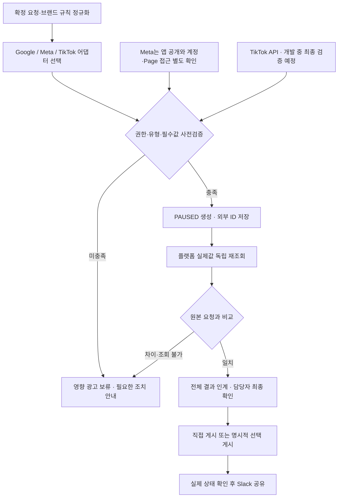

**일반 승인은 게시 명령이 아니다.** 기본은 담당자 직접 게시이며, 최종 확인한 설정 버전·광고 ID를 지정한 명시적 게시 지시만 SK09가 별도로 실행한다. 검증 중에는 어떠한 광고도 활성화하지 않았다. 중복 키·생성 응답 유실 조회·부분 실패 복구·승인 시점 이후 변경 감지·지속 게시 관찰은 기존 §7~9의 개발·시험 요구로 남는다.

### Google 계정 계층과 유형별 객체 구조

OAuth 사용자의 접근 권한, 관리자 계정 컨텍스트(`login-customer-id`), 실제 작업 대상 광고주 계정(`customer_id`)을 분리한다. 테스트 계정의 `testAccount=true` 확인은 고객 운영 계정의 권한 승인을 대신하지 않는다. refresh token으로 access token을 새로 발급하고 재조회한 한 번의 성공이 장기 만료·철회 복구까지 증명하지는 않는다.

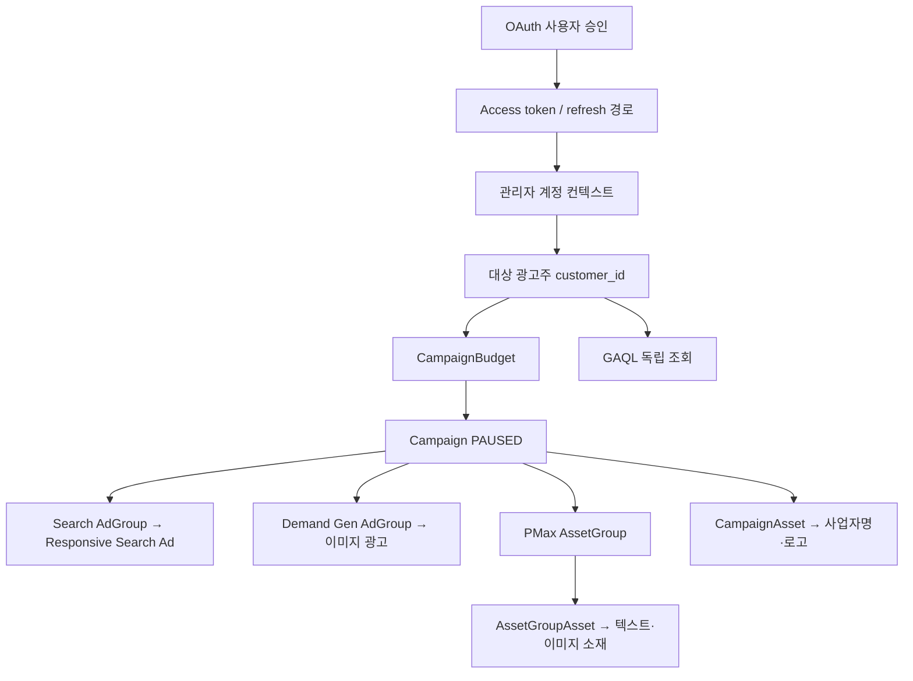

도식은 유형별 분기를 보여준다. 하나의 캠페인에 Search·Demand Gen·PMax를 함께 만드는 구조가 아니다. PMax의 사업자명·로고 연결은 이번 시험의 브랜드 설정 조건에서 캠페인 수준으로 구성했다.

| 유형·항목 | 실제 시험 범위 | 구현 시 적용할 조건 |
|---|---|---|
| Search | Campaign·AdGroup·광고 PAUSED, 제목 3개·설명 2개·final URL·UTM 재조회 | 광고그룹·광고 연결과 확정 문구를 개별 비교 |
| Demand Gen | Campaign·AdGroup·이미지 광고 PAUSED, 제목·설명·사업자명·정사각 이미지·로고·URL·UTM 재조회 | 영상 광고 성공으로 확장하지 않음. GAQL은 조회 가능한 세부 필드를 명시 |
| PMax | Campaign·AssetGroup PAUSED, 텍스트 6개·소재 연결 8개·사업자명/로고 캠페인 연결·URL·UTM | Search의 AdGroup/Ad 구조로 변환하지 않음. 소재그룹과 캠페인 소재 연결을 각각 대조 |
| 예산 | 세 캠페인 각각 10,000 KRW/일 = `10000000000` micros 저장·재조회 | 통화·단위 변환과 적용 계층 기록. Demand Gen에서 반환된 6,670 KRW 최소값은 해당 시험 조건의 오류이며 전 계정 공통 상수로 사용하지 않음 |
| 지역·언어 | Search/PMax는 캠페인, Demand Gen은 광고그룹 수준에 한국·한국어 설정·재조회 | 동일 업무 의미라도 유형별 설정 위치가 다름 |
| 키워드·일정 | Search exact 키워드 PAUSED, 월요일 09:00~18:00, 세 캠페인 종료일 2026-12-31 23:59:59·PAUSED 유지 | 계정 시간대 기준. 시작일 변경·전체 오디언스/타기팅 지원은 미검증 |
| 부정 입력 | 음수 예산 `validateOnly` 거부, 전후 조회에서 실제 예산 유지 | 오류를 보류 사유로 반환. 실제 변경 실패나 복구의 통과로 기록하지 않음 |

### Google 생성과 독립 재조회 순서

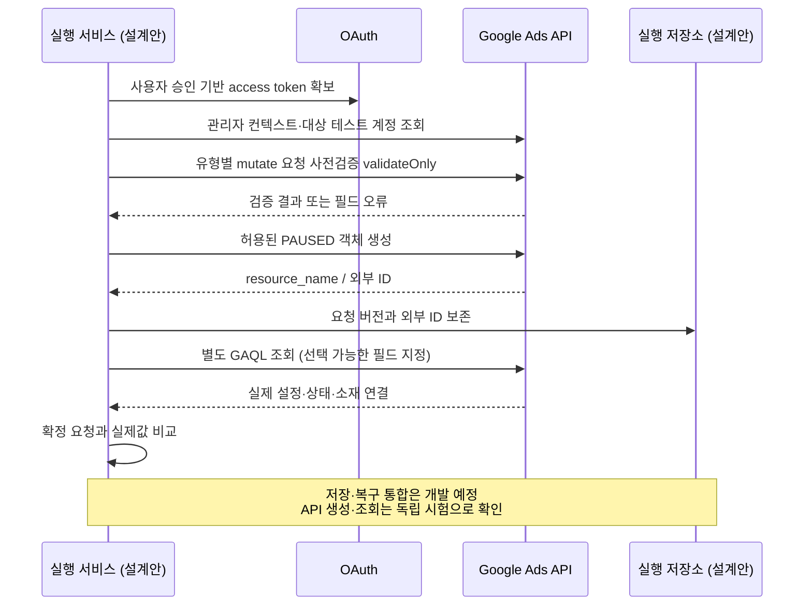

공식 구조 참고: [Demand Gen 생성](https://developers.google.com/google-ads/api/docs/demand-gen/create-campaign), [PMax 소재·브랜드 연결](https://developers.google.com/google-ads/api/performance-max/assets). 공식 설명과 시험 성공은 별개의 근거이며, 모든 옵션이 시험된 것으로 해석하지 않는다.

### Meta 인증과 광고 객체 구조 — 일반 계정 성공 경로

2026-10-28 새 일반 광고계정에서 최종 광고까지 생성하고 독립 GET으로 확인했다. 이전 sandbox 경로의 Page 오류는 과거 환경의 기록이며, 새 일반 계정의 성공이 과거 오류의 내부 원인 규명을 뜻하지 않는다. 앱 공개 상태, 토큰 권한, 광고계정 접근, Page 자산 사용 가능 여부는 별도 실행 조건이다. scope 목록이나 Page tasks만으로 광고 생성 권한을 추정하지 않는다.

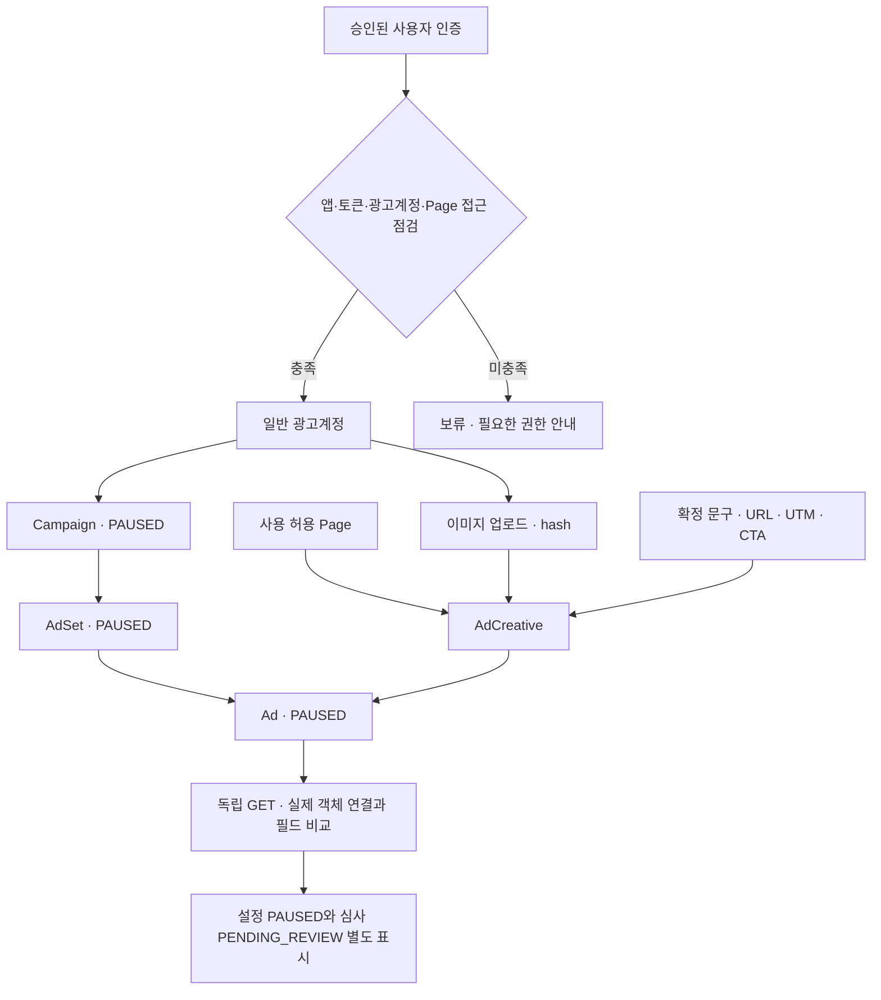

| 항목 | 2026-10-28 독립 조회 결과 | 해석·구현 규칙 |
|---|---|---|
| Campaign / AdSet | OUTCOME_TRAFFIC, 부모 객체 연결, PAUSED | 모든 목적·유형 지원으로 확대하지 않음 |
| 타기팅·일정 | KR, 25~54세, Facebook feed, 모바일·데스크톱, 시작·종료 일정 | 플랫폼이 추가한 location_types는 기본값으로 분리 |
| 예산 | 원시 daily_budget 문자열 10000 조회 | KRW 단위 환산은 별도 시험. 원시값과 통화·단위·정규화값을 함께 보관 |
| 이미지·creative | 600×600 이미지 hash, Page 연결, 한글 문구·제목·설명, LEARN_MORE, 랜딩·CTA URL·UTM 저장·조회 | 이름의 플랫폼 자동 접미사는 입력 불일치와 구분 |
| 최종 광고 | campaign/adset/creative 연결, status PAUSED, effective_status PENDING_REVIEW | 설정 중지와 심사 대기는 서로 다른 상태. 실제 게재·심사 승인 아님 |
| 성과 | insights data가 빈 배열, 계정 amount_spent는 별도 0 조회 | 빈 배열을 노출·클릭·지출 각각의 측정 0으로 변환하지 않음 |

### Meta 생성·재조회·담당자 인계 순서

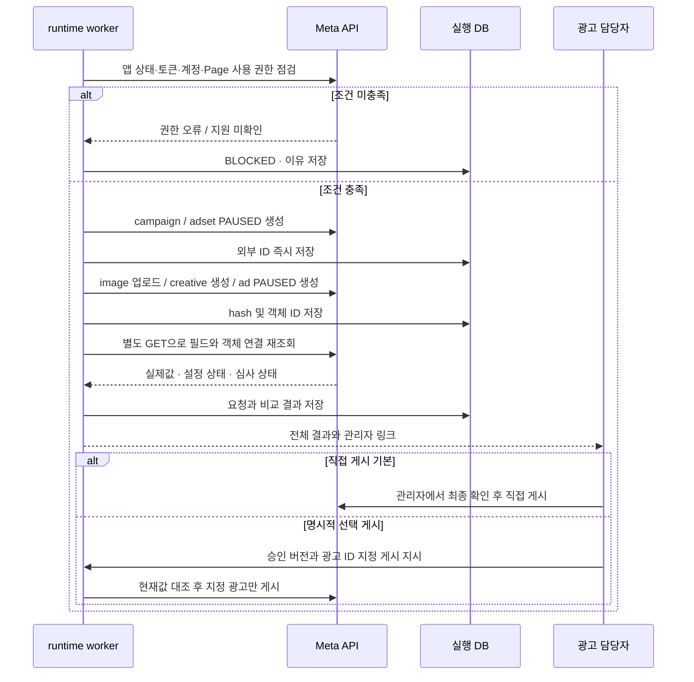

생성·독립 조회는 실제 검증이다. 위 runtime DB 기록·보류·복구·사람 인계는 앞으로 구현할 설계다. 자동 앱 공개나 API 활성화 도구는 기본 범위에 포함하지 않는다.

### 기존 시험 계약과의 연결

| 독립 API 증거 | 보완하는 시험 | 남은 인수 조건 |
|---|---|---|
| Google 유형별 생성·설정 재조회 | VT03·VT11의 부분 근거 | 운영 계정별 지원, 전체 필수 필드, Claude/Notion 통합 대조 |
| Meta 일반 계정 campaign/adset/image/creative/ad 및 URL/UTM 독립 조회 | VT03·VT09·VT11의 부분 근거 | 고객 계정 권한·통화 단위·전체 연동·실제 심사·게재·복구 |
| 음수 예산 validation 및 값 유지 | VT03·VT09의 부정 입력 일부 | 실제 변경 실패·부분 성공·응답 유실·중복 방지 VT05·06 |
| refresh token 재발급·재조회 | VT09의 인증 경로 일부 | 만료·철회·장기 운영·재개 및 사용자 권한 변경 |

VT01~19의 전체 인수 통과로 바꾸지 않는다. 영상 내용 판단·실계정 심사/게재/청구·게시 관찰/Slack·전체제품통합은 이번 API 증거로 검증되지 않았다.

### 개발 구성요소: 정책을 거치는 실행과 별도 선택 검사

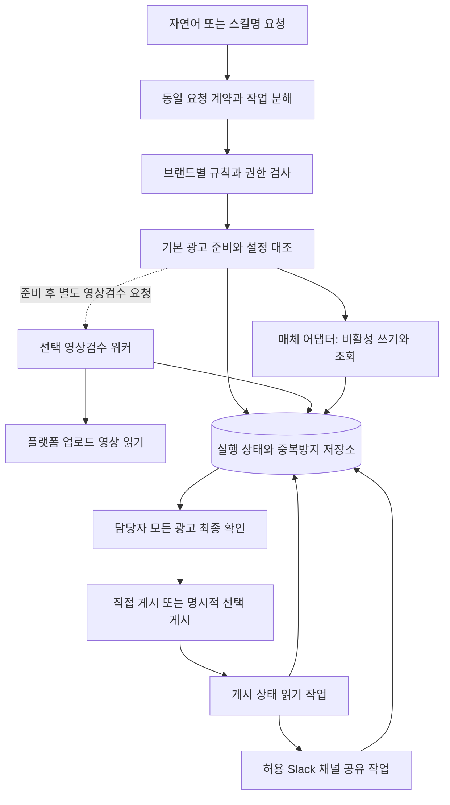

도식의 구성은 구현안이며 현재 가동 중인 서비스가 아니다. 게시 상태 읽기 작업은 광고를 활성화하는 경로를 갖지 않는다. 영상검수 요청 실패가 다른 브랜드의 독립 정상 광고를 자동 취소하지 않는다.

| 구성 | 책임 | 개발 전 확인할 계약 |
|---|---|---|
| 대화·스킬 라우터 | 두 진입 방식을 동일 정규화 요청으로 변환, 누락 질문 | 요청 언어·스킬명·규칙 버전이 같을 때 동일한 계획·차단 결과 |
| 정책 계층 | 사용자×브랜드×계정×행위 허용 확인 | 쓰기 도구 우회 차단, 허용되지 않은 기본값·계정 상속 금지 |
| 자료 어댑터 | Notion·Drive·허용 시트에서 출처 읽기 | 페이지/DB/필드 실제 확인, 파일 접근, 부분 조회 표시 |
| 매체 어댑터 | 필요한 조회·비활성 생성·허용 수정·재조회 | 매체×유형×계정×기존/신규 캠페인×추적 방식×묶음 규모별 시험 |
| 실행 저장·워커 | 작업 임대·중복 키·결과 불확실·재시도 보존 | 재시작·응답 유실·동시 요청 복구. 영구 저장 방식 확정 필요 |
| 영상 워커 | 요청된 플랫폼 영상의 접근·분석·근거 반환 | 읽을 수 있는 영상 범위와 변환본 식별·탐지 한계·비용 측정 |
| 게시 확인·알림 | 채팅 종료 후 대상 광고 상태 조회, 확인분만 공유 | 조회 주기·종료 시점·채널·전송 대조 지원 미검증 |

공식 MCP/API 우선 검토 후 필요한 공백만 별도 어댑터 후보로 둔다. 독립 REST/Graph 호출 증거를 공급자 MCP 지원 또는 이벤트·웹훅 지원으로 확장하지 않는다. 성공한 필드·유형은 API 검증 표에 한정한다. 공식 문서의 확인일·버전·대상 기능과 실제 계정 시험 결과를 별도로 저장해야 지원 목록에 올린다. 브라우저 예외는 자동 우회 수단으로 넣지 않으며 별도 허용·검증 전에는 수동 인계한다.

### 패키지와 참조 위치 제안

아래는 **구현 전 권장 폴더 구조**다. 실제 저장소·배포 경로가 존재하거나 선택됐다는 뜻이 아니며 기술 검증 후 조정한다. 브랜드 업무값·문서의 원본은 Notion/Drive에 유지하고 배포된 스킬 패키지에는 공통 실행 절차·검증 코드·매핑 계약만 둔다. 기존 `brand.md`가 있다는 근거는 없으며 새 수동 관리 파일을 필수로 만들지 않는다. 캐시가 필요하면 Notion의 확정 버전에서 생성한 읽기 전용 파생물로만 두고 출처·버전·생성 시각·만료를 기록한다. 캐시를 사람이 따로 수정하거나 두 곳을 수동 유지하지 않으며 원본 변경·권한 회수 시 무효화한다.

```text
wecarry-runtime/                  # 제안 이름
  skills/                        # SK01~09 목적·입출력·실패 계약
  rules/                         # 공통 실행 정책·검증 절차와 패키지 버전
  generated-cache/               # 필요할 때 Notion에서 생성한 읽기 전용 캐시
  reference-maps/                # Notion 실제 필드·Drive 위치 매핑
  adapters/                      # Notion·Drive·매체·Slack 연결 후보
  workflow/                      # 상태 전이·중복 키·재시도 정책
  workers/                       # 기본 준비·선택 영상·게시 확인·공유
  persistence/                   # 실행 저장 스키마·변경 이력 설계
  tests/                         # 계약·복구·브랜드 격리·인수 시험
  ops/                           # 권한 갱신·장애 대응·운영 가이드
```

| 연결 | 패키지에 두는 것 | 외부 기준·보안 경계 |
|---|---|---|
| SK01·02 → 규칙·브랜드 설정 | `skills/`의 공통 절차 버전과 Notion 브랜드·규칙의 확정 버전을 참조 | 문서 수정일로 최신 승인 버전을 추정하지 않음 |
| 브랜드 설정 → Notion | `reference-maps/`의 요청·제품·기획·확정값 필드 매핑 | 원문 값은 허용된 Notion 위치에서 읽음. 실제 필드 확인과 추가 속성 제안 분리 |
| 브랜드 설정 → Drive | 허용 폴더 참조키·소재 역할·파일 ID 대응 | 원본 파일 보존, 다른 브랜드 위치 자동 상속 금지 |
| SK03·04 → 실행·실제값 | `adapters/`·`workflow/`·`persistence/` 계약 | 매체 실제값 재조회, 실행 저장은 업무 원본을 대체하지 않음 |
| SK05 → 플랫폼 영상 | 영상 객체 참조·검사 규칙 버전·명시 요청 | 영상 바이트 접근·임시 보관은 허용된 범위만. 정답 샘플은 성능 시험에 사용 |
| SK07 → 채널·게시 기록 | 브랜드별 채널 참조와 게시/전송 중복 키 | 알림과 광고 권한 분리, 채널 불명확 시 보류 |
| 모든 연결 → 자격증명 | 비밀 저장소 참조키만 전달 | 위 트리·문서·소스에 토큰/비밀번호 저장 금지 |

### wecarry-runtime 배포 경계와 책임

`wecarry-runtime`은 신규 개발할 실행 계층의 명칭이며 별도 유료 서버를 뜻하지 않는다. Claude 공통 Skill은 요청을 안내하고 MCP는 인증된 명령을 전달한다. 실행 계층은 권한·브랜드 규칙·작업 상태를 통제한다. 아래 기술 선택은 설계 제안이며 이미 운영 중인 환경이 아니다.

| 구성 | 배포·소유 제안 | 책임 |
|---|---|---|
| 공통 Skill | 위캐리 Claude 조직 | 2358works가 버전·릴리스·롤백 작성, 위캐리 관리자가 구성원 적용 |
| MCP endpoint / workflow API | 기존 업무 환경 우선; 필요한 실행 방식은 개발팀이 검증 | 2358works 구축. 인증 주체·행위 권한·입력 schema 검증 |
| queue / worker | 합의된 실행 환경의 작업 처리 구성 | 작업 임대·동시 실행 통제·재시도·재조회. 채팅 연결 종료와 독립 |
| PostgreSQL 등 관계형 실행 DB 후보 | 실행 환경에 맞는 저장·접근 격리; 추가 인프라 필요 시 T6 사전 합의 | 영속 ID·상태·시도 이력·outbox·백업. 제품 선정은 설계 결정 사항 |
| Secret Manager 후보 | 실행 환경에 맞는 비밀 저장 방식 | 토큰 암호화·최소 권한·회전. Notion/프롬프트/로그에 비밀값 저장 금지 |
| Notion / Drive | 기존 위캐리 업무 공간 | 요청·브랜드 규칙·소재의 기준 원본 유지 |
| 결과 화면 | 권한 있는 담당자용 읽기 UI 또는 합의된 Notion 위치 | 결과값·출처·관리자 링크 제공. 실제 화면 위치는 구현 시 확정 |

비용 부담·계정 소유는 기존 합의를 따른다. 추가 인프라는 실제 필요 시 T6에서 이유·비용·소유·운영 주체를 제시하고 사용 전에 합의한다. 공급자·지역·언어·SDK 버전·저장 대상·보관 기간·백업·복구 방식은 개발팀이 구체화한다. 기존 유지보수·인계 책임은 확정 조건으로 적용하며 T2·T3은 그 실행 절차를 정리한다. 새 복구시간 보장이나 상시 대응 약정을 추가하지 않는다.

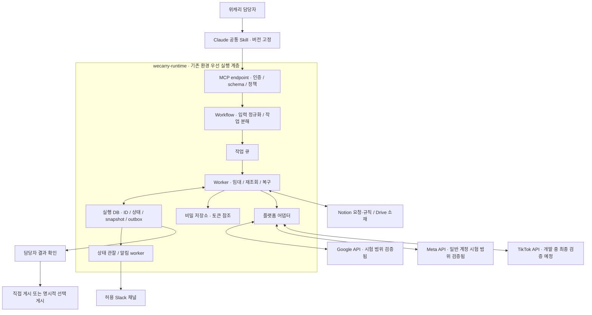

### 모듈과 기존 패키지의 대응

| 모듈 | 책임·입출력 | 기존 계약과 관계 |
|---|---|---|
| skills / mcp / contracts | 영문 스킬명, JSON Schema, 도구 응답, 버전 호환 | SK01~09을 사용자 호출과 내부 도구로 매핑 |
| policy / reference-maps | 인증 사용자→브랜드·계정 허용, Notion 속성 매핑 | rules는 실행 정책 코드. 브랜드 규칙 원본은 Notion |
| adapters/notion, drive, slack | 원본 조회·허용 필드 저장·파일 취득·알림 | Slack 전송은 광고 생성과 분리 |
| adapters/google, meta, tiktok | 정규화 요청을 매체별 객체·단위로 변환 | 세 매체 동일 인터페이스. API 연동은 개발 진행하면서 최종 검증 진행 예정 |
| workflow / workers | 준비·대조·관찰·선택 영상·복구 | 명시적 게시 지시 전용 SK09 포함; 무지시 활성화 금지 |
| persistence / outbox / secrets | DB migration, 알림 이벤트, 비밀 저장소 참조 | generated-cache는 읽기 전용 파생물, 원본 대체 금지 |
| tests / ops / review-ui | 계약·오류 주입·배포·결과 확인 | §9 인수 증거와 연결 |

### MCP 인터페이스와 정규화 계약

다음은 구현할 도구 이름 제안이다. 실제 등록 API가 이미 존재한다는 뜻이 아니다. 요청의 actor_id나 계정명을 신뢰하지 않고 검증된 인증 세션에서 actor/tenant를 결정한다. 게시 명령은 SK09 전용 도구로 분리하고 서버가 게시 권한·승인 버전·대상을 검사한다.

| 도구 | 입력 | 출력·부작용 |
|---|---|---|
| prepare_ads | request_ref, request_revision, brand_ref, skill_version, client_request_id | job_id, state=QUEUED, accepted_at. 접수 성공은 광고 생성 완료 아님 |
| get_job | job_id | 허용 사용자에게 광고별 상태·차이·확인 링크·다음 행동 반환 |
| submit_decisions | job_id, expected_revision, decisions[] | 허용 필드 결정만 반영. stale revision이면 거부하고 재확인 |
| read_brand_context | source_refs[], expected_revision | SK08. 기존 DB 읽기·누락/충돌 안내만 수행; Notion 쓰기 없음 |
| record_publish_approval | job_id, ad_ids[], expected_config_version/hash, parent_refs_to_activate[], parent_snapshot | 인증된 최종 확인자의 현재값 확인 기록 → approval_id. 게시하지 않음; 만료·철회 규칙 적용 |
| publish_ads | job_id, approval_id, approved_config_version, ad_ids[], client_request_id | SK09. 서버 검증 후 광고별 publish_attempt_id·상태 반환. 접수는 게시 완료 아님 |
| request_video_review | ad_refs[], media_version, checks[], consent_ref | 독립 video_job_id. 기본 prepare_ads에서 자동 실행하지 않음 |

`NormalizedAdSpec` 필수값: schema_version, tenant_id, brand_id, request_id/revision, ad_unit_id, platform(enum GOOGLE/META/TIKTOK), account_ref, campaign_ref 또는 신규 campaign_spec, objective, budget{decimal_string,currency,unit,scope}, schedule{start_at,end_at,timezone}, copy, assets[{file_ref,version,role}], landing_url, tracking, platform_settings, source_snapshot_id, rule_version, skill_version. 금액은 부동소수점 대신 십진 문자열/정수 최소단위를 쓰고 adapter가 단위 변환 근거를 기록한다.

필수값 누락은 null로 임의 실행하지 않고 BLOCKED로 반환한다. 선택 필드는 null의 의미를 계약에 지정한다. 조회 불가 값은 `observed=null, verification=UNVERIFIED, reason`으로 반환하며 일치나 0으로 바꾸지 않는다. 응답 envelope는 `{job_id, revision, state, items[], errors[], next_actions[], observed_at}`이다. 오류는 AUTH_REQUIRED, ACCESS_DENIED, INVALID_INPUT, UNSUPPORTED_TYPE, SOURCE_CONFLICT, STALE_REVISION, RATE_LIMITED, TRANSIENT_FAILURE, OUTCOME_UNKNOWN으로 구분한다.

어댑터 공통 메서드는 `preflight(spec)`, `create_paused(spec, attempt_context)`, `read_objects(external_refs)`, `compare(expected, observed)`, `observe_status(refs)`, `publish_approved(refs, approval, attempt_context)`다. 마지막 메서드는 SK09 전용이며 준비·조회 메서드에서 호출하지 않는다. Google GAQL, Meta GET, TikTok 조회 응답을 공통 결과 모델로 변환하되 원시값·플랫폼 상태를 보존한다. URL/UTM의 저장 여부는 요청 로그가 아니라 독립 조회로 판정한다.


### 사용자 요청 묶음의 분해·호출·집계 계약

`request_group_id`는 한 번의 사용자 요청 묶음을 식별하고 하위 `job_id` 목록을 연결한다. 단일 광고도 같은 구조로 표현한다. 이는 실행 저장소의 신규 설계이며 Notion에 새 속성이나 DB를 만드는 요구가 아니다.

기존 `prepare_ads(request_ref, request_revision, brand_ref, skill_version, client_request_id)`의 단일 요청·단일 브랜드 입력과 `job_id` 응답은 유지한다. 실행 계층의 workflow가 사용자 요청을 확인된 요청 참조·버전·브랜드별 하위 작업으로 분해하고, 각 작업에 `prepare_ads`를 호출한 뒤 결과를 묶어 제공한다. 한 하위 Job은 한 브랜드에 속하며, 확인된 요청 안의 여러 캠페인·광고는 AdUnit으로 구분한다. 여러 제품·업로드 요청이라는 이유만으로 여러 캠페인을 만들거나 캠페인 수를 추정하지 않는다. 제품·업로드 요청과 캠페인의 관계는 원본과 확정값을 따르며 불명확한 관계만 질문한다.

| 계약 항목 | 실행 계층의 책임 |
|---|---|
| 묶음과 하위 작업 연결 | RequestGroup에 원 요청 참조·버전과 분해 항목을 기록하고 각 항목의 request_ref/revision·brand_ref·job_id를 연결한다. 아직 접수하지 못한 항목도 job_id=null과 보류·오류 이유로 남기며 목록에서 누락하지 않는다. |
| 브랜드별 격리 | 각 하위 작업마다 인증 사용자×브랜드×계정×행위 권한을 확인하고 자료·규칙·스냅샷·결과·공유 채널을 분리한다. 다른 브랜드의 권한이나 기본값을 상속하지 않는다. 묶음 조회에도 현재 접근 권한을 적용하며 허용 밖 자료·결과를 노출하지 않는다. |
| 중복·복구 | 동일 원 요청 버전의 재호출·워커 재시작은 기존 묶음과 하위 작업에 연결한다. 분해 항목별 안정된 client_request_id와 기존 멱등 계약을 사용하며 재시도만으로 새 Job·광고를 중복 생성하지 않는다. 응답 유실은 기존 작업·외부 상태부터 조회한다. |
| 결과 집계 | request_group_id, revision, child_job_ids[], 항목별 job_id·상태·오류·다음 조치·observed_at을 반환한다. 하위 작업 수와 광고 수를 분리하고 광고는 고유 AdUnit 기준으로 한 번만 집계한다. 분해 전·접수 실패로 광고 수를 모르면 미확인으로 표시하고 0으로 바꾸지 않는다. |
| 일부 실패·자료 변경 | 정상 Job·AdUnit과 외부 결과는 보존하고 실패·보류·불확실 항목만 구분한다. 일부 실패나 미확인을 전체 준비 완료로 표시하지 않는다. 변경 영향 항목만 stale·재대조하고, 해당 항목 복구 후 기존 묶음의 집계를 갱신한다. |

묶음 결과는 SK06 공통 결과 표시 계약을 따른다. 준비·영상검수·게시 확인·심사·노출·Slack 상태는 별도로 집계한다. 묶음 접수나 일부 준비 성공은 게시 승인 또는 전체 성공이 아니다. 이 계약과 VT02·VT05·VT16은 개발·인수 시험 계획이며 현재 구현·통과 증거가 아니다.

### SK09 선택 게시 실행 계약과 상태

직접 게시가 기본이고 선택 게시는 사용자가 선택하는 납품 기능이다. 서버는 인증 세션에서 actor/tenant를 결정하며, 사람이 최종 확인한 승인 기록과 명시적 게시 지시를 구분한다. `record_publish_approval`로 승인 기록을 생성한 뒤 별도 `publish_ads` 호출과 별도 `explicit_instruction_ref`로 게시 지시를 저장한다. 승인 생성만으로 게시하지 않으며 승인 없는 지시는 차단한다. `PublishApproval`은 계정·광고 ID 목록·활성화할 부모 객체 ID와 예산/상태 스냅샷·설정 버전/해시·소재/규칙 버전·확인자·승인시각·만료·철회 상태를 고정한다. 만료 기준은 T4에서 시험 전에 확정하며 미정이면 게시를 차단한다. 일반 승인, 조회, 광고 준비 요청은 게시 지시가 아니다.

1. 실행 직전 게시 권한·승인 효력과 각 광고의 실제 소재·문구·URL/UTM·예산·일정·부모 객체·현재 상태를 재조회해 승인 스냅샷과 대조한다. 필수값 미조회·차이·권한 회수·만료는 `BLOCKED` 또는 `STALE`로 반환하고 재확인·새 게시 지시 전 실행하지 않는다.
2. 광고별 잠금·fencing과 `tenant/account/ad_id/approval_id/config_version/operation` UNIQUE 키로 명령 중복을 억제한다. client_request_id가 달라도 같은 승인·대상 재요청은 기존 시도를 반환한다. 플랫폼의 exactly-once 지원을 가정하지 않는다. 검사와 쓰기 사이 변경은 조건부 버전 지원 시 플랫폼 조건으로 차단하고, 미지원 시 통제 가능한 작업 잠금·즉시 재조회·변경 창 시험으로 검증한다. 외부 편집과의 경쟁을 안전하게 통제하지 못하는 경로는 선택 게시를 보류한다.
3. `AWAITING_INSTRUCTION → VALIDATING → PUBLISHING → CONFIRMED / FAILED / OUTCOME_UNKNOWN`을 광고별로 저장한다. 버전 변경은 `STALE`, 권한/승인 실패는 `BLOCKED`다. 직접 게시 경로는 SK09 실행 없이 독립 상태 조회로 연결한다.
4. 쓰기 전 Attempt와 대상 ID를 영속 저장한다. 응답 유실은 지정 ID를 독립 조회한다. 확인되면 `CONFIRMED`, 불확실하면 `OUTCOME_UNKNOWN`으로 보류하며 맹목 재게시하지 않는다. 미실행이 확정된 실패만 유효 승인·현재값 재검사 후 재시도한다. 성공한 항목은 재실행하지 않는다.
5. 상위 Campaign/AdSet/AdGroup 활성화가 필요하면 승인에 명시된 신규 준비 부모 객체만 대상으로 삼는다. 명시되지 않았거나 기존 운영 객체이면 보류한다. 부모 객체의 예산·상태 스냅샷을 대조하고 지정하지 않은 다른 광고까지 집행되지 않는지 검사한다. 승인 대상 밖 광고에 영향이 있거나 부모 객체 범위·예산을 검증하지 못하면 보류한다. 기존 운영 광고의 자동 변경·중지·삭제와 실패 시 자동 롤백은 제외한다.
6. 게시 API 성공과 실제 심사·노출은 분리한다. SK07은 독립 조회로 확인한 광고·상태만 공유하며, 부분 실패·미확인 수량도 누락하지 않는다. Slack 실패는 알림만 복구하고 광고를 다시 게시하지 않는다.

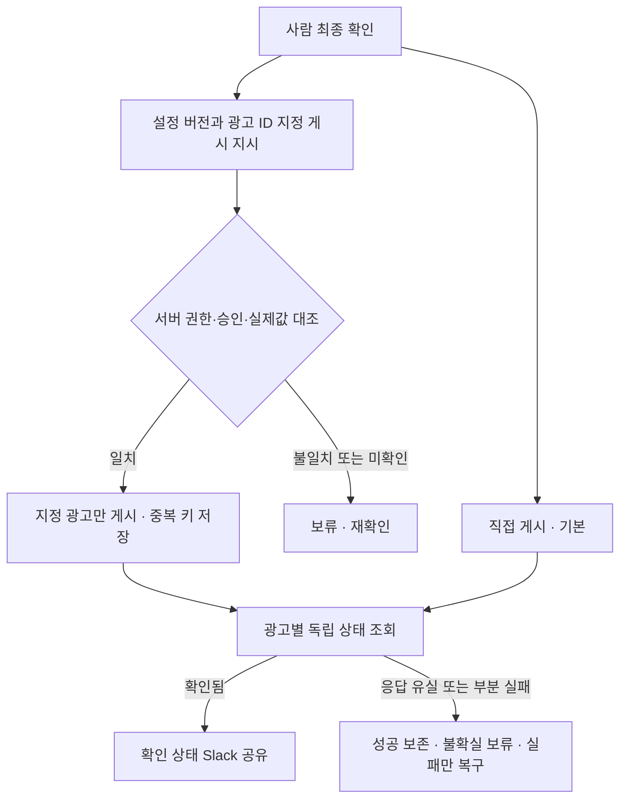

선택 게시 권한·세 매체 지원·통합·중복/복구·실제 심사/게재는 **개발 진행하면서 최종 검증 진행 예정**이다. 이 계약은 구현·시험 완료 증거가 아니다.

### 실행 DB 엔티티·키·버전

| 엔티티 | 핵심 필드·제약 |
|---|---|
| RequestGroup | request_group_id UUID PK, tenant_id, 원 요청 참조/revision, client_request_id, 분해 항목 목록·job_id 연결, 집계·확인 시각. 동일 tenant/원 요청 버전/중복 키의 재접수는 기존 묶음 반환 |
| Job | UUID PK, request_group_id FK, tenant_id, brand_ref, request_ref/revision, skill/schema/rule_version, snapshot_id, state, created_at, updated_at. 하위 job_id 목록은 이 연결에서 조회 |
| AdUnit | UUID PK, job_id FK, brand_id, platform, account_ref, normalized_spec, config_state, review_state, delivery_state |
| Attempt | UUID PK, ad_unit_id FK, operation, idempotency_key UNIQUE, lease_owner, lease_expires_at, fence_version, outcome, error_code |
| ExternalObject | platform/account_ref/type/external_id 복합 UNIQUE, ad_unit_id FK, parent_ref, first_seen_at |
| SourceSnapshot | UUID PK, source_refs, content_hash, source_version, captured_at. 실행 당시 확정 입력 보존 |
| CheckResult | ad_unit_id FK, field_path, expected, observed, verdict, source_ref, observed_at |
| StatusObservation | ad_unit_id FK, configured_status, effective/review_status, delivery_status, raw_payload_ref, observed_at |
| PublishApproval | approval_id, verified_actor, tenant/account, ad_ids, parent_refs_to_activate[], parent_budget_status_snapshot, config_version/hash, source/rule_version, approved_at, expires_at, revoked_at, explicit_instruction_ref; 서버 저장·변경 시 무효화 |
| NotificationOutbox | event_id UNIQUE, tenant/brand/channel_ref, observation_version, payload_hash, state, slack_message_id, attempt_count |

한 사용자 요청 묶음에 여러 브랜드가 있어도 Job은 브랜드별로 분리하고 AdUnit별 브랜드·계정·채널 경계를 유지한다. SQL 조회와 worker에서 tenant scope를 강제한다. DB에는 비밀 저장소 참조만 둔다. 스냅샷과 원시 응답은 최소한으로 저장하고 접근·보관·삭제 정책을 인수 전 확정한다.

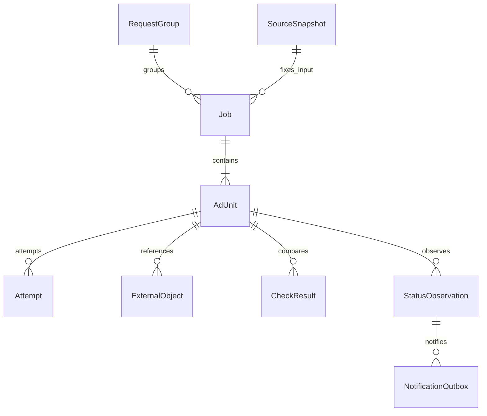

### 큐·멱등성·응답 유실·부분 실패 복구

큐는 중복 전달이 가능한 것으로 설계한다. worker는 DB 임대와 fencing version을 확보한 뒤 실행하고, 임대가 만료된 이전 worker의 상태 갱신은 거부한다. 멱등 키는 tenant+request_revision+brand+platform+ad_unit+operation으로 만들며 원본 변경은 새 revision이다. 플랫폼이 멱등 키를 지원한다고 가정하지 않는다.

생성 호출 전에 Attempt를 영속 기록하고 성공 응답의 외부 ID를 즉시 저장한다. 생성 후 응답을 잃으면 OUTCOME_UNKNOWN으로 전환한다. 외부 ID 또는 작업 식별자·시간·부모 객체 등 확정 가능한 조건으로 플랫폼을 조회한다. 유일하게 대응되면 연결하고, 없거나 여러 개이면 자동 재생성하지 않고 보류한다. 재조회 불가능한 플랫폼에서 무조건 재시도하는 구현은 불합격이다.

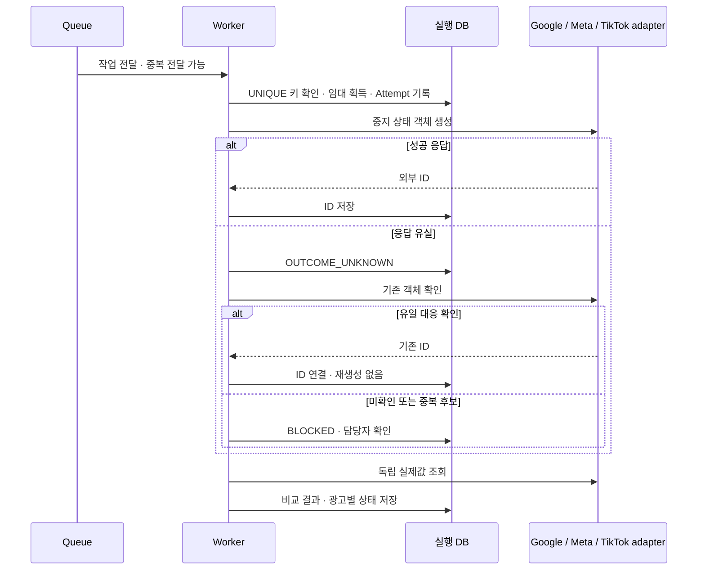

정상 광고는 유지하고 실패한 AdUnit만 복구한다. 입력·규칙·소재가 바뀌면 해당 unit을 STALE로 표시하고 새 입력으로 다시 대조한다. 과거 snapshot과 새 값을 조용히 섞지 않는다. 429/일시 오류만 지수 backoff+jitter 및 상한을 적용하고, 권한·정책·필수값 오류는 반복 재시도하지 않는다. 상한·관찰 주기·동시 작업 수는 실제 rate limit 시험 후 설정값으로 확정한다.

### 작업 상태·광고 상태·알림 상태의 분리

Job 접수/실행 상태, AdUnit의 기본 설정 검수, 선택 영상 검수, 플랫폼 설정/심사/게재, Slack 전송 상태는 서로 다른 필드다. Meta PAUSED/PENDING_REVIEW를 하나의 ‘게시 완료’로 합치지 않는다. 확인시각이 오래된 결과는 최신 상태처럼 표시하지 않는다.

상태 관찰과 알림은 별도 worker가 수행한다. 관찰 결과와 outbox 이벤트를 같은 DB transaction에 기록한다. event_id와 payload_hash로 중복 전송을 억제하고, Slack 응답 유실은 message_id/조회 가능한 근거로 대조한다. 확정할 수 없으면 알림 상태 미확인으로 남긴다. Slack 오류 복구는 광고 재생성·게시를 유발하지 않는다.

### 추가 인수 기준 — VT14~VT19

입력·권한, 중복·응답 유실, 부분 실패·버전 변경, 상태·알림 복구, 세 매체 통합의 시험 계획은 §9 통합 인수표 및 SK09·VT19로 연결합니다. 계획의 존재와 실행·통과는 별도입니다.


<a id="prd-4"></a>
## 4. 데이터 책임과 입출력

**업무의 요청·확정 세팅값은 Notion 기준, 실행 상태·재시도는 별도 저장소 권장안**으로 분리한다. 실행 로그가 업무 기준을 임의로 덮어쓰지 않는다. Drive는 소재와 보조 문서의 원본이며 매체 실제값은 외부 광고 객체 재조회가 기준이다.

| 데이터 | 기존 조사로 확인한 것 | 새 설계 또는 추가 확인 | 책임 |
|---|---|---|---|
| Notion 업무 구조 | 브랜드·제품·업로드 요청·기획·제작 보드와 관계가 조사 18에서 확인됨 | 현재 DB/속성 ID·타입·관계·읽기 범위 재조회 필요 | 위캐리 업무 소유자, 2358works 매핑 검증 |
| 요청·세팅값 | 요청의 수량·매체·유형·파일 위치와 일부 기획/운영표 대응 확인 | 모든 값이 구조화된 기존 필드에 있다고 단정 금지. 실제 필드 매핑과 추가 속성 제안을 분리 | 위캐리가 확정, 시스템은 근거 읽기 |
| 확정·승인 근거 | 제작 상태·세팅 체크 등 서로 다른 상태 존재 | 확정자·효력 시점·변경 버전의 저장 위치는 제안. 기존 체크값을 승인/게시로 변환 금지 | 업무 확인자 |
| Drive 소재 | 고유 ID·경로 후보와 목록 대응 | 최종본·사용 허가·내용 동일성·현재 접근은 대상별 검증 | 소재 소유자, 어댑터 읽기 |
| 규칙·참조표 | 문서·시트·과거 지시·제안이 혼재 | 브랜드별 참조 등록부·적용 버전·충돌 처리 계약 추가 제안 | 위캐리 규칙 확인, 2358works 구조 관리 |
| 실행 로그·재시도 | 현재 운영 저장소가 확인된 것은 아님 | 작업/항목/시도/외부 ID/상태/중복 키를 지속 저장하는 권장안 | 2358works 개발·운영, 소유·비용은 기존 합의 준용, 추가 인프라 필요 시 이유·비용·소유·운영 주체를 제시하고 사용 전 T6 합의 |
| 실제 광고·알림 | 목록 대응만으로 확인 불가 | 광고 실제값·게시 확인·Slack 메시지 ID를 각각 재조회 | 매체/Slack 원본, 시스템 조회 기록 |
| 자격증명 | 본 문서에 수집·복사하지 않음 | 실행 환경에 맞는 비밀 저장 방식의 참조키만 사용, 폐기·회전·접근 감사 설계 | 계정 소유자·허용 관리자 |

필드 매핑표는 `업무 의미 / 실제 DB·속성 / 원문 타입 / 관계 / 읽기 시각 / 확인 상태 / 추가 제안`으로 작성한다. 미조회 열은 공란 또는 미확인으로 두고 예시 필드명을 실제 스키마라고 표시하지 않는다. 추가 속성·DB 생성과 기존 표 자동 갱신은 별도 결정 전 시행하지 않는다.

### 기존 브랜드 DB 읽기와 신규 항목 반영

기준 원본은 위캐리가 기존 업무에서 관리하는 Notion 브랜드 DB다. 자동화 전용 재등록·복제 DB·별도 등록 스킬은 기본 흐름에서 제외한다. 광고 요청이 들어오면 연결된 브랜드·제품·소재·규칙을 현재 권한으로 읽고 입력 버전과 근거를 실행 저장소에 기록한다.

SK08은 기존 등록 계약을 **브랜드 자료 조회·준비 상태 확인** 계약으로 변경한다. 요청 브랜드 식별 → 기존 DB·연결 자료 조회 → 필수값/권한 확인 → 누락·충돌만 질문 → 확인된 입력으로 준비 순서다. Notion 브랜드 생성·수정 쓰기는 하지 않는다. 읽기 실패는 미확인으로 남기고 다른 브랜드 기본값을 대신 쓰지 않는다. 기존 데이터가 변경되면 영향받는 입력·결과만 재확인한다.

신규 브랜드 추가는 위캐리의 기존 DB 관리 업무다. 새 항목을 읽고 처리하는 기능·연결·오류 안내는 2358works가 구현한다. 계정/자료 접근 허용은 소유자가 수행한다. 별도 Notion 쓰기나 속성 추가가 실제 필요해지면 대상·변경 이유를 설명하고 해당 변경만 확인받는다.

### 데이터 흐름: 업무 기준과 실행 기록의 분리

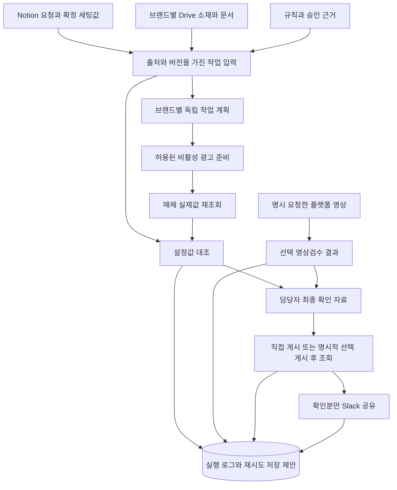

공통 입력 계약(신규 설계): `request_ref, request_revision, actor_ref, brand_ref, product_ref, account_ref, campaign_ref, item_refs, confirmed_settings_ref, rule_version, config_version, requested_actions`와 필수 참조의 읽기 시각·완전성. 식별자는 내부 승인 범위에서만 전달하고 로그 화면·고객 배포본에서는 비식별화한다. 빠진 계정·예산·최종본·권한을 모델이 추정하지 않는다.

공통 출력 계약(신규 설계): `request_group_id, job_ref, item_ref, skill_version, status, expected_values, actual_values, evidence_refs, observed_at, unknown_fields, next_action, retry_class, external_object_ref`. 선택 영상 결과는 `not_requested / queued / running / review_needed / inspected / failed / unavailable / stale`를 별도 필드에 보관한다. `inspected`는 요청한 검사 항목을 실행했다는 뜻이며 광고 사용 적합성·최종 승인과 동일하지 않다.

### 공통 결과 표시 계약

SK06은 아래 항목을 모든 상태에서 먼저 보여주고, 상태별 추가 내용은 그 뒤에 표시한다. Q14의 랜딩/UTM·AI 판단값·오류/확인 사항은 4/4, 처리 매체는 3/4의 응답이다. 식별·집계·대조·링크 필드는 이를 업무 결과로 구체화한 설계 제안이며 전원 합의 항목으로 표현하지 않는다.

| 필드 묶음 | 표시 계약 |
|---|---|
| 대상 | 브랜드·매체·계정·캠페인·광고명·소재의 광고별 대응 |
| 수량·진행 | request_group_id와 하위 job_id 목록, 하위 작업 수와 광고 수를 분리해 표시. 전체·진행 중·준비됨·보류·실패·미확인 등 상태별 수를 고유 항목 기준으로 집계. 광고 수 미확정 항목은 별도 표시하며, 수가 확정된 범위에서 합계와 전체의 일치를 확인 |
| 요청과 실제 | 문구·랜딩/UTM·예산의 요청값·실제값·차이, 기준 자료·확인 시각. 예산 계층을 표시하며 공유 예산을 광고 수만큼 합산하지 않음 |
| AI 판단·변경 | 선택값·변경 전후 값·이유·근거. 실제 변경을 확인했을 때만 변경 또는 변경 없음으로 표시 |
| 확인 필요 | 오류·누락·사람 판단·영향 광고·다음 조치 |
| 연결 | 요청 원문·광고 관리자 링크. 허용된 독자에게만 제공 |

값의 상태는 `known / not_created / not_queried / unavailable / not_applicable`로 구분한다. 미생성·미조회·조회 불가·해당 없음을 빈값이나 정상으로 합치지 않고, 미확인 이유·후속 조치를 남긴다. 아직 없는 광고 관리자 링크와 실제값을 만들어내지 않으며 AI 변경 이력 미조회는 ‘변경 없음’이 아니다. 기존 `unknown_fields`에 이러한 구분을 보관한다. 상태별 결과와 선택 영상검수 상태는 이 공통 결과를 덮어쓰지 않는다.

### 납품물·기능 ID·시험·운영 인수물 연결

| 납품물 | 기능 ID | 검증 | 운영 인수물 |
|---|---|---|---|
| 업무 스킬 패키지 | SK01~09 | VT01·13 | 설치/버전·배포·권한·사용 안내 |
| 광고 준비·설정 검수 기능 | SK01~04·06 | VT02·03·05·06·07·09·11·14~16 | 입력/규칙 버전·실제값·근거·복구 기록 |
| 명시적 선택 게시 기능 | SK09 | VT07·18·19 | 승인 버전·대상 ID 대조, 중복/응답 유실/부분 실패 증거. 사용은 선택·기능 시험은 필수 |
| Slack 자동 알림 기능 | SK07 | VT08·17·18 | 게시 판정/관찰 종료 명세·채널·전송 증거·재시도 절차 |
| Notion 브랜드 정보 연동 기능 | SK08 | VT10·14 | 기존 DB 매핑·조회 근거·입력 버전·누락/권한 안내 |
| 사용 매뉴얼·문제 대응 가이드 | SK01·06·08 및 운영 계약 | VT12a·13·15 | 핵심 실습 기록·장애 접수·지원 역할·수동 인계 절차 |
| 영상 내용 검수 기능 | SK05, D2 결정에 따라 호출 계약 수정 | VT04·11 | 시점·대상·검사 범위·한계·사용량/비용 측정 기록 |

<a id="prd-5"></a>
## 5. 스킬별 실행 계약

처음 사용하는 담당자에게는 스킬명으로 할 일을 고르는 방식을 권장한다. 자연어는 누락 질문에 답하거나 상황·예외를 설명할 때 함께 사용한다. 이는 진입 부담과 반복 설명을 줄일 것으로 기대하는 제안이며 효과를 실측한 결과가 아니다.

아래 스킬명과 요청형 영상 계약은 **D1/D2 결정 전 개발 제안**이다. 자연어 예시와 스킬명은 모두 같은 함수 계약·참조·권한 정책에 연결한다. 명시하지 않은 영상검수는 광고 준비 스킬의 숨은 하위 호출로 실행하지 않는다.

| 스킬·목적 / 자연어 예시 | 입력 → 출력 | 필수 참조 | 권한 | 실패·사람 판단 |
|---|---|---|---|---|
| SK01 `request_prepare` 요청 분해 / “이 요청의 광고를 준비해줘” | 요청 링크·범위 → 브랜드/광고별 계획·누락 목록 | Notion 요청·제품·브랜드·확정값 | 대상 읽기 | 연결 모호·자료 접근 실패는 영향 항목 보류. 최종본·새 예산 결정은 사람 |
| SK02 `brand_rules_resolve` 규칙 적용 / “이 브랜드 규칙을 확인해줘” | 브랜드·대상·시점 → 적용 규칙 버전·충돌 | 브랜드 Notion/Drive 참조 등록부·승인 근거 | 허용 참조 읽기 | 최신 수정일만으로 우선순위 결정 금지. 충돌하는 유효 지시는 확인자 판단 |
| SK03 `ad_prepare` 비활성 준비 / “확정값으로 광고를 세팅해줘” | SK01 계획·SK02 규칙·소재 연결 → 외부 객체 대응·생성 결과 | 확정 문구/링크/예산·계정 지원표·비집행 근거 | 허용 대상 비활성 생성/수정 | 비집행 보장 불가 시 쓰기 차단. 응답 유실 시 먼저 조회, 신규 타기팅·문구 후보 채택은 사람 |
| SK04 `settings_compare` 기본 대조 / “설정이 요청과 맞는지 확인해줘” | 확정값·대상 객체 → 일치/불일치/미확인·근거 | 실제 광고값·규칙/설정 버전·전체 입력 위치 | 조회, 허용 비활성 정정만 | 조회 불가를 통과 처리 금지. 정답이 있는 허용 오류만 수정·재조회, 표현 판단은 사람 |
| SK05 `video_review` 선택 영상검수 / “이 업로드 영상만 검수해줘” | 플랫폼 영상 ID·요청 검사 항목 → 구간·근거·수행 범위·미검증 | 플랫폼 결과·접근 허용·영상 버전·검사 규칙 | 해당 영상 읽기·분석 | 접근/전편 확인 불가 시 unavailable/부분 미검증. 원본 자동 대체 금지. 의도·표현·최종 사용은 사람 |
| SK06 `result_handoff` 최종 확인 인계 / “준비 결과를 보여줘” | 광고별 대조·영상 수행 상태 → 전체 목록·문제·판단·관리자 연결 | 요청·실제값·근거·시각·완전성 | 허용 결과 읽기 | 오래된 근거는 stale, 준비 완료 해제. 모든 광고의 최종 확인은 사람, 게시 실행은 직접 게시 또는 명시적 선택 게시 |
| SK09 `publish_approved` 명시적 선택 게시 / “확인한 버전의 지정 광고만 게시해줘” | 승인 ID·설정 버전·광고 ID·중복 키 → 광고별 게시 시도·실제 조회 상태 | 최종 확인 기록·현재 실제 설정·계정/광고/부모 객체 범위 | 인증된 게시 권한자만 명시 지시; 무지시 실행 금지 | 버전 불일치·권한 회수 차단; 응답 유실 조회; 부분 실패 분리; VT19 필수 |
| SK07 `publish_observe_share` 게시 확인·공유 / “게시한 결과를 확인하고 공유해줘” | 등록된 작업 대상·허용 채널 → 게시 확인분·전송 ID/미확인 | 게시 전 기준 상태·현재 실제값·브랜드 채널/양식 | 광고 읽기·지정 Slack 전송 | 게시 미확인 시 완료 전송 금지. 응답 유실 대조 후 알림만 재시도, 광고 재게시 금지 |
| SK08 `brand_context_read` 브랜드 자료 확인 | 요청의 브랜드 참조 → 기존 DB·연결 자료·입력 버전·누락/충돌 | 기존 Notion 브랜드/제품/요청·계정·규칙·채널 | 허용 자료 읽기; 브랜드 DB 쓰기 없음 | 접근 실패·필수값 누락만 기존 담당자 확인. 다른 브랜드 기본값 상속 금지 |

D2 결정 전에는 SK05의 요청형·플랫폼 변환본 계약이 제안 기준입니다. 자동 검사를 채택하면 실행 트리거·시점·원본/변환본 대상·대기/실패 시 준비 흐름 영향을 확정하고 SK05 호출 조건과 VT04 사전조건·기대 결과·검사 표본을 함께 개정합니다. 자동 검사에서도 최종 사용 판단과 직접 게시 또는 선택 게시 지시는 사람의 역할입니다. 플랫폼 영상 접근 실패를 Drive 원본 검사 성공으로 대체하지 않습니다.

### 사용자 스킬명과 내부 실행 계약의 대응

아래 영문 이름은 보고서의 호출 예시이며 최종 이름·호출 방식은 T8에서 2주차 말 확정한다. 기존 SK ID와 내부 함수명은 추적을 위해 유지한다. 이름을 입력했다고 설치·호출 성공으로 처리하지 않고 라우터가 지원 작업으로 해석한 뒤 동일 권한·필수값 검사를 수행한다.

| 사용자 호출명 | 내부 실행 계약 | 실행 결과·경계 |
|---|---|---|
| 광고 준비 중 브랜드 자료 확인 (별도 등록 호출 없음) | SK08 → SK02 | 기존 Notion 브랜드 DB를 읽고 누락·충돌만 확인. 브랜드 생성·재등록 없음 |
| `ad-prepare` | SK01 → SK02 → SK03 → SK04 → SK06 | 요청 분해·규칙 확인·비활성 준비·실제값 대조·전체 결과. SK05 자동 호출 및 광고 게시 없음 |
| `video-review` | SK05 → SK06 결과 갱신 | 명시한 영상·검사 범위만 처리, 미검수·부분 확인 구분 |
| `ad-publish` | SK09 → SK07 | 명시적 게시 지시와 버전·ID 검증 후 실행; 독립 조회로 확인된 항목만 공유 |
| `result-status` | SK06, 필요 시 SK07의 상태 조회 | 저장된 진행/공유 상태와 허용된 실제 조회. 조회 요청만으로 새 광고 생성·알림 재전송·게시 실행하지 않음 |

SK07 게시 관찰은 준비 작업에 연결된 별도 지속 실행이며, 상태 조회와 전송 재시도를 구분한다. 자연어 요청도 같은 실행 계약으로 연결한다.

SK03 안에서 기본 설정 대조(SK04)를 이어서 수행할 수 있다. SK07은 준비 시 등록된 작업의 직접 게시 또는 SK09 선택 게시 결과를 채팅 재입력 없이 확인하는 지속 실행을 목표로 하며, 별도 호출은 상태 조회·복구 진입점이다. 운영 서비스가 준비되지 않았다면 이 목표는 미구현 상태로 표시한다. 요청·규칙이 변경되면 영향받은 입력과 결과의 버전을 함께 갱신하며 이전 기록을 덮어쓰지 않는다.

기본 검수는 소재 연결·문구·랜딩/UTM·계정·예산·자동 옵션 대조이고, 선택 검수는 요청한 영상의 검은 화면·자막 등 내용 확인이다. 영상 개수·길이·검사 범위에 따라 시간과 AI 사용량이 늘고 광고 준비·게시가 지연될 수 있어 필요한 영상과 항목을 선택하도록 한다. 증가 폭이나 비용을 검증 없이 단정하지 않으며, 의도된 장면·표현의 적합성은 사람이 판단한다. Q36의 업로드 시작 시 자동 검사 4/4 응답은 보고서 부록에 보존하며 선택 운영안을 고객 합의로 승격하지 않는다.

SK05 일상 검수에 정답 샘플 제출을 요구하지 않는다. 정답 샘플은 탐지 성능·오탐/미탐을 측정하는 VT04 시험용 자료다.

영상 검수의 기존 시험 기록에서 확인한 것은 Drive 원본 1개 전처리입니다. Claude 내용 판정·플랫폼 변환본 검수·5/20개 모델 시험·모델 비용은 미검증/미측정입니다. 로컬 전처리는 실제 플랫폼 취득·권한·내용 검수·운영 검증을 대신하지 않습니다. D2/T5에서 대상·검사 범위·허용 환경·사용량 확인 방법을 정한 뒤 VT04를 실행합니다. 내부 시험 원문은 이 고객 배포본에 포함하지 않습니다.

<a id="prd-6"></a>
## 6. 규칙 버전과 브랜드별 참조 계약

기존 Notion 브랜드 DB를 읽은 실행용 참조 매핑은 `브랜드 내부키 / Notion 요청·제품·기획 참조 / Drive 허용 위치·소재 ID / 운영표·링크 규칙 참조 / 광고 계정·지원 유형 / Slack 허용 채널 / 규칙 확인자 / 버전·효력 시점 / 접근 완전성`을 갖는다. 실제 ID와 원문 URL은 내부 권한 범위에서만 보관하며 본 공유 문서에는 고객별 값·민감 브랜드명을 싣지 않는다. 자격증명 값은 등록부에도 넣지 않고 별도 보관한다.

| 규칙 항목 | 필수 계약 |
|---|---|
| 선택·우선순위 | 브랜드·제품·매체·적용 대상·효력 시점·예외·승인 상태를 비교. 기존 광고는 참고이며 새 요청 확정값을 자동 덮어쓰지 않음 |
| 명명·파일 | 원래 이름과 경로 보존. ID·버전·번호·용도로 대응. 원본/프록시/수정/시딩/참고본을 구분하며 새 입력 양식 강제 없음 |
| 문구·링크 | 스크립트·장면 메모와 실제 광고 문구 분리. 소재별 일반/별도 랜딩과 추적 코드 유지, UTM 미사용도 허용 |
| 표 해석 | 색상 범례·탭·취소선·일정의 근거 보존. 다른 표에 범례 전파 금지, 예정일은 게시 증거가 아님 |
| 버전 저장 | 스킬 버전·규칙 버전·브랜드 설정 버전·요청 버전을 분리, 변경자·근거·차이·효력 시각 보관 |
| 변경 적용 | 실행 전에 읽은 버전과 현재 버전 비교. 소재·URL·예산·권한·사용 조건 변경 시 영향 광고의 준비 완료 해제·재대조 |
| 롤백 | 검증된 이전 스킬/설정 버전으로 후속 작업 복구 가능성을 시험. 최신 확정 요청을 무시하거나 운영 광고를 자동 되돌리지 않음 |

필수 자료 접근 실패, 페이지 일부 미열람, 목록 상한은 자료 부재·승인 없음의 증거가 아니다. 필요한 항목만 보류하고 담당자에게 필요한 위치·권한·결정을 묶어 전달한다.

<a id="prd-7"></a>
## 7. 분리 상태와 복구

업무 준비, 선택 영상검수, 담당자 판단, 외부 게시/심사/노출, 알림, 기존 기록 갱신 상태를 분리한다. 묶음 상태는 항목 상태의 집계이며 한 항목 실패로 정상 광고를 삭제·재생성하지 않는다.

### 분리 상태전이: 광고 준비·선택 영상·게시 알림

SK09 실행 상태는 §3의 “SK09 선택 게시 실행 계약과 상태”를 따로 저장한다. 아래 Notify는 직접 게시 또는 SK09 이후의 독립 조회·알림 상태이며 SK09의 VALIDATING/PUBLISHING/FAILED/STALE/BLOCKED/OUTCOME_UNKNOWN을 대체하지 않는다.

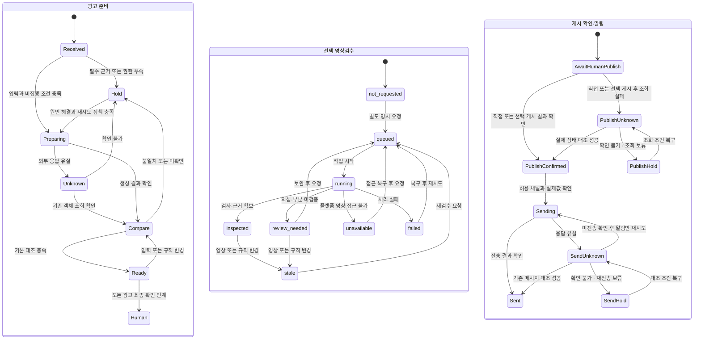

세 영역은 독립 저장 상태이며 연결되지 않은 시작점은 자동 병렬 실행을 뜻하지 않는다. D2 결정 전 제안에서 Video는 명시 요청 시에만 실행한다. 영상검수 미실행 표시를 유지한 채 기본 대조 완료 결과를 인계할 수 있지만, 사람이 모든 광고의 최종 확인을 생략할 수는 없다. 요청된 영상검수에서 unresolved 경고·미검증이 남으면 해당 항목의 사람 판단과 근거를 남긴다. 외부 심사/노출 상태는 Notify 완료로 덮어쓰지 않는다.

| 실패·변경 | 복구 규칙 | 보존·차단 |
|---|---|---|
| 필수값·권한·최종본 불명 | 영향 광고 보류, 질문을 모아 담당자에게 전달 | 정상 독립 항목 진행, 다른 브랜드 값 대체 금지 |
| 비집행 보장 불가 | 해당 유형 자동 쓰기 차단·수동 인계 | 생성 후 사람이 확인하는 방식으로 완화 금지 |
| 명확한 일시 오류 | 횟수·간격·종료 한계를 설정하고 허용 항목만 재시도 | 한계 미정이면 무한 반복 금지, 담당자에게 복구 필요 표시 |
| 생성 응답 유실 | 계정·대상·작업 키·외부 ID를 대조, 존재 확인 후 이어가기 | 확인 전 재생성 금지. 확인 불가 상태 보존 |
| 일부 광고 실패 | 광고별 성공/실패/불확실 분리, 영향 항목만 재처리 | 정상 광고·원본 파일·운영 광고 보존 |
| 설정·규칙 변경 | 영향 결과 stale 처리, 준비 완료 해제, 재대조 | 과거 승인을 새 값에 적용하지 않음 |
| 게시 확인 실패 | 조회 상태·마지막 확인 시각·다음 조치 표시 | 게시 완료 알림 금지, 실제 게시 여부 추정 금지 |
| Slack 실패·응답 유실 | 메시지 존재 대조, 미전송 확인 후 알림만 재시도 | 광고 재게시 금지, 불확실 시 재전송 보류 |

중복 키는 브랜드·계정·요청 버전·항목·행위 단위로 설계하고 외부 객체 대응을 함께 저장한다. 동시 실행의 잠금/작업 임대, 중복 요청의 기존 결과 반환, 재시작 후 미완료 작업 복원은 시험 대상이다. 외부 서비스에서 무조건 정확히 한 번 처리된다고 약속하지 않는다.

<a id="prd-8"></a>
## 8. 권한·운영·지원

| 역할 | 책임·허용 경계 |
|---|---|
| 현재 광고 세팅 담당 | D3 결정 전 제안의 기본 최종 확인자. 요청·확정값·소재 확인, 모든 광고 최종 확인·직접 게시 또는 명시적 선택 게시 지시·기존 기록 유지 |
| 브랜드별 Slack 채널 확인 담당 | 현재 사용하는 채널과 허용 독자·양식을 확인하여 연결 |
| 기존 브랜드 DB 관리 담당 | 기존 업무대로 브랜드 정보를 관리. 새 자동화 등록 담당을 추가하지 않음. 누락·충돌 시 기존 책임자가 내용 확인 |
| 위캐리 계정 소유자/관리자 | 대상 계정·자료·Slack 권한 부여·회수, 신규 사용자·브랜드 범위 확인 |
| 규칙 충돌 결정·갱신 담당 | 기존 업무 분담에서 적용 기준을 결정할 사람과 확정 규칙을 갱신할 사람 확인. 같은 사람이 맡을 수 있음 |
| 2358works 개발/지원 | 스킬·어댑터·실행 저장·지원표·검증·복구 절차 구축. 최종 검수 후 6개월 합의 범위 유지보수와 아래 종료·인계 조건 수행. 업무 정책을 대신 확정하지 않음 |
| 시스템 | 호출자의 허용 범위와 행위 제한 내 실행. 관리 권한이 광고 게시 권한으로 자동 확대되지 않음 |

위 역할은 광고마다 별도 인원을 추가하라는 요구가 아니다. 기존 업무 분담과 승인 절차를 우선 적용하고, 비어 있는 등록·공유·규칙 관리 책임을 확인한다.

권한 매트릭스는 읽기, 비활성 생성, 비활성 정정, 설정 참조 조회, 명시적 선택 게시, 게시 조회, Slack 전송을 별도로 둔다. 명시적 선택 게시 권한은 SK09에만 부여한다. 무지시 활성화·자동 OFF·삭제·기존 운영 광고 자동 변경은 제외한다. 직접 쓰기 도구가 정책 계층을 우회할 수 있다면 노출을 차단하고 지원 범위를 축소한다. 비밀은 별도 저장하고 토큰·비밀번호·임시 서명 URL·원문 민감 자료를 문서·로그·고객 메시지에 출력하지 않는다.

운영 인수물은 지원 행렬, 기존 브랜드 자료 연결 안내, 권한 갱신/회수·재시작·재시도·수동 인계 절차, 알림 실패 확인법, 실행·배포 파일, 설정·접근 정보, 운영·백업·복구 문서다. 개발팀이 실제 저장 대상·실행 환경에 맞춰 보관·삭제·백업·복구 방식과 장애 접수 경로를 구체화한다. 기존 6개월 유지보수·종료·데이터 제공 책임을 미정 항목으로 재상정하지 않는다. 계약 종료 표지만으로 자료 삭제·광고 OFF를 실행하지 않는다.

### 실행 환경·비용과 유지보수·인계 조건

Claude Team과 기존 업무 환경을 우선 활용합니다. 별도 유료 서버와 모델 API는 기본 요구가 아닙니다. 추가 인프라가 실제 필요한 경우에만 개발팀이 필요 이유·비용·소유·운영 주체를 제시하고 사용 전에 합의합니다. 추가 비용 0원을 검증된 사실로 단정하지 않으며, 이번 수정으로 새로운 비용 부담이나 소유권 이전을 정하지 않습니다.

최종 검수 후 6개월간 2358works가 합의 범위의 오류 수정·안정화·경미한 보완·경미한 광고/AI 연동 변경·기본 상태 확인을 수행합니다. 개발 종료는 지원 종료가 아닙니다. 6개월 이후 기존 기능 이용과 추가 수정·지원의 별도 합의를 구분하며, 무기한 유지보수를 약속하지 않습니다.

기존 조건에 따라 지원 중단은 원칙적으로 30일 전 안내하고, 요청 시 기본 데이터·보관 소재를 10영업일 이내 1회 제공합니다. 계속 운영에 필요한 실행·배포 파일, 설정·접근 정보와 운영·백업·복구 문서를 인계합니다. 접근 정보는 권한 있는 인수자에게 안전하게 전달하고 공개 문서에 비밀값을 싣지 않습니다. 이 인계는 새로운 소유권 이전을 정하는 것이 아닙니다.

보관·백업·복구 방식은 개발팀이 실제 저장 대상과 실행 환경에 맞춰 구체화하고 시험합니다. 새로운 복구시간 보장이나 상시 대응 약정을 추가하지 않습니다.

### 게시 확인 판정 명세 — T4 확정 대상

아래는 개발 제안이며 고객 계정 시험으로 확정합니다. 생성 성공만으로 게시 확인을 기록하지 않습니다. 관찰 시작·종료(담당자 취소, 종료일, 조회 한계)와 조회 간격은 T4에서 2주차 말 확정하며, 종료 시 미게시/미확인은 그대로 남깁니다.

| 매체 | 게시 확인 후보 조건 | 별도 표시·미확정 영향 |
|---|---|---|
| Meta | 사람 게시 기록과 같은 광고 ID의 독립 GET에서 요청 상태 ACTIVE 및 부모 객체 상태 대조 | effective_status 심사/게재는 분리. 정확한 조합은 T4/VT08 시험 전 확정; 그 전 게시 확인 보류 |
| Google | 사람 게시 기록과 같은 광고/상위 객체의 독립 GAQL 상태 대조로 ENABLED 전환 확인 | 정책/심사·게재는 분리. 유형별 필수 필드는 T4/VT08 시험 전 확정; 미조회 시 보류 |
| TikTok | 사람 게시 기록과 같은 광고/상위 객체의 독립 조회 상태 일치 | 상태 필드·값은 미검증; 개발 담당이 T4에서 명세·시험. 확정 전 게시 확인/Slack 성공 표시 금지 |

### Slack 게시 결과 메시지 계약

Q38의 매체별 세트명·일예산 형식을 바탕으로 Q39 추가 요구를 반영한다. R2·R4는 현행 형식으로 충분하다고 했으며, R1의 관리자 연결 정보와 R3의 재처리·값 차이·AI 판단·시각 요구를 짧은 요약과 상세 링크로 제공한다. 모든 항목이 전원 합의라는 뜻은 아니다. 고객 예시는 [보고서 §6](report.html#example-slack-results)을 따른다.

| 메시지 영역 | 필드·생성 조건 |
|---|---|
| 공통 요약 | 브랜드·매체·캠페인/세트, 실제 예산과 적용 단위, 요청 수·게시 확인 수·미게시 수·미확인 수, 실제 상태 확인 시각 |
| 변경·AI 판단 | 변경 전후 값·이유·기준 자료와 AI가 선택한 값. 변경이 없다고 확인된 경우에만 ‘변경 없음’; 조회 실패는 미확인 |
| 문제·재처리 | 해당 광고·문제·다음 조치, 재처리 수행 여부와 결과. 정상 건을 다시 게시하지 않음 |
| 연결 | 허용된 광고 관리자 링크·상세 결과 링크. 미생성/조회 불가 링크는 원인과 확인 경로 표시, 임의 URL 생성 금지 |
| 상세 결과 | 문구·랜딩/UTM·요청/실제 설정과 대조 근거는 상세 결과에서 광고별 확인. 공개 채널에 민감한 내부 자료 링크를 자동 첨부하지 않음 |

게시·심사·실제 노출은 별도로 표시한다. 전체 게시 예시는 요청 4개=Meta 2개+Google 2개, 부분 게시 예시는 Meta 5개 중 게시 확인 3개·미게시 2개로 일관되게 집계한다. 미확인 광고는 미게시로 추정하지 않는다. Meta 세트 일예산과 Google 캠페인 일예산의 실제 적용 계층을 표기하고 광고 수만큼 합산하지 않는다. 영상 의심 구간은 별도 검수 수행 근거가 있을 때만 표시한다.

브랜드별 허용 채널이 없으면 전송을 보류한다. Slack 오류는 메시지 존재 확인 후 알림만 복구하며 광고를 재게시하지 않는다. Notion 기록과 Slack 전송은 독립 상태로 관리한다. 예시 금액·광고명은 가상이며 실제 Slack 전송 증거가 아니다. 고객용 [FAQ](report.html#faq)는 보고서를 참조한다.

<a id="prd-9"></a>
## 9. 시험과 인수 계약

대표자 서면 결정은 범위·일정·후속 처리에 관한 결정이다. 해당 VT의 미실행/실패 판정과 증거는 그대로 기록하며 서면 결정으로 통과로 바꾸지 않는다.

아래는 **VT01~19 통합 인수표 / 시험 계획**이다. VT12b 참고 관찰을 제외한 기능·교육 시험은 필수이며 현재 전체 판정은 미실행·미완료다. 행의 담당 역할이 증거로 판정하고 최종 인수는 위캐리 검수 책임자가 결정한다. VT12의 기능·교육 수행 판정과 업무 효과 관찰은 별도다. T5 중 기능 검사의 수치 기준이 필요한 시험은 사전 확정 전 판정 보류다. VT12의 효과 관찰 기록은 필수 합격 조건에서 제외하며 미측정·미달성은 인수 차단 사유가 아니다. 공동 판정 이견은 위캐리 검수 책임자가 증거와 이유를 기록해 최종 결정하되 필수 증거 누락을 통과로 변경하지 않는다. 증거에는 시험 ID·실행일·환경/입력 버전·기대/실제 결과·판정자 역할·재시험 연결을 남긴다. 각 실패 조치는 수정 후 해당 시험 및 영향 회귀 시험 재실행을 포함한다.  VT01~19 전체 인수 시험은 미완료다. API 검증 절의 독립 증거는 VT03·09·11 등의 일부 기술 근거이며, 제품 통합·전체 시험 통과를 대신하지 않는다. 영상19의 별도 실측도 전체 기능 인수를 대체하지 않는다. 공통 사전조건은 허용된 자료·개발팀이 정리한 기대 결과/대조 기준·시험 담당자·지원 후보·복구 방법이다. 실계정 쓰기·실제 게시·Slack 전송 시험은 대상 계정·예산·기간·채널·허용 행위가 별도 승인된 이후에만 수행한다. 모의 시험, 제한 계정 시험, 실제 운영 파일럿 결과를 구분한다.

| 시험 ID·목적 | 사전조건·담당·입력 | 기대 결과·통과 증거 | 차단·복구 |
|---|---|---|---|
| VT01 진입 동일성 | 개발+위캐리 검수자; 판정: 해당 역할 공동, 동일 요청을 자연어/스킬명으로 제시, 같은 버전 고정 | 동일 광고 계획·권한 차단·규칙 선택·영상 미실행. 두 실행의 정규화 결과 비교 | 다른 계약이면 라우터 수정 후 재시험 |
| VT02 자료·브랜드 격리 | 개발+자료 확인자 공동 판정; 다섯 요청 유형, 여러 제품·업로드 요청과 단일/복수 캠페인 관계, 복수 브랜드의 누락·권한 없음·모호한 파일·표 범례 | 원 요청→request_group_id→브랜드별 job_id→AdUnit 연결 및 prepare_ads 단일 입력 유지. 제품 수로 캠페인을 임의 분리하지 않음. 브랜드별 자료·권한 격리, 불완전성·질문 보존. 분해표·정답 연결표·접근 로그 | 영향 항목만 보류, 허용 밖 자료·결과 미노출. 확정 근거 확보 후 해당 항목만 재개 |
| VT03 생성·실제 설정 | 개발+광고 담당; 판정: 해당 역할 공동, 비집행 검증 계정·정답 문구/URL/예산/타기팅·자동 옵션·복수 입력 위치 | 필수 반영값 일치(미조회는 사전 합의한 수동 대조 증거 필요), 미확인은 보류로 표시, 상위 ACTIVE/공유 예산 불변, 허용 오류 수정 후 재조회. 전후 조회 증거 | 비집행 보장 실패는 쓰기 제외; 미조회 필드는 합의한 수동 대조 근거 없으면 보류 |
| VT04 선택 영상·플랫폼 | 분석 담당+검수자; 판정: 해당 역할 공동, 명시 요청한 플랫폼 영상, 정상/오류/의도된 장면, 1/5/20개 묶음별 동일 검사 범위·정답 표본(T5), 오류/정상/의도 장면 포함 | 실행/미실행/접근불가 분리, 근거 구간·미검증·오탐/미탐 기록, 현재 선택형 제안에서는 기본 흐름 자동 실행 0건; D2 변경 시 시험 계약 선개정. 결과·범위·실행 환경·사용량(확인 불가 시 미측정) 대조 | 플랫폼 취득 불가 시 미검증; 원본 대체는 별도 지원 시험, 사람의 표현 판단 유지 |
| VT05 부분 실패·중복 | 개발; 판정: 해당 역할 공동, 한 묶음의 정상/실패/접수 전 보류 혼합, 동시 중복 요청·응답 유실·워커 재시작 | 동일 request_group_id·하위 job_id 연결 유지, 정상 객체 보존, 기존 외부 결과 대조 후 실패 항목만 재시도. 작업 수/광고 수 분리·중복 없는 상태별 집계, 접수 실패·미확인 누락 없음. 분해·집계·작업/객체/시도 로그 비교 | 외부 존재 불명 시 보류. 전체 성공으로 표시하지 않고 확인 뒤 실패 항목만 재개·재집계 |
| VT06 변경·취소·버전 | 개발+업무 확인자; 판정: 해당 역할 공동, 준비 후 파일/URL/예산/규칙/권한 변경·취소 | 영향 준비 완료 해제·stale·재대조, 이전 승인 재사용 없음. 변경 이력과 영향 대상 비교 | 운영 광고 자동 변경 없음, 취소 대상 쓰기 중지·권한 복구 후 재확인 |
| VT07 사람 확인·게시 | 위캐리 담당+개발 관찰자; 판정: 해당 역할 공동, 정상·문제·영상 미실행·미생성·미조회·해당 없음 광고 혼재, 정답 집계·변경 이력, 승인된 게시 시험 | 공통 결과의 모든 필드·상태·집계 및 실제값/차이/이유/시각/검사 범위 확인 가능, 미생성·미조회·해당 없음 구분, AI 변경 미조회는 미확인. 직접 게시 기록과 SK09 선택 게시·승인/실패 처리 증거(VT19) 구분 | 최종 확인자·게시 시험 권한 미정이면 인계 단계까지만 확인하고 전체 VT07 판정은 보류 |
| VT08 게시·Slack | 개발+위캐리 채널 담당; 판정: 해당 역할 공동, 일부 게시·심사 중·설정 변경·채팅 종료 | 대상 광고의 확인분만 짧은 요약·필요 링크로 전송, 상세 결과 분리, 기존 브랜드별 허용 채널 적용, 브랜드 분리, 중복 없음. 게시 조회+메시지 ID·내용 대조 | 미확인 필수값·채널 오류는 전송 보류, 광고 변경 없이 알림 복구 |
| VT09 운영 장애·권한 | 운영+개발; 판정: 해당 역할 공동, 연결 만료·조회 지연·Slack 응답 유실·저장 복구·정책 우회·삭제 요청·미지원 UI 변경 | 만료 차단·알림 불확실 보존·복구 후 중복 방지·비밀 미노출·삭제 거부·미지원 UI 수동 인계. 실패/복구/접근 로그 | 지원 담당 인계, 영구 저장 복구 확인 전 불확실 작업 재실행 금지 |
| VT10 신규 브랜드 자료 반영 | 위캐리 담당+개발 검수; 기존 DB에 추가된 새 브랜드·허용 권한·지원 유형 | 별도 자동화 등록·Notion 쓰기 없이 새 항목 조회→자료/규칙 연결→대표 광고 비활성 준비·대조. 원본 변경 시 재조회·영향 결과 갱신, 다른 브랜드 혼용 없음 | 누락/권한 실패는 해당 항목 보류·안내. 최초 계정 연동/권한은 개발팀·소유자가 처리 |
| VT11 지원 경계 | 2358works; 판정: 해당 역할 공동, 매체×유형×계정×캠페인×추적×규모 후보와 공식 자료 | 기능별 문서 확인일·계정 시험·지원/제약/미지원/미검증 표, 수동 경로·책임 기록 | 문서만 확인되면 실지원 미검증, 필수 지원 부족 시 일정·범위 영향 보고 |
| VT12a 교육·실습 필수 인수 | 위캐리 실무자+검수 책임자; 정상/예외 사례와 사용·문제 대응 안내 준비 | 업무 요청·결과/미확인 확인·신규 브랜드 자료 확인·문제 대응 핵심 실습 증거, 고객 인수 결정 | 핵심 실습 실패·미실행은 인수 보류. 교육 축소 시에도 생략 금지 |
| VT12b 효과 참고 관찰 (필수 인수 제외) | 유사 조건 전후 업무·관찰 방식은 T5에서 협의 | 반복 확인·개입·체감 부담·연결 정확성·수동 잔여 업무와 한계 기록 | 방식 미합의·미측정·미달성은 효과 미검증으로 기록하며 인수 차단 사유 아님 |
| VT13 공동 배포·용량 | 개발+위캐리 검수 책임자; 두 구성원·동일 입력/규칙·사용량 제한 주입; 판정: 해당 역할 공동 | 필수 설정/검사 결과 동일, 중복 생성 없음, 제한 후 조회·복구. 버전·결과·사용량/미측정 로그 | 불일치·검사 누락·허위 완료 시 실패; 수정·재시험, 적합성 보류 |
| VT14 입력·권한 계약 | 개발 보안 검수자; 위조 actor·타 브랜드 account_ref·누락/단위 오류 입력; 판정: 해당 역할 공동 | 불법/불완전 입력 거부, 동일 snapshot/version 기록. 요청·거부·권한 로그 | 쓰기 차단, 정책/단위 수정 후 재시험 |
| VT15 중복·응답 유실 | 개발 검수자; 동일 입력 동시 제출·생성 직후 응답 유실·worker 재시작; 판정: 해당 역할 공동 | 외부 중복 없음 또는 결과 불확실 시 보류. 독립 조회·시도/객체 로그 | 무조건 재생성 금지; 외부 조회·복구 후 재시험 |
| VT16 부분 실패·버전 변경 | 개발+업무 확인자 공동 판정; 복수 브랜드·제품·업로드 요청 묶음에서 한 Job/AdUnit 실패, 재개 전 해당 자료 변경 | 정상 Job·AdUnit 보존, 변경 영향 항목만 stale·재대조. request_group_id와 하위 job_id·입력 버전 연결 유지, 복구 후 상태·수량 재집계. 변경 전후·분해·집계 로그 | 영향 항목 보류; 정상 훼손·오래된 승인 사용·전체 완료 오표시는 수정 후 재시험 |
| VT17 상태·알림 복구 | 개발+위캐리 채널 담당; PAUSED/심사/게재·outbox 재시도·응답 유실; 판정: 해당 역할 공동 | 광고 무변경, 상태 분리·전송/미확인 구분·중복 방지. 독립 상태 조회·메시지 ID/로그 | 알림만 복구, 광고 변경 금지; 불확실 전송 보류·재시험 |
| VT18 세 매체 통합 | 개발+위캐리 검수 책임자; 세 매체 각각 허용 고객 계정·지원 후보 유형·게시/채널 시험 승인; 판정: 해당 역할 공동 | Notion/Drive→MCP→runtime→매체→독립 조회→사람 인계→직접 게시 또는 명시적 선택 게시→독립 게시 확인 후 Slack. 요청 버전·객체·메시지 연결 증거 | 한 매체라도 필수 경로 미실행/실패면 전체 통과 금지; 영향 보고·서면 결정 또는 수정 후 재시험 |
| VT19 선택 게시 (필수) | 개발+위캐리 검수 책임자 공동 판정. 세 매체 각각 승인된 계정·광고·설정 버전·예산·기간; 오류 주입 환경과 실제 게시 시험 허용 범위 기록 | 정상 명시 지시만 실행; 승인 기록 없는 지시·무지시·ID/버전 불일치·만료/철회·권한 회수 0건 실행; 실행 직전 변경/경쟁 차단; 중복 요청·재시작은 기존 시도 반환; 응답 유실 독립 조회·불확실 보류; 부분 성공 보존·실패만 복구; 미승인 부모/기존 운영 객체 활성화 및 부모 활성화의 비지정 광고 영향 차단; 심사/노출·Slack 상태 분리. 승인/Attempt/외부 조회/메시지 증거 대조 | 현재 미실행. 모의·제한계정·실제 파일럿을 구분; 한 필수 시나리오라도 실패/미실행이면 통과 금지. 사용자가 기능을 쓰지 않아도 시험 면제 없음. 수정·영향 회귀 재시험 또는 영향 보고·서면 결정 |

### VT13 · 공동 배포와 요금제 적합성 시험

동일 권한을 가진 두 테스트 구성원에게 동일 스킬 배포본·모델 설정·확정 입력·브랜드 규칙을 제공하고, 독립된 시험 작업에서 대상 계정·소재·문구·URL·예산·검수 상태를 비교한다. 준비 광고의 비활성 상태를 유지한다. 답변 표현이 달라도 확정 설정과 필수 검사 결과는 같아야 한다. 동일 작업 키 재호출은 기존 결과로 연결되어 중복 생성되지 않아야 한다.

스킬 비활성·버전 변경·권한 부족·사용량 제한을 시험 또는 모의 장애로 확인한다. 필수 검사를 건너뛰거나 잘못된 완료를 반환하면 실패다. 공유 스킬 업데이트가 다음 사용에 반영되는지, 실행 중 입력/규칙 버전이 보존되는지, 외부 객체 재조회 후 복구되는지 기록한다. 테스트 구성원 두 명은 기술 시험 조건이며 고객에게 실습 담당자 1명을 지금 지정하라는 요청이 아니다.

대표 작업의 모델·처리 수량·검사 범위·사용량·제한 도달·복구 결과와 좌석/API/서버 비용을 구분해 기록한다. Claude 앱에서 토큰 수를 확인할 수 없으면 미측정으로 남기고 사용량 표시를 정확한 토큰값으로 환산하지 않는다. Team Standard 좌석의 기능 충족과 실제 처리 용량이 확인되기 전 Team 환경 용량 적합성은 미검증이다. VT13도 현재 미실행 계획이다.

기존 C01~C58과 FR-01~19·D01~13·M01~13는 대응표(비공개 근거, 이 배포본에 미포함)에 유지·변경·대체를 기록한다. 옛 자동 활성화 시험을 이번 합격 조건으로 재사용하지 않는다. 설정 대조는 일치 항목/전체 필수 항목과 미조회 수, 탐지는 오류 정답별 탐지/미탐과 정상 오탐을 분리한다. 영상 검사 미실행은 탐지율 분모에 실행 완료로 포함하지 않는다.

광고 준비 소요시간·사람 직접 작업시간은 현 발표 필수 KPI에서 제외한 기존 결정을 유지한다. 과거 8개 KPI 정의는 이전 문서에 보존한다. 이번에는 반복 확인·개입·오류/재작업·묶음 연결·부분 실패 복구·게시 후 공유·신규 담당자 수행·체감 부담을 평가하며 목표·표본·허용 지연은 미합의다. 영상 1/5/20개 실측은 검사 구성 검증용으로서 고객의 작업시간 절감·서비스 SLA를 증명하지 않는다.

<a id="prd-10"></a>
## 10. 미팅 결정과 개발 착수 조건

구축비·지급 조건은 기존 대표자 간 협의 내용을 따릅니다. 유지보수·종료·인계 조건은 기존 합의에 따르며, 이번 기술안의 고객 승인과 구분합니다. Claude Team을 기본 전제로 하며 T6은 개발팀이 추가 인프라 필요 여부를 점검하고 실제 필요 시 이유·비용·소유·운영 주체를 제시해 사용 전 합의하는 절차입니다.

### 고객 사용 방식과 개발팀 수행 항목

D1~D3은 고객의 사용 방식, T1~T8은 2358works가 개발·시험해 전달할 항목이다. D4는 기존 업무 유지, D5는 실제 변경 필요 시에만 확인한다. Claude Team 사용은 기본 전제다. 이 표의 기한은 6주 계획 안의 확인 지점이며 SLA 약속이 아닙니다. 아래에 명시되지 않은 세부 미확정 수치·규칙도 해당 묶음의 담당·기한·영향을 적용합니다. 역할의 실제 배정은 착수 전에 양측 책임자가 확인합니다.

| ID·상태 | 결정할 내용·선택안 | 담당 역할·기한 | 미확정 시 영향 |
|---|---|---|---|
| D1 고객 결정 필요 | 스킬명 중심+자연어 병행 또는 자연어 중심 안내 | 위캐리 업무 책임자, 2주차 말 | 교육·진입 안내 확정 불가; 두 진입의 동일 계약 유지 |
| D2 고객 결정 필요 | Q36 업로드 시 자동 검사 또는 요청형 선택 검사; 원본 수령/업로드 전/플랫폼 업로드 후 시점과 원본/변환본 대상 | 위캐리 업무 책임자 + 개발 책임자, 2주차 말 | 영상 운영안 미합의. 자동 검사 채택 시 영향·시험계획 재검토, 지원 확정 금지 |
| D3 고객 결정 필요 | 현재 세팅 담당 최종 확인·직접 게시 기본, 선택 게시 권한자·기존 팀장 승인 적용 여부 | 위캐리 업무 책임자, 2주차 말 | 게시 인수 시험 보류; 명시 지시 없는 게시 금지·선택 게시 필수 시험 보류 |
| D4 기존 업무 유지 | 기존 브랜드 DB 관리 담당이 정보·규칙을 관리. 별도 등록 담당 신설 안 함 | 기존 업무 담당; 누락·충돌 발생 시 확인 | 자동화용 재등록 요구 없음 |
| T1 개발팀 수행 | 기존 요청/브랜드 자료의 읽기 연결, 매체별 입력값·지원 유형·권한 및 앱 조건 검증 | 2358works 개발팀, 2주차 매핑·QC 재확인 | 개발팀이 부족한 대상·권한만 구체적으로 요청. 고객에게 정답 목록 작성을 일괄 요구하지 않음 |
| T2 개발팀 수행 | 기존 환경 우선 실행 구성·실제 저장 대상·보관/삭제·백업·복구 방식 구체화 | 2358works 개발/운영 책임자, 2주차 말 명세, 5주차(보완 시 6주 초) 복구 시험 | 명세·시험 미충족 시 운영 전환 보류. 새로운 복구시간 보장 없음; 자료 삭제·광고 OFF 자동 실행 금지 |
| T3 개발팀 수행 | 확정된 6개월 유지보수·30일 전 중단 안내·요청 시 10영업일 이내 1회 데이터/소재 제공을 접수·권한·인계 절차에 반영. 실행·배포 파일과 설정·접근 정보·운영/백업/복구 문서 준비 | 2358works 운영 책임자 + 위캐리 관리자, 2주차 말 절차, 6주차 운영 인계; 지원 중단·자료 요청 시 기존 조건 이행 | 기존 책임은 미정이 아님. 실행 절차·인수물 미충족 시 전환 보류; 상시 대응 약정 없음 |
| T4 개발팀 수행 | SK09 승인 유효기간·철회 조건·재시도 횟수/간격/종료·매체별 게시 확인 조건·관찰 종료·조회 간격·Slack 채널·허용 지연 | 개발/운영 책임자 + 채널 관리자, 2주차 말, 5주차(개발 보완 시 6주 초) 시험 | 승인 만료 기준 미정이면 선택 게시 차단·VT19 판정 보류. 무한 반복 금지·불확실 보류; 알림 인수 불가 |
| T5 개발팀 수행 | 모델·검사 범위·오탐/미탐 허용 기준·시험 표본·효과 관찰 방식 | 개발 검수 책임자 + 위캐리 검수 책임자, 2주차 말, 5주차(개발 보완 시 6주 초) 참고 관찰 | 기능 검사 기준 미확정은 해당 시험 보류; 효과 방식 미합의는 효과 미검증만 기록하고 인수를 막지 않음. 사후 기준 완화 금지 |
| T6 개발팀 점검 | Claude Team·기존 업무 환경 우선. 별도 유료 서버·모델 API는 기본 요구 제외; 추가 인프라 실제 필요 여부 검증 | 2358works 개발팀, 2주차 검토 및 추가 서비스 사용 전 | 실제 필요 시 이유·비용·소유·운영 주체를 제시하고 사용 전 합의. 미합의 추가 서비스 사용 보류; 추가 비용 0원 단정 금지 |
| D5 필요 시 변경 확인 | 기존 DB 읽기 우선. 업무 결과 기록·속성 변경이 실제 필요할 때만 구체 변경안 확인 | 개발팀 검토 후 기존 자료 소유자에게 설명 | 새 DB/양식/승인 필드를 일괄 요구하지 않음. 해당 변경 전 읽기와 쓰기 분리 |
| D6 고객 결정 필요 | 외부 처리자·전송 자료·저장 위치·보관/삭제·접근 역할 명세 승인 | 위캐리 자료 책임자 + 개발/운영 책임자, 2주차 말 및 실제 자료 처리 전 | 승인 범위 밖 자료 전송·보관 보류 |
| T7 개발팀 수행 | 실제 게시 시험 대상·예산 부담 주체·한도·기간·채널·허용 행위 | 개발 검수 책임자 + 고객 검수 책임자/양측 대표자, 2주차 말 계획·실제 QC 전 서면 확정(기본 5주, 보완 시 6주 초) | 승인 전 유료 게시/전송 시험 미실행·해당 인수 보류 |
| T8 개발팀 수행 | 자동 정정 허용 필드·오류 조건·금지 필드 목록, 스킬 최종 이름 | 개발 책임자 + 위캐리 업무 책임자, 2주차 말 | 목록 밖 정정 금지. 예산·계정·캠페인 대상 변경은 고객 확인 없이 자동 정정하지 않음 |

### 착수·고객 준비·자료 처리 조건

1주차는 양측 책임자가 역할 배정·초기 접근 조건·시작일을 확인해 기록한 날부터 계산합니다. 실제 시작일은 아직 기재하지 않았습니다. 초기 2주 내 개발팀이 기존 자료·연결·시험 기준을 정리하고, 접근할 수 없는 대상이나 불명확한 업무값만 고객 자료/계정 관리자에게 확인합니다(T1). 2358works는 누락 대상만 묶어 안내하고, 실제 QC 전에(기본 5주차, 보완 시 6주 초) 고객 검수 책임자와 시험 브랜드·광고·게시 허용 행위·채널을 확정합니다. 미제공/미승인 대상은 보류하며 개발 책임자가 일정 영향을 대표자에게 보고합니다. 실제 게시 시험 비용 부담 주체·한도·기간은 T7에서 별도 서면 확정합니다.

자료는 허용된 요청에 필요한 부분만 Notion/Drive에서 읽어 Claude와 실행 계층에서 처리하도록 설계합니다. 실행 저장소에는 입력 버전·작업/재시도·결과 증거를 보관하며 영상/임시 파일의 보관 여부·기간·삭제 방식과 외부 처리자·접근 역할은 T2 명세 및 D6 고객 승인 전 확정되지 않았습니다. 승인되지 않은 자료의 전송·장기 보관은 진행하지 않습니다.

신규 브랜드는 기존 Notion 브랜드 DB에 추가된 정보를 읽습니다. 새 계정·자료 접근 권한은 소유자가 부여하고 개발팀이 연결을 지원합니다. 기존 값을 다시 입력하지 않으며 부족한 업무값만 기존 담당자에게 확인합니다.

매체별 인증·생성의 중간 점검은 3주차 말에 실시합니다. Google·Meta·TikTok은 모두 위캐리가 사용하는 납품 대상이며 API 연동은 개발 진행하면서 최종 검증 진행 예정입니다. 실제 차단 문제가 확인되면 개발 책임자가 원인·영향·대응안을 보고합니다. 어느 매체든 필수 경로가 미충족이면 VT18 전체 통과는 불가하며 서면 결정도 실패·미실행을 통과로 바꾸지 않습니다. 쓰기 안전성 미충족 시 해당 실행을 차단하되 납품 요구를 자동 삭제하지 않습니다.

### 개발 준비와 운영 인수물

기존 M01~13은 추적용으로 보존하되 위의 고객 안건과 구분한다. 업무 기준·규칙 충돌(M02~04·M11), 채널·기록 매핑(M08·M12), 지원·운영 환경(M01·M06·M10·M13), 인수 시험 준비(M09)는 개발팀이 기존 자료·권한·계정 지원과 대조해 준비한다. 필요한 기술 요구를 삭제하지 않으며, 이미 고객에게 요청한 새 담당자 지정이나 미팅 결정으로 표현하지 않는다. 기존 자료로 해결되지 않는 개별 권한·업무 판단은 대상과 영향을 제시해 확인한다.

고객 합의 기록에는 결정 대상·선택안·결정자·근거·시각·유효 범위를 남긴다. 사전 미팅 동료 의견과 고객 결정을 다른 항목으로 저장한다. 문서 v1.12 번호는 구현 완료나 범위 승인 번호가 아니다.

개발 착수 전 필수 결과물은 업무 기준 매핑·권한표·지원 검증 계획·비집행 조건·운영환경 권장안·예외 담당과 인수 계획이다. 실제 자동 쓰기 착수는 별도의 제한 계정 검증과 허용 범위가 충족되어야 한다. 기존 DB 신규 브랜드 자료 반영, 명시적 선택 게시·게시 확인·Slack까지 포함하는 첫 납품 요구를 조용히 축소하지 않고 미지원·보완·일정 영향을 명시한다.

### 개발 전에 확인할 자료 범위

과거 전체 자료조사는 요청별 납품 접근 범위와 다릅니다. 폴더 목록·레코드 수집은 승인본·최종 문구·광고 실제값 확인을 뜻하지 않습니다. 일부 읽기 상한·미지원 블록·403/404 접근 실패가 있었으며 삭제 증거는 아닙니다. 원본 수치·경로는 내부 조사 기록에 보존합니다. 개발 시 T1에 따라 해당 요청의 현재 위치·권한·승인·규칙만 재확인합니다.

### 전체 프로젝트 일정과 운영 전환

기본 일정은 1~2주 분석·협의, 3~4주 개발, 5주 검증·보완, 6주 교육·최종 확인입니다. 개발·보완이 최대 1주 더 필요하면 교육 기간을 줄여 **총 6주 안에서 조정**합니다. 완료된 기능부터 검증을 병행하고 4주차 중간 시연과 6주차 최종 확인은 유지합니다. 보완 시 5주차 개발 보완과 완료 기능 검증을 병행하고, 6주 초 잔여 QC·재확인 후 6주 후반에 축소 교육·최종 확인을 진행합니다. 교육 기간이 줄어도 업무 요청·결과 확인·신규 브랜드 자료 확인·문제 대응의 핵심 실습은 유지합니다. 일정 도달만으로 필수 시험을 통과 처리하지 않습니다.

운영 전환은 VT12a 핵심 실습과 필수 기능 시험·T2/T3/T6 운영 조건 충족 후 결정합니다. T2 운영 명세·복구 증거, T3 지원/권한 회수·수동 인계 안내, T4 게시 판정·관찰 종료·Slack 복구 명세, T6 추가 인프라 필요 여부 점검 및 실제 필요 시 이유·비용·소유·운영 주체 제시와 사용 전 합의를 각 책임 역할이 2주차 명세·5주차(개발 보완 시 6주 초) 시험·6주차 인계 일정에 연결합니다.


## 개정 이력

- 2026-10-28 · 사용자 피드백 반영: 별도 등록/Notion 쓰기 계약을 기존 브랜드 DB 조회로 변경(SK08·VT10). D4는 기존 업무 유지, D5는 필요 시 변경 확인, T1~T8은 개발팀 수행으로 정리. Claude Team을 기본 전제로 반영.

- 2026-10-28 · Codex · v1.10: 기존 v1.9를 보존하고 납품물·SK/VT·운영 인수물을 연결했습니다. VT12a 필수 실습과 VT12b 참고 관찰을 분리했습니다. 새 API/통합 시험 수행 또는 고객 승인 완료를 뜻하지 않습니다.

선택 게시 추가에 따른 공수·외부 승인·실제 시험 비용 영향은 미확정이다. 총 6주·세 매체 납품 범위를 유지하되 2주차에 영향 확인, 3주차 연결 점검, 5주차 QC(보완 시 6주 초), 6주차 필수 시험 판정에 반영한다. 미충족은 보류·대표자 보고·서면 결정이며 일정 경과나 사용 미선택을 통과 근거로 삼지 않는다.

- 2026-10-28 · Codex · v1.11: 이전 버전 보존. 기존 환경 우선·추가 인프라 사전 합의, 기존 6개월 유지보수·종료·인계 조건과 세 매체 납품 표현을 정정했습니다. 총 6주·SK09·필수 VT19 유지. 새 API 시험이나 제품 구현 완료를 뜻하지 않습니다.

- 2026-10-29 · Codex · v1.12: v1.11을 보존하고 다섯 요청 유형의 범위, request_group_id와 하위 job_id 연결, 실행 계층의 분해·호출·집계와 브랜드 격리·부분 실패 계약을 명시했습니다. prepare_ads 단일 입력은 유지하고 VT02·VT05·VT16을 보완했습니다. 런타임 구현·실제 광고 실행·외부 게시·Notion 변경은 수행하지 않았습니다.
