# 위캐리 광고 업무 개선 · 개발 PRD v3.0 미팅 협의안 v1.7

- 상태: `DISCUSSION-DRAFT` · 개발 계약 제안 / 고객 범위 합의·기술 검증 전
- 작성: Codex · 2026-10-27. 독립 테스트 API 생성·조회 일부 검증. 운영 제품 구현·고객 실계정 통합·게시·Slack 전송은 미검증.
- 기준: PRD v1.3을 보존한 개정안, 보고서 v1.23와 자료 조사 18·영상 근거 19 v0.2의 확인 범위. 사전 미팅 노트는 **동료 리뷰이며 고객 합의가 아니다**.
- 독자: 개발·운영·검수 담당. 문제와 고객 업무 설명은 [보고서 v1.23](https://kyle92-kr.github.io/wecarry-meeting-docs/report.html), 변경 추적은 요구사항 대응표 (내부 보존 문서)를 사용한다.

<a id="prd-1"></a>
## 1. 문서 목적과 용어 정의

**요청·확정 세팅값은 Notion을 기준으로 읽고, 권한과 브랜드 규칙에 따라 비활성 광고를 준비한 뒤 실제 설정을 대조한다. 모든 광고의 최종 확인과 직접 게시는 사람에게 남긴다. 영상검수는 광고 준비 후 기존 플랫폼 업로드 영상을 대상으로 별도 요청하는 선택 스킬이다.**

이 문서는 개발 구조와 인수 조건을 제안한다. 설문·시연 사실은 [보고서](https://kyle92-kr.github.io/wecarry-meeting-docs/report.html), 과거 조사 범위는 자료 조사 18 (내부 보존 문서)의 비식별 요약으로 확인한다. 조사 18 원본은 내부 자료이며 고객용 배포에 원문 링크·식별정보를 복사하지 않는다. 목록 대응은 승인본·실제 광고 연결 완료가 아니다. 2026-10-28에 Claude 요금·Team·스킬 공식 안내를 확인했다. Google 테스트 계정과 2026-10-28 Meta 새 일반 광고계정의 독립 API 증거를 대조했다. Notion·Drive·Claude와의 제품 통합, 고객 운영 계정 지원은 미검증이며 독립 API 성공과 구분한다.

| 용어 | 본 문서의 의미와 경계 |
|---|---|
| 스킬 | 반복 업무의 목적·입출력·참조·권한·실패 처리를 정의한 실행 계약. 제품의 완성·설치 여부를 뜻하지 않음 |
| 자연어 / 스킬명 호출 | 동일 계약으로 들어오는 두 진입 방식. 문장으로 요청해도 권한·규칙·최종 확인을 생략하지 않음 |
| 확정 세팅값 | Notion에서 해당 작업에 적용하기로 확인된 값과 승인 근거. 값이 존재한다는 이유만으로 확정 처리하지 않음 |
| 기본 설정값 대조 | 계정·소재 연결·문구·랜딩·추적·예산·자동 옵션의 요청값/확정값/실제 반영값 대조. 영상 내용 판정과 별개 |
| 선택 영상검수 | 명시 요청한 기존 플랫폼 업로드 영상의 확인 가능한 결과를 분석하고 의심 구간을 제공. 미실행은 통과가 아님 |
| 준비 완료 | 필수 설정 근거와 실제값 대조가 충족되어 담당자 최종 확인을 요청할 수 있음. 영상검수 미실행 여부를 함께 표시 |
| 게시 확인 / 심사 / 노출 | 게시 결과 조회, 매체 심사, 실제 게재·노출은 독립 상태. 생성 성공·ON 표시만으로 모두 완료 처리하지 않음 |
| 사용자 결정 / 고객 합의 | 이번 작업 지시의 설계 방향과 고객의 업무 규칙·인수 합의는 별도 기록. 동료 리뷰를 후자로 승격하지 않음 |

<a id="prd-2"></a>
## 2. 범위와 결정 상태

| 구분 | 현행 범위 | 결정 상태 |
|---|---|---|
| 매체·요청 | Meta·TikTok·Google, 단일 브랜드 단일/복수 캠페인, 복수 브랜드 묶음 | 사용자 지정 방향 유지. 계정·유형·형식별 실지원 미검증 |
| 광고 준비 | 자료 해석, 문구 후보 또는 지정 문구 적용, 링크 규칙, 허용된 비활성 생성·수정, 실제 설정 대조 | 개발 요구. 비집행을 보장할 수 없으면 자동 쓰기 제외 |
| 영상검수 | 별도 요청형 선택 스킬. 기존 플랫폼 업로드 영상 대상 | 이번 개정 변경. 기본 세팅 흐름에 자동 호출하지 않음 |
| 최종 확인·게시 | 현재 광고 세팅 담당자가 기본 최종 확인자로서 모든 광고 확인 후 광고 관리자에서 직접 게시·중지 | 기존 운영 승인 절차 유지. 광고마다 새 역할을 의무로 추가하지 않음 |
| 게시 후 공유 | 실제 게시 확인 후 브랜드별 Slack 자동 공유 | 첫 납품 요구 유지. 상시 실행·조회·전송 지원 시험 전 |
| 신규 브랜드 | 검증된 지원 범위 안에서 위캐리 담당자가 직접 등록·변경 | 공통 연동 최초 구축·계정 소유자 권한 부여가 선행될 수 있음 |
| 신규 연동 | 새로운 매체·광고/추적 시스템·미지원 유형은 2358works가 조사·개발·시험 | 기존 브랜드 설정을 복사해 지원으로 간주하지 않음 |
| 제외·별도 협의 | 광고 자동 게시·활성화·자동 중지·삭제, 기존 운영 광고 자동 변경, Notion/작업표 무단 갱신 | 첫 납품 자동 실행에서 제외. 미래 범위는 별도 승인 필요 |
| 권장 시작 방식 | 초보자는 스킬명을 중심으로 시작하고 자연어로 질문·상황 설명을 보완 | 두 방식은 같은 함수·기능·규칙. 고객 교육 방식은 미팅 확인 |

최종 확인 후 Claude에게 게시를 요청하는 방식은 **향후 선택지이며 이번 개발 범위에 포함하지 않는다**. 사용자가 현재 개발에서 제외한 방향이며, 호출 스킬·권한·상태전이에 게시 실행을 추가하지 않는다. 별도 범위 결정 없이 미래 선택지를 현재 지원 기능으로 안내하지 않는다.

허용된 Drive 원본 예비시험은 실제 광고 ID가 없어도 진행할 수 있다. 다만 원본 영상 검사로 플랫폼 결과 검수를 대신하는 기능은 **별도 시험·지원 미검증**이다. 플랫폼 영상에 접근할 수 없으면 미검증으로 남기며 Drive 원본을 자동 대체하지 않는다. 이미지·GIF 등 유형의 기존 요구는 삭제하지 않고 지원 행렬에서 별도 판정한다.

<a id="prd-3"></a>
## 3. 권장 개발 구성

대화 계층은 요청 해석·진행 안내를 담당하고, 별도 실행 계층은 정책 검사·저장·재시도·게시 확인을 담당하는 구성을 권장한다. 스킬 문서만으로 지속 실행·보안·중복 방지를 보장하지 않는다. 관리형 컨테이너, 작업 큐, 관계형 실행 저장소, 제한된 임시 파일 저장소는 **구현 후보**이며 호스팅 공급자·언어·용량·비용·보관 기간은 미확정이다. Claude 구독과 별도 API·실행 서비스·저장 비용을 구분한다.

### Claude 운영환경과 최소 요금제

**공동 운영의 권장 최소안은 Claude Team Standard다. Team은 공통 스킬과 자료를 배포·관리하는 기반이며, 가입만으로 같은 업무 결과나 오류 없는 광고 실행이 보장되지는 않는다.** Claude 앱을 담당자의 요청·결과 확인 진입점으로 제안한다. 게시 상태 관찰·재시도 같은 지속 작업은 별도 실행 서비스가 담당하도록 설계하며 앱 구독만으로 상시 실행이 구현됐다고 보지 않는다.

공식 안내 확인일: **2026-10-28**. 다음은 공급자 제공 기능과 본 프로젝트의 설계 판단을 구분한 기준이다.

| 구분 | 공식 제공 기능·조건 | 위캐리 적용 기준 |
|---|---|---|
| 개인 기능 시험 | Skills는 Free·Pro·Max·Team·Enterprise에서 제공, 코드 실행 활성화 필요 | 스킬 사용 자체에 유료 구독이 필수라고 쓰지 않음. Free의 업무 처리 용량·필요 연결 기능 충족은 미검증 |
| 공동 운영 권장 최소 | Team Standard: 구성원·연결 도구 관리, 프로젝트 협업, 스킬 공유·조직 배포 | 공통 스킬 배포와 운영 관리를 위해 권장. 광고 계정 접근 권한·연동 기능은 별도 구축·시험 |
| Team Standard 비용 | 미국 표시 가격: 월 결제 $25/인·월, 연 결제 $20/인·월, 최소 2명 | 2명 기준 월 결제 $50/월 또는 연 결제 $480/년(월 환산 $40). 세금 별도, 지역·통화·계약 시점 가격 재확인 |
| 사용량 확대 | Standard에도 구성원별 사용량 제한이 있음. Premium 또는 추가 사용량 선택 가능 | 대표 업무로 제한 도달·중단·복구를 측정한 뒤 해당 사용자만 상향 검토. Standard로 모든 물량을 처리한다고 보장하지 않음 |
| 전체 운영비 | Team의 API 크레딧 제공 안내가 있으나 적용 조건이 있음 | 좌석 구독, API 사용, 실행 서버·큐·저장 비용을 분리. 제공 크레딧의 연결·유효 조건·잔액·초과분을 확인하고 무제한 API 포함으로 계산하지 않음 |

근거: [공식 요금표](https://claude.com/pricing), [Team 기능·가격·사용량 제한](https://support.claude.com/en/articles/9266767-what-is-the-team-plan), [Skills 사용·공유·조직 배포](https://support.claude.com/en/articles/12512180-use-skills-in-claude). 위캐리의 Team Standard 권장은 이 기능을 바탕으로 한 설계 판단이며 구매 확정이 아니다. Enterprise는 별도 보안·감사·조직 관리 요구가 확인될 때 검토한다.

### 공통 업무 절차를 유지하기 위한 배포·실행 규칙

| 통제 대상 | 구현·운영 요구 | 확인 방법 |
|---|---|---|
| 공통 스킬 | 검토된 조직용 스킬을 배포하고 배포 버전·변경 이력 관리. 개인 업로드를 팀 공통 배포로 간주하지 않음 | 구성원 두 명이 같은 배포본에 접근·활성화할 수 있는지 확인 |
| 스킬 변경 | 공유 스킬은 다음 사용 시 갱신될 수 있으므로 실행 시작 시 버전과 입력 기준을 기록 | 진행 중 작업은 시작 기준을 보존하고, 변경 영향이 있으면 stale 처리·재대조 |
| 브랜드 규칙 | 확정된 Notion 규칙 버전·효력·대상 계정으로 실행 | 개인 대화나 계정 기억이 확정값을 조용히 바꾸지 않는지 검사 |
| 권한과 필수값 | 실행 계층에서 사용자·브랜드·계정·행위 권한과 필수 입력을 검증 | 스킬 미설치·비활성·잘못된 버전·권한 부족 시 실행 대신 필요한 조치 반환 |
| 결과 일관성 | 출력 문구가 아니라 대상 계정·소재·문구·URL·예산·상태·검수 기준의 일치로 판정 | 동일 확정 입력을 서로 다른 담당자가 실행한 시험 결과 비교 |
| 사용량·중단 | 제한 도달 시 작업 상태를 보존하고 복귀 후 외부 객체 조회부터 재개 | 완료되지 않은 작업의 완료 표시·중복 생성·중복 공유가 없는지 확인 |

Claude가 스킬을 선택했다는 문장만으로 실행을 증명하지 않는다. 실행 서비스는 실제 작업 ID·스킬/규칙 버전·외부 객체와 결과를 기록한다. 프로젝트·스킬 공유와 각 구성원의 Notion·Drive·광고 계정 권한은 별도다. 조직 배포 정책의 실제 강제 범위는 해당 조직 설정에서 검증한다(VT13).

### 연결 도구별 책임과 지원 확인

| 구성요소·연결 방식 | 필요한 동작 | 권한·실행 조건 | 현재 상태 |
|---|---|---|---|
| Claude 앱 + 배포 스킬 | 호출 해석, 누락 질문, 결과 안내 | 조직 배포본·활성화·실행 버전 확인 | 운영 진입점 제안, 위캐리 조직 구성 미실시 |
| Notion 커넥터/API 어댑터 | 요청·브랜드·제품·규칙 읽기, 허용 등록 필드 저장·재조회 | DB/페이지/속성 매핑과 사용자 권한 필요 | 자료 구조 근거 있음, 자동 쓰기 구현·시험 전 |
| Google Drive 커넥터/API 어댑터 | 요청에 연결된 소재 파일·메타데이터 조회 | 허용 파일과 최종 사용본 근거 필요 | 파일 조사·일부 원본 전처리와 운영 연동을 구분 |
| Meta·Google·TikTok 광고 어댑터 | 비활성 광고 준비, 실제 설정·게시 상태 조회 | 매체×계정×광고 유형별 지원과 비집행 조건 확인 | Google v26·Meta Graph v26.0 독립 시험 범위는 아래 검증 절 참고. TikTok 확인 중, 고객 계정·운영 어댑터 통합 전 |
| Slack API 어댑터 | 허용 채널 전송·전송 결과 대조 | 브랜드별 채널 매핑·게시 확인 결과 필요 | 자동 공유 구현·시험 전 |
| 실행 서비스·큐·저장소 | 작업 상태·중복 키·외부 ID 보존, 재시도·게시 관찰 | 서비스 인증·작업별 권한·재시도 한계 | 기술 구성 후보, 공급자·언어 미확정 |

정확한 API/SDK·MCP 도구명은 선정 시 공식 문서 버전·읽기/쓰기 범위·시험 근거와 함께 지원표에 기록한다. 커넥터가 검색을 지원한다는 사실만으로 파일 다운로드·DB 쓰기·광고 생성까지 지원한다고 판단하지 않는다. 미지원 기능을 프롬프트로 우회하지 않고 수동 인계 또는 추가 개발 대상으로 표시한다.

<a id="api-verification"></a>

### API 검증 결과와 제품 구현의 경계

**Google과 Meta는 시험한 광고 유형의 중지 상태 생성 및 독립 재조회가 정상 작동했다.** Google은 테스트 계정, Meta는 2026-10-28 새 일반 광고계정의 결과다. TikTok은 심사 요건 등의 사유로 확인 중이며, 개발 구조에는 포함하되 **설계 가정 / API 검증 미완료**로 구분한다.

검증 출처는 Google 2026-10-27 및 Meta 2026-10-28 검증 기록이다. 아래 경로의 ID는 자리표시자이며 실제 계정·객체 ID와 인증 비밀은 공개본에서 제외한다. Claude·Notion·Drive·Slack의 전체 제품 통합은 개발 진행하면서 최종 검증 진행 예정이다.

| 대상 | 검증 환경 | 검증된 범위 | 개발 진행하면서 최종 검증 진행 예정 |
|---|---|---|---|
| Google | testAccount=true 테스트 광고주 계정 · API v26 | Search·Demand Gen 이미지·PMax 객체 PAUSED 생성, 독립 GAQL 20/20 및 타기팅·일정·상태 14/14 비교. refresh 경로 1회, 음수 예산 거부 및 기존값 유지 | 고객 계정 권한·앱 조건, 지원 유형 확대, 실제 심사·게재·성과, 전체 연동·복구 |
| Meta | 새 일반 광고계정 · Graph API v26.0 | campaign/adset/image/creative/ad 생성·독립 GET. 문구·소재·URL·UTM·CTA 및 객체 연결 확인. status PAUSED, 광고 effective_status PENDING_REVIEW | 고객 계정·권한·앱 심사, 실제 심사 승인·게재·성과, 지원 유형 확대, 전체 연동·복구 |
| TikTok | 심사 요건 등의 사유로 확인 중 | API 인증·생성·독립 조회는 검증 미완료. 어댑터는 설계 가정으로 포함 | 실제 자격정보·계정 권한, 광고 생성·조회 및 통합 시험 |

20/20과 14/14는 정해진 비교 항목 두 묶음이며 전체 광고 설정이나 모든 광고 유형의 통과율이 아니다. Meta에는 동일한 항목 수 집계를 만들어 붙이지 않는다. 음수 예산 사전검증 성공은 실제 변경 요청의 원자성·응답 유실 복구 성공을 뜻하지 않는다.

### 공통 실행 플로우 — 검증 사실을 반영한 제품 설계안

아래 공통 라우팅·저장·복구 흐름은 **앞으로 구현할 제품 구조**다. 독립 스크립트의 성공을 공통 실행 서비스 구현 완료로 표시하지 않는다. 입력은 브랜드·매체·계정·광고 유형·목적·예산과 적용 단위·일정·문구·소재·URL/UTM·규칙 버전으로 정규화한다. 플랫폼에 따라 객체 계층과 필수값이 다르므로 같은 JSON을 세 매체에 그대로 보내지 않는다.

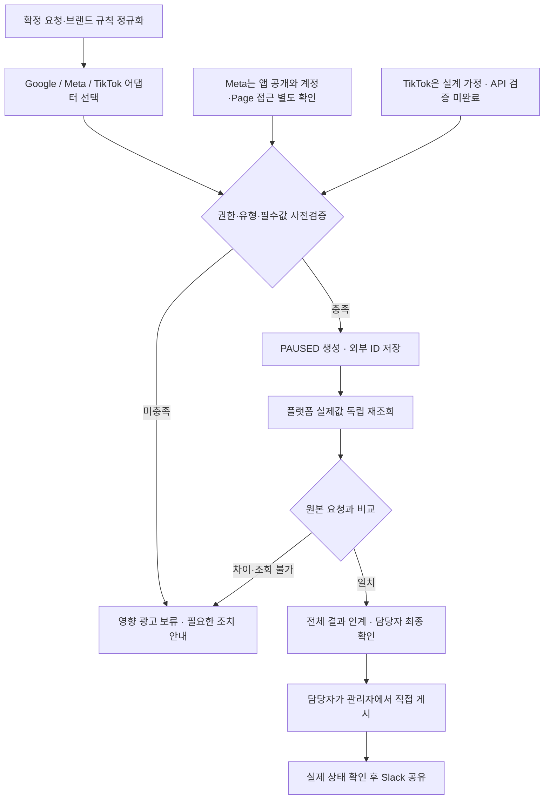

**사람의 승인이 곧 API 활성화 명령이 되는 구조는 이번 범위에 넣지 않는다.** 광고를 켜는 마지막 행위는 담당자가 광고 관리자에서 직접 수행한다. 검증 중에는 어떠한 광고도 활성화하지 않았다. 중복 키·생성 응답 유실 조회·부분 실패 복구·승인 시점 이후 변경 감지·지속 게시 관찰은 기존 §7~9의 개발·시험 요구로 남는다.

### Google 계정 계층과 유형별 객체 구조

OAuth 사용자의 접근 권한, 관리자 계정 컨텍스트(`login-customer-id`), 실제 작업 대상 광고주 계정(`customer_id`)을 분리한다. 테스트 계정의 `testAccount=true` 확인은 고객 운영 계정의 권한 승인을 대신하지 않는다. refresh token으로 access token을 새로 발급하고 재조회한 한 번의 성공이 장기 만료·철회 복구까지 증명하지는 않는다.

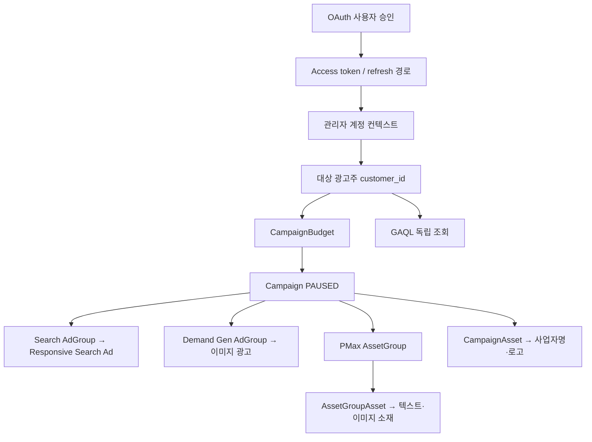

도식은 유형별 분기를 보여준다. 하나의 캠페인에 Search·Demand Gen·PMax를 함께 만드는 구조가 아니다. PMax의 사업자명·로고 연결은 이번 시험의 브랜드 설정 조건에서 캠페인 수준으로 구성했다.

| 유형·항목 | 실제 시험 범위 | 구현 시 적용할 조건 |
|---|---|---|
| Search | Campaign·AdGroup·광고 PAUSED, 제목 3개·설명 2개·final URL·UTM 재조회 | 광고그룹·광고 연결과 확정 문구를 개별 비교 |
| Demand Gen | Campaign·AdGroup·이미지 광고 PAUSED, 제목·설명·사업자명·정사각 이미지·로고·URL·UTM 재조회 | 영상 광고 성공으로 확장하지 않음. GAQL은 조회 가능한 세부 필드를 명시 |
| PMax | Campaign·AssetGroup PAUSED, 텍스트 6개·소재 연결 8개·사업자명/로고 캠페인 연결·URL·UTM | Search의 AdGroup/Ad 구조로 변환하지 않음. 소재그룹과 캠페인 소재 연결을 각각 대조 |
| 예산 | 세 캠페인 각각 10,000 KRW/일 = `10000000000` micros 저장·재조회 | 통화·단위 변환과 적용 계층 기록. Demand Gen에서 반환된 6,670 KRW 최소값은 해당 시험 조건의 오류이며 전 계정 공통 상수로 사용하지 않음 |
| 지역·언어 | Search/PMax는 캠페인, Demand Gen은 광고그룹 수준에 한국·한국어 설정·재조회 | 동일 업무 의미라도 유형별 설정 위치가 다름 |
| 키워드·일정 | Search exact 키워드 PAUSED, 월요일 09:00~18:00, 세 캠페인 종료일 2026-12-31 23:59:59·PAUSED 유지 | 계정 시간대 기준. 시작일 변경·전체 오디언스/타기팅 지원은 미검증 |
| 부정 입력 | 음수 예산 `validateOnly` 거부, 전후 조회에서 실제 예산 유지 | 오류를 보류 사유로 반환. 실제 변경 실패나 복구의 통과로 기록하지 않음 |

### Google 생성과 독립 재조회 순서

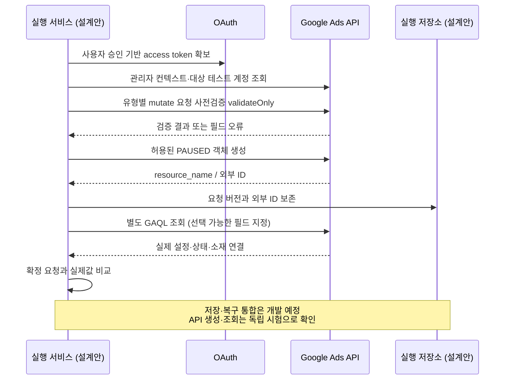

공식 구조 참고: [Demand Gen 생성](https://developers.google.com/google-ads/api/docs/demand-gen/create-campaign), [PMax 소재·브랜드 연결](https://developers.google.com/google-ads/api/performance-max/assets). 공식 설명과 시험 성공은 별개의 근거이며, 모든 옵션이 시험된 것으로 해석하지 않는다.

### Meta 인증과 광고 객체 구조 — 일반 계정 성공 경로

2026-10-28 새 일반 광고계정에서 최종 광고까지 생성하고 독립 GET으로 확인했다. 이전 sandbox 경로의 Page 오류는 과거 환경의 기록이며, 새 일반 계정의 성공이 과거 오류의 내부 원인 규명을 뜻하지 않는다. 앱 공개 상태, 토큰 권한, 광고계정 접근, Page 자산 사용 가능 여부는 별도 실행 조건이다. scope 목록이나 Page tasks만으로 광고 생성 권한을 추정하지 않는다.

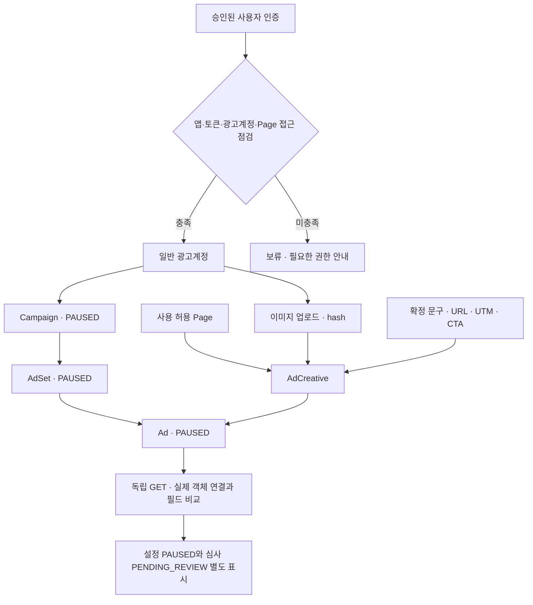

| 항목 | 2026-10-28 독립 조회 결과 | 해석·구현 규칙 |
|---|---|---|
| Campaign / AdSet | OUTCOME_TRAFFIC, 부모 객체 연결, PAUSED | 모든 목적·유형 지원으로 확대하지 않음 |
| 타기팅·일정 | KR, 25~54세, Facebook feed, 모바일·데스크톱, 시작·종료 일정 | 플랫폼이 추가한 location_types는 기본값으로 분리 |
| 예산 | 원시 daily_budget 문자열 10000 조회 | KRW 단위 환산은 별도 시험. 원시값과 통화·단위·정규화값을 함께 보관 |
| 이미지·creative | 600×600 이미지 hash, Page 연결, 한글 문구·제목·설명, LEARN_MORE, 랜딩·CTA URL·UTM 저장·조회 | 이름의 플랫폼 자동 접미사는 입력 불일치와 구분 |
| 최종 광고 | campaign/adset/creative 연결, status PAUSED, effective_status PENDING_REVIEW | 설정 중지와 심사 대기는 서로 다른 상태. 실제 게재·심사 승인 아님 |
| 성과 | insights data가 빈 배열, 계정 amount_spent는 별도 0 조회 | 빈 배열을 노출·클릭·지출 각각의 측정 0으로 변환하지 않음 |

### Meta 생성·재조회·담당자 인계 순서

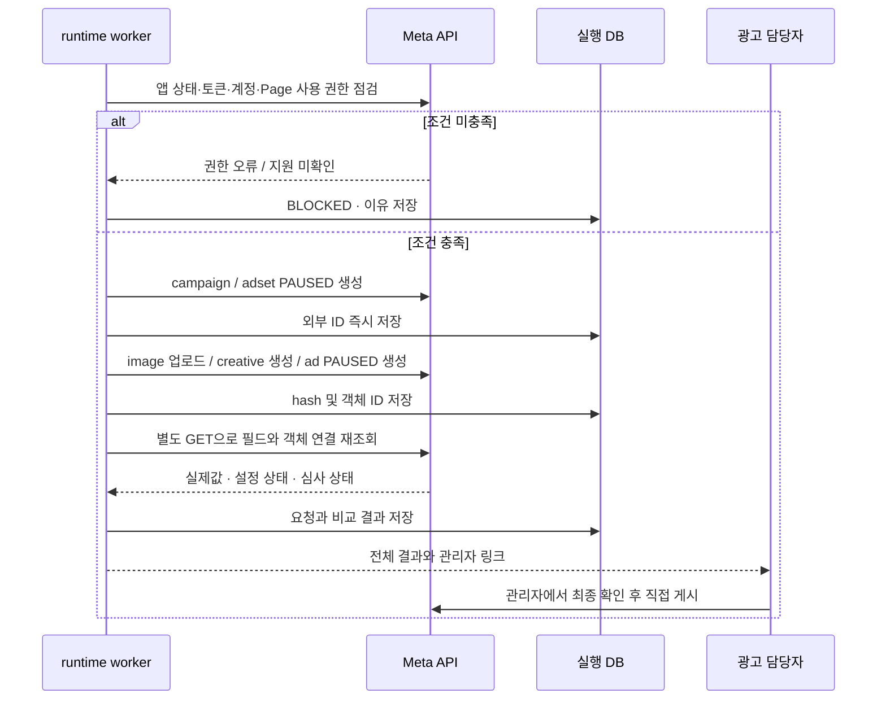

생성·독립 조회는 실제 검증이다. 위 runtime DB 기록·보류·복구·사람 인계는 앞으로 구현할 설계다. 자동 앱 공개나 API 활성화 도구는 기본 범위에 포함하지 않는다.

### 기존 시험 계약과의 연결

| 독립 API 증거 | 보완하는 시험 | 남은 인수 조건 |
|---|---|---|
| Google 유형별 생성·설정 재조회 | VT03·VT11의 부분 근거 | 운영 계정별 지원, 전체 필수 필드, Claude/Notion 통합 대조 |
| Meta 일반 계정 campaign/adset/image/creative/ad 및 URL/UTM 독립 조회 | VT03·VT09·VT11의 부분 근거 | 고객 계정 권한·통화 단위·전체 연동·실제 심사·게재·복구 |
| 음수 예산 validation 및 값 유지 | VT03·VT09의 부정 입력 일부 | 실제 변경 실패·부분 성공·응답 유실·중복 방지 VT05·06 |
| refresh token 재발급·재조회 | VT09의 인증 경로 일부 | 만료·철회·장기 운영·재개 및 사용자 권한 변경 |

VT01~13의 전체 인수 통과로 바꾸지 않는다. 영상 내용 판단·실계정 심사/게재/청구·게시 관찰/Slack·전체제품통합은 이번 API 증거로 검증되지 않았다.

### 개발 구성요소: 정책을 거치는 실행과 별도 선택 검사

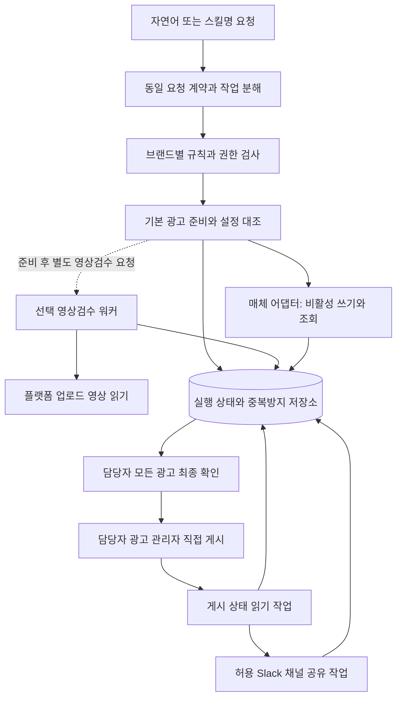

도식의 구성은 구현안이며 현재 가동 중인 서비스가 아니다. 게시 상태 읽기 작업은 광고를 활성화하는 경로를 갖지 않는다. 영상검수 요청 실패가 다른 브랜드의 독립 정상 광고를 자동 취소하지 않는다.

| 구성 | 책임 | 개발 전 확인할 계약 |
|---|---|---|
| 대화·스킬 라우터 | 두 진입 방식을 동일 정규화 요청으로 변환, 누락 질문 | 요청 언어·스킬명·규칙 버전이 같을 때 동일한 계획·차단 결과 |
| 정책 계층 | 사용자×브랜드×계정×행위 허용 확인 | 쓰기 도구 우회 차단, 허용되지 않은 기본값·계정 상속 금지 |
| 자료 어댑터 | Notion·Drive·허용 시트에서 출처 읽기 | 페이지/DB/필드 실제 확인, 파일 접근, 부분 조회 표시 |
| 매체 어댑터 | 필요한 조회·비활성 생성·허용 수정·재조회 | 매체×유형×계정×기존/신규 캠페인×추적 방식×묶음 규모별 시험 |
| 실행 저장·워커 | 작업 임대·중복 키·결과 불확실·재시도 보존 | 재시작·응답 유실·동시 요청 복구. 영구 저장 방식 확정 필요 |
| 영상 워커 | 요청된 플랫폼 영상의 접근·분석·근거 반환 | 읽을 수 있는 영상 범위와 변환본 식별·탐지 한계·비용 측정 |
| 게시 확인·알림 | 채팅 종료 후 대상 광고 상태 조회, 확인분만 공유 | 조회 주기·종료 시점·채널·전송 대조 지원 미검증 |

공식 MCP/API 우선 검토 후 필요한 공백만 별도 어댑터 후보로 둔다. 독립 REST/Graph 호출 증거를 공급자 MCP 지원 또는 이벤트·웹훅 지원으로 확장하지 않는다. 성공한 필드·유형은 API 검증 표에 한정한다. 공식 문서의 확인일·버전·대상 기능과 실제 계정 시험 결과를 별도로 저장해야 지원 목록에 올린다. 브라우저 예외는 자동 우회 수단으로 넣지 않으며 별도 허용·검증 전에는 수동 인계한다.

### 패키지와 참조 위치 제안

아래는 **구현 전 권장 폴더 구조**다. 실제 저장소·배포 경로가 존재하거나 선택됐다는 뜻이 아니며 기술 검증 후 조정한다. 브랜드 업무값·문서의 원본은 Notion/Drive에 유지하고 배포된 스킬 패키지에는 공통 실행 절차·검증 코드·매핑 계약만 둔다. 기존 `brand.md`가 있다는 근거는 없으며 새 수동 관리 파일을 필수로 만들지 않는다. 캐시가 필요하면 Notion의 확정 버전에서 생성한 읽기 전용 파생물로만 두고 출처·버전·생성 시각·만료를 기록한다. 캐시를 사람이 따로 수정하거나 두 곳을 수동 유지하지 않으며 원본 변경·권한 회수 시 무효화한다.

```text
wecarry-runtime/                  # 제안 이름
  skills/                        # SK01~08 목적·입출력·실패 계약
  rules/                         # 공통 실행 정책·검증 절차와 패키지 버전
  generated-cache/               # 필요할 때 Notion에서 생성한 읽기 전용 캐시
  reference-maps/                # Notion 실제 필드·Drive 위치 매핑
  adapters/                      # Notion·Drive·매체·Slack 연결 후보
  workflow/                      # 상태 전이·중복 키·재시도 정책
  workers/                       # 기본 준비·선택 영상·게시 확인·공유
  persistence/                   # 실행 저장 스키마·변경 이력 설계
  tests/                         # 계약·복구·브랜드 격리·인수 시험
  ops/                           # 권한 갱신·장애 대응·운영 가이드
```

| 연결 | 패키지에 두는 것 | 외부 기준·보안 경계 |
|---|---|---|
| SK01·02 → 규칙·브랜드 설정 | `skills/`의 공통 절차 버전과 Notion 브랜드·규칙의 확정 버전을 참조 | 문서 수정일로 최신 승인 버전을 추정하지 않음 |
| 브랜드 설정 → Notion | `reference-maps/`의 요청·제품·기획·확정값 필드 매핑 | 원문 값은 허용된 Notion 위치에서 읽음. 실제 필드 확인과 추가 속성 제안 분리 |
| 브랜드 설정 → Drive | 허용 폴더 참조키·소재 역할·파일 ID 대응 | 원본 파일 보존, 다른 브랜드 위치 자동 상속 금지 |
| SK03·04 → 실행·실제값 | `adapters/`·`workflow/`·`persistence/` 계약 | 매체 실제값 재조회, 실행 저장은 업무 원본을 대체하지 않음 |
| SK05 → 플랫폼 영상 | 영상 객체 참조·검사 규칙 버전·명시 요청 | 영상 바이트 접근·임시 보관은 허용된 범위만. 정답 샘플은 성능 시험에 사용 |
| SK07 → 채널·게시 기록 | 브랜드별 채널 참조와 게시/전송 중복 키 | 알림과 광고 권한 분리, 채널 불명확 시 보류 |
| 모든 연결 → 자격증명 | 비밀 저장소 참조키만 전달 | 위 트리·문서·소스에 토큰/비밀번호 저장 금지 |

<a id="prd-4"></a>
### wecarry-runtime 배포 경계와 책임

`wecarry-runtime`은 신규 개발할 실행 서버의 명칭이다. Claude 공통 Skill은 요청을 안내하고 MCP는 인증된 명령을 전달한다. 실행 서버는 권한·브랜드 규칙·작업 상태를 통제한다. 아래 기술 선택은 설계 제안이며 이미 운영 중인 환경이 아니다.

| 구성 | 배포·소유 제안 | 책임 |
|---|---|---|
| 공통 Skill | 위캐리 Claude 조직 | 2358works가 버전·릴리스·롤백 작성, 위캐리 관리자가 구성원 적용 |
| MCP endpoint / workflow API | 위캐리 소유 클라우드 계정의 별도 서비스 | 2358works 구축. 인증 주체·행위 권한·입력 schema 검증 |
| queue / worker | 같은 클라우드의 분리 프로세스 | 작업 임대·동시 실행 통제·재시도·재조회. 채팅 연결 종료와 독립 |
| PostgreSQL 등 관계형 실행 DB 후보 | 비공개 네트워크, 개발/시험/운영 분리 | 영속 ID·상태·시도 이력·outbox·백업. 제품 선정은 설계 결정 사항 |
| Secret Manager 후보 | 클라우드 비밀 저장소 | 토큰 암호화·최소 권한·회전. Notion/프롬프트/로그에 비밀값 저장 금지 |
| Notion / Drive | 기존 위캐리 업무 공간 | 요청·브랜드 규칙·소재의 기준 원본 유지 |
| 결과 화면 | 권한 있는 담당자용 읽기 UI 또는 합의된 Notion 위치 | 결과값·출처·관리자 링크 제공. 실제 화면 위치는 구현 시 확정 |

클라우드 비용·계정 소유는 위캐리, 최초 구축은 2358works를 제안한다. 공급자·지역·언어·SDK 버전·운영 담당·장애 대응 범위·보관 기간·RPO/RTO는 개발 설계 결정표에 책임자와 확정일을 기록한다. 장기 운영 계약은 별도 확정하며 이번 문서로 약속하지 않는다.

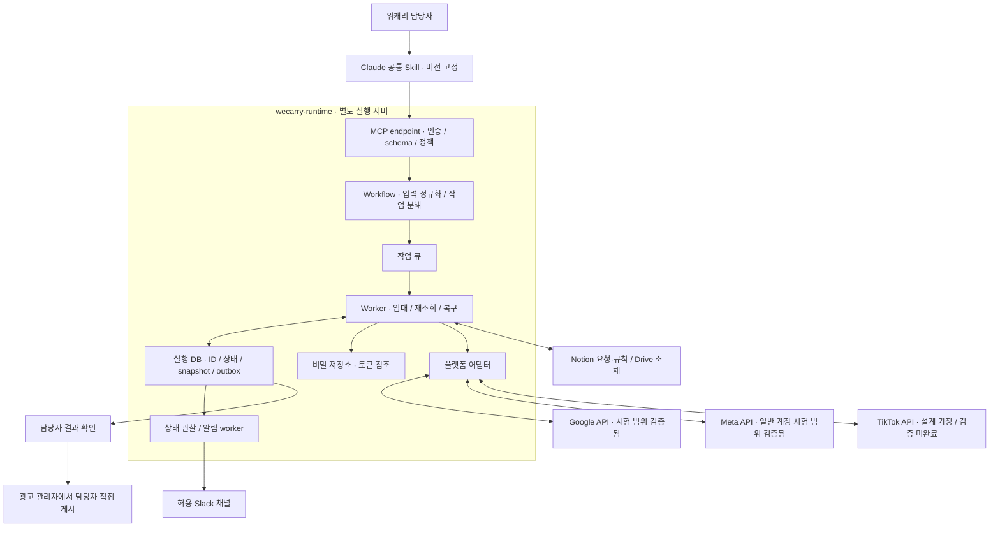

### 모듈과 기존 패키지의 대응

| 모듈 | 책임·입출력 | 기존 계약과 관계 |
|---|---|---|
| skills / mcp / contracts | 영문 스킬명, JSON Schema, 도구 응답, 버전 호환 | SK01~08을 사용자 호출과 내부 도구로 매핑 |
| policy / reference-maps | 인증 사용자→브랜드·계정 허용, Notion 속성 매핑 | rules는 실행 정책 코드. 브랜드 규칙 원본은 Notion |
| adapters/notion, drive, slack | 원본 조회·허용 필드 저장·파일 취득·알림 | Slack 전송은 광고 생성과 분리 |
| adapters/google, meta, tiktok | 정규화 요청을 매체별 객체·단위로 변환 | TikTok도 동일 인터페이스, API 검증은 미완료 |
| workflow / workers | 준비·대조·관찰·선택 영상·복구 | 자동 게시·활성화 작업 없음 |
| persistence / outbox / secrets | DB migration, 알림 이벤트, 비밀 저장소 참조 | generated-cache는 읽기 전용 파생물, 원본 대체 금지 |
| tests / ops / review-ui | 계약·오류 주입·배포·결과 확인 | §9 인수 증거와 연결 |

### MCP 인터페이스와 정규화 계약

다음은 구현할 도구 이름 제안이다. 실제 등록 API가 이미 존재한다는 뜻이 아니다. 요청의 actor_id나 계정명을 신뢰하지 않고 검증된 인증 세션에서 actor/tenant를 결정한다. 도구에는 활성화·게시 명령을 제공하지 않는다.

| 도구 | 입력 | 출력·부작용 |
|---|---|---|
| prepare_ads | request_ref, request_revision, brand_ref, skill_version, client_request_id | job_id, state=QUEUED, accepted_at. 접수 성공은 광고 생성 완료 아님 |
| get_job | job_id | 허용 사용자에게 광고별 상태·차이·확인 링크·다음 행동 반환 |
| submit_decisions | job_id, expected_revision, decisions[] | 허용 필드 결정만 반영. stale revision이면 거부하고 재확인 |
| register_brand | source_refs[], expected_revision, confirmed_patch | 초안→담당자 확인→허용 Notion 필드 저장→재조회·페이지 링크/버전 반환 |
| request_video_review | ad_refs[], media_version, checks[], consent_ref | 독립 video_job_id. 기본 prepare_ads에서 자동 실행하지 않음 |

`NormalizedAdSpec` 필수값: schema_version, tenant_id, brand_id, request_id/revision, ad_unit_id, platform(enum GOOGLE/META/TIKTOK), account_ref, campaign_ref 또는 신규 campaign_spec, objective, budget{decimal_string,currency,unit,scope}, schedule{start_at,end_at,timezone}, copy, assets[{file_ref,version,role}], landing_url, tracking, platform_settings, source_snapshot_id, rule_version, skill_version. 금액은 부동소수점 대신 십진 문자열/정수 최소단위를 쓰고 adapter가 단위 변환 근거를 기록한다.

필수값 누락은 null로 임의 실행하지 않고 BLOCKED로 반환한다. 선택 필드는 null의 의미를 계약에 지정한다. 조회 불가 값은 `observed=null, verification=UNVERIFIED, reason`으로 반환하며 일치나 0으로 바꾸지 않는다. 응답 envelope는 `{job_id, revision, state, items[], errors[], next_actions[], observed_at}`이다. 오류는 AUTH_REQUIRED, ACCESS_DENIED, INVALID_INPUT, UNSUPPORTED_TYPE, SOURCE_CONFLICT, STALE_REVISION, RATE_LIMITED, TRANSIENT_FAILURE, OUTCOME_UNKNOWN으로 구분한다.

어댑터 공통 메서드는 `preflight(spec)`, `create_paused(spec, attempt_context)`, `read_objects(external_refs)`, `compare(expected, observed)`, `observe_status(refs)`다. Google GAQL, Meta GET, TikTok 조회 응답을 공통 결과 모델로 변환하되 원시값·플랫폼 상태를 보존한다. URL/UTM의 저장 여부는 요청 로그가 아니라 독립 조회로 판정한다.

### 실행 DB 엔티티·키·버전

| 엔티티 | 핵심 필드·제약 |
|---|---|
| Job | UUID PK, tenant_id, request_ref/revision, skill/schema/rule_version, snapshot_id, state, created_at, updated_at |
| AdUnit | UUID PK, job_id FK, brand_id, platform, account_ref, normalized_spec, config_state, review_state, delivery_state |
| Attempt | UUID PK, ad_unit_id FK, operation, idempotency_key UNIQUE, lease_owner, lease_expires_at, fence_version, outcome, error_code |
| ExternalObject | platform/account_ref/type/external_id 복합 UNIQUE, ad_unit_id FK, parent_ref, first_seen_at |
| SourceSnapshot | UUID PK, source_refs, content_hash, source_version, captured_at. 실행 당시 확정 입력 보존 |
| CheckResult | ad_unit_id FK, field_path, expected, observed, verdict, source_ref, observed_at |
| StatusObservation | ad_unit_id FK, configured_status, effective/review_status, delivery_status, raw_payload_ref, observed_at |
| NotificationOutbox | event_id UNIQUE, tenant/brand/channel_ref, observation_version, payload_hash, state, slack_message_id, attempt_count |

한 요청의 브랜드가 섞여도 AdUnit별 브랜드·계정·채널 경계를 유지한다. SQL 조회와 worker에서 tenant scope를 강제한다. DB에는 비밀 저장소 참조만 둔다. 스냅샷과 원시 응답은 최소한으로 저장하고 접근·보관·삭제 정책을 인수 전 확정한다.

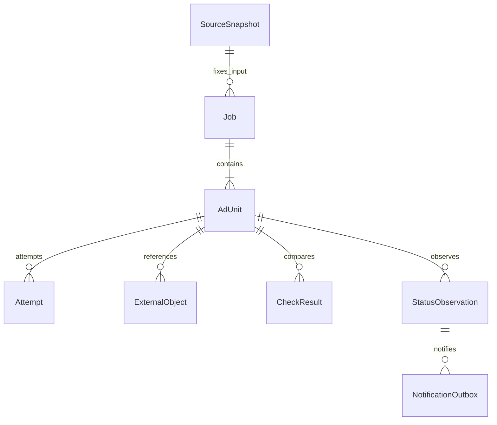

### 큐·멱등성·응답 유실·부분 실패 복구

큐는 중복 전달이 가능한 것으로 설계한다. worker는 DB 임대와 fencing version을 확보한 뒤 실행하고, 임대가 만료된 이전 worker의 상태 갱신은 거부한다. 멱등 키는 tenant+request_revision+brand+platform+ad_unit+operation으로 만들며 원본 변경은 새 revision이다. 플랫폼이 멱등 키를 지원한다고 가정하지 않는다.

생성 호출 전에 Attempt를 영속 기록하고 성공 응답의 외부 ID를 즉시 저장한다. 생성 후 응답을 잃으면 OUTCOME_UNKNOWN으로 전환한다. 외부 ID 또는 작업 식별자·시간·부모 객체 등 확정 가능한 조건으로 플랫폼을 조회한다. 유일하게 대응되면 연결하고, 없거나 여러 개이면 자동 재생성하지 않고 보류한다. 재조회 불가능한 플랫폼에서 무조건 재시도하는 구현은 불합격이다.

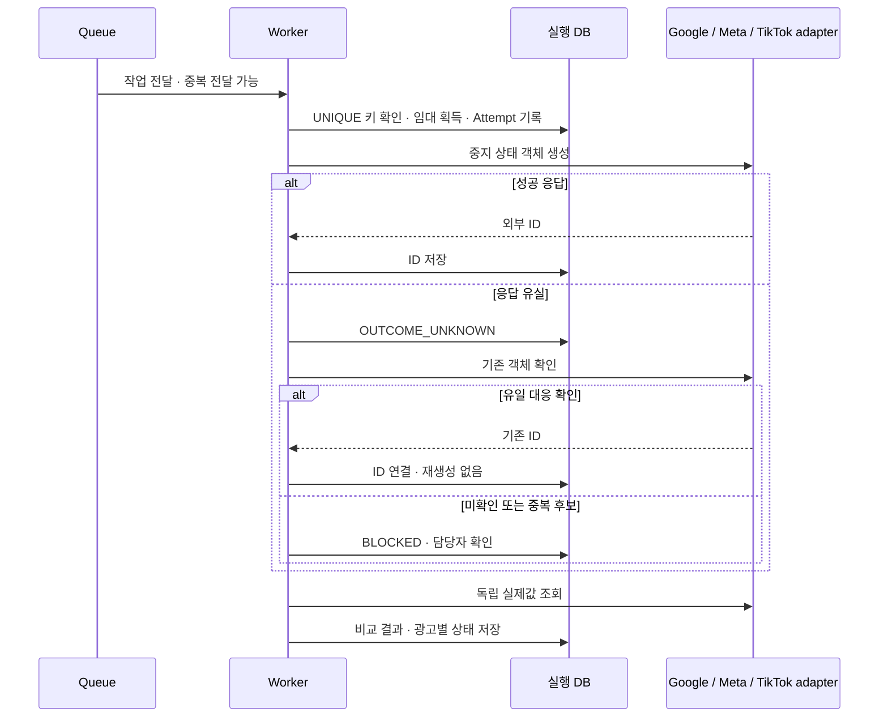

정상 광고는 유지하고 실패한 AdUnit만 복구한다. 입력·규칙·소재가 바뀌면 해당 unit을 STALE로 표시하고 새 입력으로 다시 대조한다. 과거 snapshot과 새 값을 조용히 섞지 않는다. 429/일시 오류만 지수 backoff+jitter 및 상한을 적용하고, 권한·정책·필수값 오류는 반복 재시도하지 않는다. 상한·관찰 주기·동시 작업 수는 실제 rate limit 시험 후 설정값으로 확정한다.

### 작업 상태·광고 상태·알림 상태의 분리

Job 접수/실행 상태, AdUnit의 기본 설정 검수, 선택 영상 검수, 플랫폼 설정/심사/게재, Slack 전송 상태는 서로 다른 필드다. Meta PAUSED/PENDING_REVIEW를 하나의 ‘게시 완료’로 합치지 않는다. 확인시각이 오래된 결과는 최신 상태처럼 표시하지 않는다.

상태 관찰과 알림은 별도 worker가 수행한다. 관찰 결과와 outbox 이벤트를 같은 DB transaction에 기록한다. event_id와 payload_hash로 중복 전송을 억제하고, Slack 응답 유실은 message_id/조회 가능한 근거로 대조한다. 확정할 수 없으면 알림 상태 미확인으로 남긴다. Slack 오류 복구는 광고 재생성·게시를 유발하지 않는다.

### 추가 인수 기준 — VT14~VT18

| ID | 시험·완료 증거 |
|---|---|
| VT14 입력·권한 계약 | 위조 actor/다른 브랜드 account_ref 거부, 누락·단위 오류 거부, 동일 snapshot/version 기록. 인증 주체와 프롬프트 분리 |
| VT15 중복·응답 유실 | 동일 입력 동시 제출, 생성 직후 응답 유실, worker 재시작을 주입. 외부 객체 중복 없음 또는 불확실 보류 증거 |
| VT16 부분 실패·버전 변경 | 한 unit 실패 시 정상 unit 보존. 재개 전 자료 변경은 STALE, 영향 unit만 재대조 |
| VT17 상태·알림 복구 | PAUSED/심사/게재 별도 표시. outbox 재시도·응답 유실에서 광고 무변경, 전송·미확인 구분 |
| VT18 세 매체 통합 | 실제 허용 고객 계정과 Notion/Drive→MCP→runtime→매체→독립 조회→담당자 인계→게시 후 Slack 증거. TikTok도 독립 시험 필요 |

VT14~18 및 고객 계정 권한·앱 심사·실제 심사/게재/성과·전체 연동·복구는 **개발 진행하면서 최종 검증 진행 예정**이다. 개별 API 시험의 통과를 이 인수 시험 통과로 기입하지 않는다. 실제 게시·광고비 발생 시험은 별도로 합의한 범위에서 담당자가 실행한다.


## 4. 데이터 책임과 입출력

**업무의 요청·확정 세팅값은 Notion 기준, 실행 상태·재시도는 별도 저장소 권장안**으로 분리한다. 실행 로그가 업무 기준을 임의로 덮어쓰지 않는다. Drive는 소재와 보조 문서의 원본이며 매체 실제값은 외부 광고 객체 재조회가 기준이다.

| 데이터 | 기존 조사로 확인한 것 | 새 설계 또는 추가 확인 | 책임 |
|---|---|---|---|
| Notion 업무 구조 | 브랜드·제품·업로드 요청·기획·제작 보드와 관계가 조사 18에서 확인됨 | 현재 DB/속성 ID·타입·관계·읽기 범위 재조회 필요 | 위캐리 업무 소유자, 2358works 매핑 검증 |
| 요청·세팅값 | 요청의 수량·매체·유형·파일 위치와 일부 기획/운영표 대응 확인 | 모든 값이 구조화된 기존 필드에 있다고 단정 금지. 실제 필드 매핑과 추가 속성 제안을 분리 | 위캐리가 확정, 시스템은 근거 읽기 |
| 확정·승인 근거 | 제작 상태·세팅 체크 등 서로 다른 상태 존재 | 확정자·효력 시점·변경 버전의 저장 위치는 제안. 기존 체크값을 승인/게시로 변환 금지 | 업무 확인자 |
| Drive 소재 | 고유 ID·경로 후보와 목록 대응 | 최종본·사용 허가·내용 동일성·현재 접근은 대상별 검증 | 소재 소유자, 어댑터 읽기 |
| 규칙·참조표 | 문서·시트·과거 지시·제안이 혼재 | 브랜드별 참조 등록부·적용 버전·충돌 처리 계약 추가 제안 | 위캐리 규칙 확인, 2358works 구조 관리 |
| 실행 로그·재시도 | 현재 운영 저장소가 확인된 것은 아님 | 작업/항목/시도/외부 ID/상태/중복 키를 지속 저장하는 권장안 | 2358works 개발·운영, 소유·비용 위캐리 방향 |
| 실제 광고·알림 | 목록 대응만으로 확인 불가 | 광고 실제값·게시 확인·Slack 메시지 ID를 각각 재조회 | 매체/Slack 원본, 시스템 조회 기록 |
| 자격증명 | 본 문서에 수집·복사하지 않음 | 별도 비밀 저장소의 참조키만 사용, 폐기·회전·접근 감사 설계 | 계정 소유자·허용 관리자 |

필드 매핑표는 `업무 의미 / 실제 DB·속성 / 원문 타입 / 관계 / 읽기 시각 / 확인 상태 / 추가 제안`으로 작성한다. 미조회 열은 공란 또는 미확인으로 두고 예시 필드명을 실제 스키마라고 표시하지 않는다. 추가 속성·DB 생성과 기존 표 자동 갱신은 별도 결정 전 시행하지 않는다.

### 브랜드 등록 위치와 저장 절차

기존 Notion 브랜드 DB를 우선 재사용하고 부족한 속성만 합의 후 확장하는 제안이다. 브랜드·제품 관계, 광고 계정 참조, 담당자, 허용 채널은 브랜드 DB에 연결하고 상세 규칙은 연결된 규칙 페이지에 원문 출처 링크와 함께 둔다. Drive 원본은 이동·복제하지 않고 참조한다. 실제 DB·속성 ID, 관계형 스키마와 쓰기 권한은 아직 확인·구현되지 않았다.

| 등록 항목 | 제안 저장 위치와 기준 원본 | 검증·버전 조건 |
|---|---|---|
| 브랜드·제품·요청 참조 | 기존 브랜드 DB와 제품/요청 관계 | 고유 참조, 대상 범위, 기존 중복 브랜드 대조 |
| 계정·담당자·채널 | 브랜드 DB의 계정 참조·담당자·허용 Slack 채널 속성 | 계정 소유자 권한, 매체·지원 유형, 실제 허용 채널 확인; 비밀값 제외 |
| 소재·문서 | Drive 원본 ID·허용 위치를 Notion에 연결 | 최종본·역할·사용 근거·읽기 시각; 파일명만으로 승인 추정 금지 |
| 브랜드별 규칙 | 연결된 Notion 규칙 페이지와 원문 링크 | 적용 제품/매체/기간·예외·확인자·확정 상태·효력 시각·규칙 버전 |
| 설정 변경 이력 | Notion의 합의된 버전·변경 기록 위치 | 설정 버전·변경자·사유·이전 값·확인 근거; 저장 위치도 합의 대상 |
| 공통 실행 절차 | 배포 스킬 패키지 | 스킬 릴리스 버전·검증 기록. 브랜드 업무 기준의 별도 원본으로 쓰지 않음 |
| 비밀·실행 상태 | 별도 비밀 저장소 / 별도 실행 저장소 | Notion에는 비밀 참조키만; 실행 로그는 확정 업무값을 덮어쓰지 않음 |

SK08 등록은 자료 읽기 → 등록 초안·누락/충돌 제시 → 담당자 내용 확인 → 합의된 Notion 위치에 허용 필드만 저장 → 재조회 → 저장된 페이지 링크·버전·변경 요약 반환 순서다. 확인은 자료 내용의 확정이며 DB 쓰기 권한을 자동 부여하지 않는다. 권한이나 스키마가 없으면 초안과 필요한 조치를 반환하고 저장 완료로 표시하지 않는다. 동시 변경은 읽은 버전과 비교해 보류하고, 응답 유실은 브랜드 고유키·등록 작업키·기존 페이지 재조회로 먼저 대조하여 중복 생성을 막는다. 재조회 실패 시 저장 결과 불확실로 남기며 링크 반환만으로 검증 완료 처리하지 않는다.

### 데이터 흐름: 업무 기준과 실행 기록의 분리

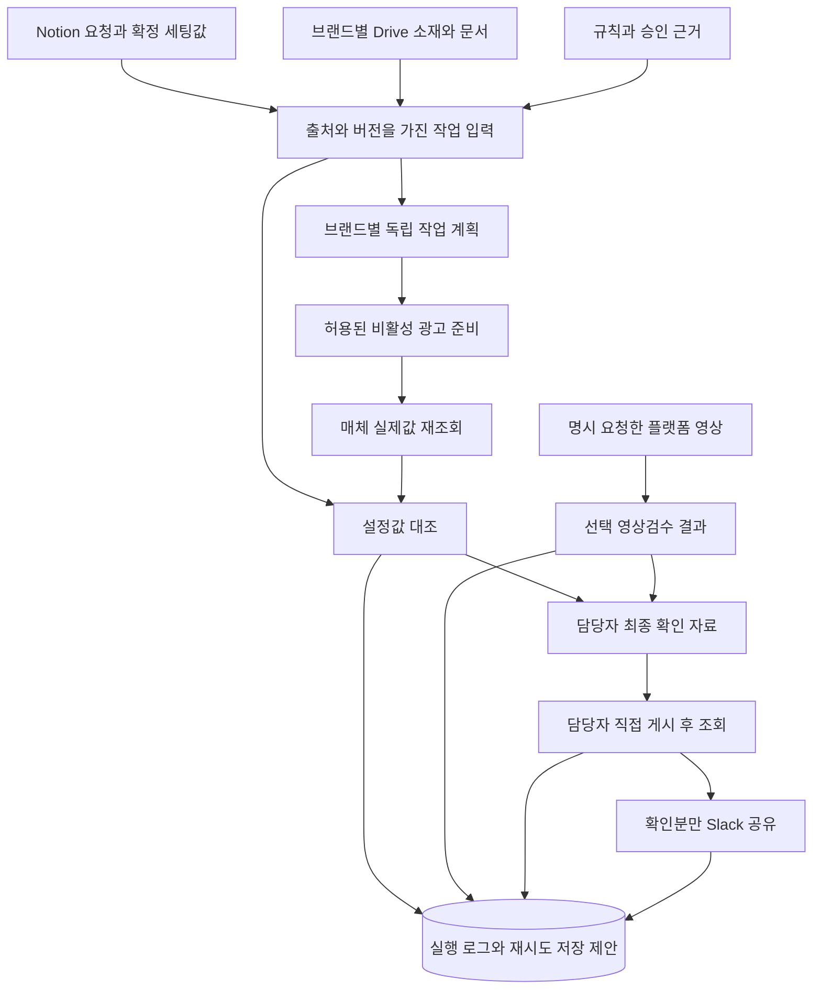

공통 입력 계약(신규 설계): `request_ref, request_revision, actor_ref, brand_ref, product_ref, account_ref, campaign_ref, item_refs, confirmed_settings_ref, rule_version, config_version, requested_actions`와 필수 참조의 읽기 시각·완전성. 식별자는 내부 승인 범위에서만 전달하고 로그 화면·고객 배포본에서는 비식별화한다. 빠진 계정·예산·최종본·권한을 모델이 추정하지 않는다.

공통 출력 계약(신규 설계): `job_ref, item_ref, skill_version, status, expected_values, actual_values, evidence_refs, observed_at, unknown_fields, next_action, retry_class, external_object_ref`. 선택 영상 결과는 `not_requested / queued / running / review_needed / inspected / failed / unavailable / stale`를 별도 필드에 보관한다. `inspected`는 요청한 검사 항목을 실행했다는 뜻이며 광고 사용 적합성·최종 승인과 동일하지 않다.

### 공통 결과 표시 계약

SK06은 아래 항목을 모든 상태에서 먼저 보여주고, 상태별 추가 내용은 그 뒤에 표시한다. Q14의 랜딩/UTM·AI 판단값·오류/확인 사항은 4/4, 처리 매체는 3/4의 응답이다. 식별·집계·대조·링크 필드는 이를 업무 결과로 구체화한 설계 제안이며 전원 합의 항목으로 표현하지 않는다.

| 필드 묶음 | 표시 계약 |
|---|---|
| 대상 | 브랜드·매체·계정·캠페인·광고명·소재의 광고별 대응 |
| 수량·진행 | 전체·진행 중·준비됨·보류 수와 나머지 상태별 수. 광고 항목을 중복 집계하지 않고 합계와 전체의 일치를 확인 |
| 요청과 실제 | 문구·랜딩/UTM·예산의 요청값·실제값·차이, 기준 자료·확인 시각. 예산 계층을 표시하며 공유 예산을 광고 수만큼 합산하지 않음 |
| AI 판단·변경 | 선택값·변경 전후 값·이유·근거. 실제 변경을 확인했을 때만 변경 또는 변경 없음으로 표시 |
| 확인 필요 | 오류·누락·사람 판단·영향 광고·다음 조치 |
| 연결 | 요청 원문·광고 관리자 링크. 허용된 독자에게만 제공 |

값의 상태는 `known / not_created / not_queried / unavailable / not_applicable`로 구분한다. 미생성·미조회·조회 불가·해당 없음을 빈값이나 정상으로 합치지 않고, 미확인 이유·후속 조치를 남긴다. 아직 없는 광고 관리자 링크와 실제값을 만들어내지 않으며 AI 변경 이력 미조회는 ‘변경 없음’이 아니다. 기존 `unknown_fields`에 이러한 구분을 보관한다. 상태별 결과와 선택 영상검수 상태는 이 공통 결과를 덮어쓰지 않는다.

<a id="prd-5"></a>
## 5. 스킬별 실행 계약

처음 사용하는 담당자에게는 스킬명으로 할 일을 고르는 방식을 권장한다. 자연어는 누락 질문에 답하거나 상황·예외를 설명할 때 함께 사용한다. 이는 진입 부담과 반복 설명을 줄일 것으로 기대하는 제안이며 효과를 실측한 결과가 아니다.

아래 스킬명은 **개발 제안 명칭**이다. 자연어 예시와 스킬명은 모두 같은 함수 계약·참조·권한 정책에 연결한다. 명시하지 않은 영상검수는 광고 준비 스킬의 숨은 하위 호출로 실행하지 않는다.

| 스킬·목적 / 자연어 예시 | 입력 → 출력 | 필수 참조 | 권한 | 실패·사람 판단 |
|---|---|---|---|---|
| SK01 `request_prepare` 요청 분해 / “이 요청의 광고를 준비해줘” | 요청 링크·범위 → 브랜드/광고별 계획·누락 목록 | Notion 요청·제품·브랜드·확정값 | 대상 읽기 | 연결 모호·자료 접근 실패는 영향 항목 보류. 최종본·새 예산 결정은 사람 |
| SK02 `brand_rules_resolve` 규칙 적용 / “이 브랜드 규칙을 확인해줘” | 브랜드·대상·시점 → 적용 규칙 버전·충돌 | 브랜드 Notion/Drive 참조 등록부·승인 근거 | 허용 참조 읽기 | 최신 수정일만으로 우선순위 결정 금지. 충돌하는 유효 지시는 확인자 판단 |
| SK03 `ad_prepare` 비활성 준비 / “확정값으로 광고를 세팅해줘” | SK01 계획·SK02 규칙·소재 연결 → 외부 객체 대응·생성 결과 | 확정 문구/링크/예산·계정 지원표·비집행 근거 | 허용 대상 비활성 생성/수정 | 비집행 보장 불가 시 쓰기 차단. 응답 유실 시 먼저 조회, 신규 타기팅·문구 후보 채택은 사람 |
| SK04 `settings_compare` 기본 대조 / “설정이 요청과 맞는지 확인해줘” | 확정값·대상 객체 → 일치/불일치/미확인·근거 | 실제 광고값·규칙/설정 버전·전체 입력 위치 | 조회, 허용 비활성 정정만 | 조회 불가를 통과 처리 금지. 정답이 있는 허용 오류만 수정·재조회, 표현 판단은 사람 |
| SK05 `video_review` 선택 영상검수 / “이 업로드 영상만 검수해줘” | 플랫폼 영상 ID·요청 검사 항목 → 구간·근거·수행 범위·미검증 | 플랫폼 결과·접근 허용·영상 버전·검사 규칙 | 해당 영상 읽기·분석 | 접근/전편 확인 불가 시 unavailable/부분 미검증. 원본 자동 대체 금지. 의도·표현·최종 사용은 사람 |
| SK06 `result_handoff` 최종 확인 인계 / “준비 결과를 보여줘” | 광고별 대조·영상 수행 상태 → 전체 목록·문제·판단·관리자 연결 | 요청·실제값·근거·시각·완전성 | 허용 결과 읽기 | 오래된 근거는 stale, 준비 완료 해제. 모든 광고의 최종 확인·게시 실행은 사람 |
| SK07 `publish_observe_share` 게시 확인·공유 / “게시한 결과를 확인하고 공유해줘” | 등록된 작업 대상·허용 채널 → 게시 확인분·전송 ID/미확인 | 게시 전 기준 상태·현재 실제값·브랜드 채널/양식 | 광고 읽기·지정 Slack 전송 | 게시 미확인 시 완료 전송 금지. 응답 유실 대조 후 알림만 재시도, 광고 재게시 금지 |
| SK08 `brand_register` 브랜드 등록 / “새 브랜드를 등록해줘” | 자료·계정 참조·확정 규칙 → 확인 초안·Notion 저장 재조회·페이지 링크·등록 버전 | 기존 지원표·브랜드 참조·채널·계정 권한 | 허용 등록 저장. 권한 부여는 계정 소유자 | 다른 브랜드 기본값 상속 금지. 위캐리가 설정 확인, 미지원 연동은 2358works 지원 요청 |

### 사용자 스킬명과 내부 실행 계약의 대응

아래 영문 이름은 보고서의 호출 예시이며 최종 설치 이름은 배포 시 확정한다. 기존 SK ID와 내부 함수명은 추적을 위해 유지한다. 이름을 입력했다고 설치·호출 성공으로 처리하지 않고 라우터가 지원 작업으로 해석한 뒤 동일 권한·필수값 검사를 수행한다.

| 사용자 호출명 | 내부 실행 계약 | 실행 결과·경계 |
|---|---|---|
| `brand-register` | SK08, 필요 시 SK02 | 초안 확인 후 허용 Notion 필드 저장·재조회, 링크·버전 반환. 대표 비활성 광고 시험 전 운영 가능 판정 금지 |
| `ad-prepare` | SK01 → SK02 → SK03 → SK04 → SK06 | 요청 분해·규칙 확인·비활성 준비·실제값 대조·전체 결과. SK05 자동 호출 및 광고 게시 없음 |
| `video-review` | SK05 → SK06 결과 갱신 | 명시한 영상·검사 범위만 처리, 미검수·부분 확인 구분 |
| `result-status` | SK06, 필요 시 SK07의 상태 조회 | 저장된 진행/공유 상태와 허용된 실제 조회. 조회 요청만으로 새 광고 생성·알림 재전송·게시 실행하지 않음 |

SK07 게시 관찰은 준비 작업에 연결된 별도 지속 실행이며, 상태 조회와 전송 재시도를 구분한다. 자연어 요청도 같은 실행 계약으로 연결한다.

SK03 안에서 기본 설정 대조(SK04)를 이어서 수행할 수 있다. SK07은 준비 시 등록된 작업의 수동 게시 결과를 채팅 재입력 없이 확인하는 지속 실행을 목표로 하며, 별도 호출은 상태 조회·복구 진입점이다. 운영 서비스가 준비되지 않았다면 이 목표는 미구현 상태로 표시한다. 요청·규칙이 변경되면 영향받은 입력과 결과의 버전을 함께 갱신하며 이전 기록을 덮어쓰지 않는다.

기본 검수는 소재 연결·문구·랜딩/UTM·계정·예산·자동 옵션 대조이고, 선택 검수는 요청한 영상의 검은 화면·자막 등 내용 확인이다. 영상 개수·길이·검사 범위에 따라 시간과 AI 사용량이 늘고 광고 준비·게시가 지연될 수 있어 필요한 영상과 항목을 선택하도록 한다. 증가 폭이나 비용을 검증 없이 단정하지 않으며, 의도된 장면·표현의 적합성은 사람이 판단한다. Q36의 업로드 시작 시 자동 검사 4/4 응답은 보고서 부록에 보존하며 선택 운영안을 고객 합의로 승격하지 않는다.

SK05 일상 검수에 정답 샘플 제출을 요구하지 않는다. 정답 샘플은 탐지 성능·오탐/미탐을 측정하는 VT04 시험용 자료다.

선택 영상검수의 1/5/20개 실측·시험 설계·증거 범위는 영상검수 실측 결과와 검증 계획 19 (내부 보존 문서)를 따른다. 2026-10-26 근거에서는 Drive 원본 후보 20개 확보, 38.741초 원본 1개 로컬 전처리 성공(11.146초: 다운로드·이전 실패·대기 제외), 표본 40장 및 수동 앱 입력용 19장 준비까지 확인했다. Claude 앱·CLI 호출은 각각 0회이며 토큰·모델 시간·내용 판정은 미측정, 5·20개 시험은 미실시다. 실제 차단점은 허용된 인증 앱 실행 경로와 포함 사용량·추가사용 차단 미확인이며, 실제 광고 ID 미확인은 원본 예비시험의 차단점이 아니다. 플랫폼 변환본 검증은 별도다. GUI 조작·영상/프레임 공개는 수행하지 않았다. 이 PRD는 수치·속도·비용·탐지율을 새로 산출하지 않는다. 문서 19는 내부 자료이며 고객 공개 HTML에 전문을 복제하지 않고 비식별 상태 요약과 허용된 첨부 경로만 제공한다. 로컬 파일 시험이 있다 해도 실제 플랫폼 취득·권한·변환본 접근·서비스 운영 검증과 구분한다. OCR·음성 싱크·표현 심사는 검증된 범위만 별도 표시한다.

<a id="prd-6"></a>
## 6. 규칙 버전과 브랜드별 참조 계약

기존 Notion 브랜드 DB를 재사용·확장할 브랜드 참조 등록부(신규 설계 제안)는 `브랜드 내부키 / Notion 요청·제품·기획 참조 / Drive 허용 위치·소재 ID / 운영표·링크 규칙 참조 / 광고 계정·지원 유형 / Slack 허용 채널 / 규칙 확인자 / 버전·효력 시점 / 접근 완전성`을 갖는다. 실제 ID와 원문 URL은 내부 권한 범위에서만 보관하며 본 공유 문서에는 고객별 값·민감 브랜드명을 싣지 않는다. 자격증명 값은 등록부에도 넣지 않고 별도 보관한다.

| 규칙 항목 | 필수 계약 |
|---|---|
| 선택·우선순위 | 브랜드·제품·매체·적용 대상·효력 시점·예외·승인 상태를 비교. 기존 광고는 참고이며 새 요청 확정값을 자동 덮어쓰지 않음 |
| 명명·파일 | 원래 이름과 경로 보존. ID·버전·번호·용도로 대응. 원본/프록시/수정/시딩/참고본을 구분하며 새 입력 양식 강제 없음 |
| 문구·링크 | 스크립트·장면 메모와 실제 광고 문구 분리. 소재별 일반/별도 랜딩과 추적 코드 유지, UTM 미사용도 허용 |
| 표 해석 | 색상 범례·탭·취소선·일정의 근거 보존. 다른 표에 범례 전파 금지, 예정일은 게시 증거가 아님 |
| 버전 저장 | 스킬 버전·규칙 버전·브랜드 설정 버전·요청 버전을 분리, 변경자·근거·차이·효력 시각 보관 |
| 변경 적용 | 실행 전에 읽은 버전과 현재 버전 비교. 소재·URL·예산·권한·사용 조건 변경 시 영향 광고의 준비 완료 해제·재대조 |
| 롤백 | 검증된 이전 스킬/설정 버전으로 후속 작업 복구 가능성을 시험. 최신 확정 요청을 무시하거나 운영 광고를 자동 되돌리지 않음 |

필수 자료 접근 실패, 페이지 일부 미열람, 목록 상한은 자료 부재·승인 없음의 증거가 아니다. 필요한 항목만 보류하고 담당자에게 필요한 위치·권한·결정을 묶어 전달한다.

<a id="prd-7"></a>
## 7. 분리 상태와 복구

업무 준비, 선택 영상검수, 담당자 판단, 외부 게시/심사/노출, 알림, 기존 기록 갱신 상태를 분리한다. 묶음 상태는 항목 상태의 집계이며 한 항목 실패로 정상 광고를 삭제·재생성하지 않는다.

### 분리 상태전이: 광고 준비·선택 영상·게시 알림

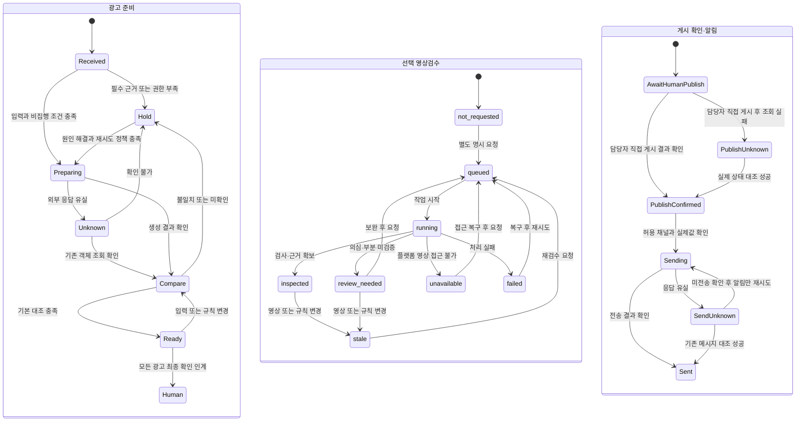

세 영역은 독립 저장 상태이며 연결되지 않은 시작점은 자동 병렬 실행을 뜻하지 않는다. Video는 명시 요청 시에만 실행한다. 영상검수 미실행 표시를 유지한 채 기본 대조 완료 결과를 인계할 수 있지만, 사람이 모든 광고의 최종 확인을 생략할 수는 없다. 요청된 영상검수에서 unresolved 경고·미검증이 남으면 해당 항목의 사람 판단과 근거를 남긴다. 외부 심사/노출 상태는 Notify 완료로 덮어쓰지 않는다.

| 실패·변경 | 복구 규칙 | 보존·차단 |
|---|---|---|
| 필수값·권한·최종본 불명 | 영향 광고 보류, 질문을 모아 담당자에게 전달 | 정상 독립 항목 진행, 다른 브랜드 값 대체 금지 |
| 비집행 보장 불가 | 해당 유형 자동 쓰기 차단·수동 인계 | 생성 후 사람이 확인하는 방식으로 완화 금지 |
| 명확한 일시 오류 | 횟수·간격·종료 한계를 설정하고 허용 항목만 재시도 | 한계 미정이면 무한 반복 금지, 담당자에게 복구 필요 표시 |
| 생성 응답 유실 | 계정·대상·작업 키·외부 ID를 대조, 존재 확인 후 이어가기 | 확인 전 재생성 금지. 확인 불가 상태 보존 |
| 일부 광고 실패 | 광고별 성공/실패/불확실 분리, 영향 항목만 재처리 | 정상 광고·원본 파일·운영 광고 보존 |
| 설정·규칙 변경 | 영향 결과 stale 처리, 준비 완료 해제, 재대조 | 과거 승인을 새 값에 적용하지 않음 |
| 게시 확인 실패 | 조회 상태·마지막 확인 시각·다음 조치 표시 | 게시 완료 알림 금지, 실제 게시 여부 추정 금지 |
| Slack 실패·응답 유실 | 메시지 존재 대조, 미전송 확인 후 알림만 재시도 | 광고 재게시 금지, 불확실 시 재전송 보류 |

중복 키는 브랜드·계정·요청 버전·항목·행위 단위로 설계하고 외부 객체 대응을 함께 저장한다. 동시 실행의 잠금/작업 임대, 중복 요청의 기존 결과 반환, 재시작 후 미완료 작업 복원은 시험 대상이다. 외부 서비스에서 무조건 정확히 한 번 처리된다고 약속하지 않는다.

<a id="prd-8"></a>
## 8. 권한·운영·지원

| 역할 | 책임·허용 경계 |
|---|---|
| 현재 광고 세팅 담당 | 기본 최종 확인자. 요청·확정값·소재 확인, 모든 광고 최종 확인·직접 게시·기존 기록 유지 |
| 브랜드별 Slack 채널 확인 담당 | 현재 사용하는 채널과 허용 독자·양식을 확인하여 연결 |
| 신규 브랜드 등록 담당 | 팀장이 신규 브랜드 추가·정보 관리를 맡는 기본안을 제안하며 위캐리 확인 전 미확정. 등록 초안·자료·설정 및 저장 결과 확인 |
| 위캐리 계정 소유자/관리자 | 대상 계정·자료·Slack 권한 부여·회수, 신규 사용자·브랜드 범위 확인 |
| 규칙 충돌 결정·갱신 담당 | 기존 업무 분담에서 적용 기준을 결정할 사람과 확정 규칙을 갱신할 사람 확인. 같은 사람이 맡을 수 있음 |
| 2358works 개발/지원 | 스킬·어댑터·실행 저장·지원표·검증·장애 복구 절차. 업무 정책을 대신 확정하지 않음 |
| 시스템 | 호출자의 허용 범위와 행위 제한 내 실행. 관리 권한이 광고 게시 권한으로 자동 확대되지 않음 |

위 역할은 광고마다 별도 인원을 추가하라는 요구가 아니다. 기존 업무 분담과 승인 절차를 우선 적용하고, 비어 있는 등록·공유·규칙 관리 책임을 확인한다.

권한 매트릭스는 읽기, 비활성 생성, 비활성 정정, 설정 등록, 게시 조회, Slack 전송을 별도로 둔다. 광고 활성화/ON·OFF 변경과 삭제는 자동 실행 도구에서 제외한다. 직접 쓰기 도구가 정책 계층을 우회할 수 있다면 노출을 차단하고 지원 범위를 축소한다. 비밀은 별도 저장하고 토큰·비밀번호·임시 서명 URL·원문 민감 자료를 문서·로그·고객 메시지에 출력하지 않는다.

운영 인수물은 지원 행렬, 브랜드 등록 가이드, 권한 갱신/회수 절차, 재시작·재시도·수동 인계 절차, 알림 지연/실패 확인법, 보관·삭제 정책, 비용 책임, 장애 연락·지원 시간이다. 호스팅·서비스 계정·지역·백업·복구 목표·보관 기간·재시도 수치는 고객/운영 담당과 확정할 항목이며 이번 문서에 임의 수치를 넣지 않는다. 계약 종료 표지만으로 자료 삭제·광고 OFF를 실행하지 않는다.

### Slack 게시 결과 메시지 계약

Q38의 매체별 세트명·일예산 형식을 바탕으로 Q39 추가 요구를 반영한다. R2·R4는 현행 형식으로 충분하다고 했으며, R1의 관리자 연결 정보와 R3의 재처리·값 차이·AI 판단·시각 요구를 짧은 요약과 상세 링크로 제공한다. 모든 항목이 전원 합의라는 뜻은 아니다. 고객 예시는 [보고서 §6](16_위캐리_설문영상_통합분석_보고서_v1.23.md#example-slack-results)을 따른다.

| 메시지 영역 | 필드·생성 조건 |
|---|---|
| 공통 요약 | 브랜드·매체·캠페인/세트, 실제 예산과 적용 단위, 요청 수·게시 확인 수·미게시 수·미확인 수, 실제 상태 확인 시각 |
| 변경·AI 판단 | 변경 전후 값·이유·기준 자료와 AI가 선택한 값. 변경이 없다고 확인된 경우에만 ‘변경 없음’; 조회 실패는 미확인 |
| 문제·재처리 | 해당 광고·문제·다음 조치, 재처리 수행 여부와 결과. 정상 건을 다시 게시하지 않음 |
| 연결 | 허용된 광고 관리자 링크·상세 결과 링크. 미생성/조회 불가 링크는 원인과 확인 경로 표시, 임의 URL 생성 금지 |
| 상세 결과 | 문구·랜딩/UTM·요청/실제 설정과 대조 근거는 상세 결과에서 광고별 확인. 공개 채널에 민감한 내부 자료 링크를 자동 첨부하지 않음 |

게시·심사·실제 노출은 별도로 표시한다. 전체 게시 예시는 요청 4개=Meta 2개+Google 2개, 부분 게시 예시는 Meta 5개 중 게시 확인 3개·미게시 2개로 일관되게 집계한다. 미확인 광고는 미게시로 추정하지 않는다. Meta 세트 일예산과 Google 캠페인 일예산의 실제 적용 계층을 표기하고 광고 수만큼 합산하지 않는다. 영상 의심 구간은 별도 검수 수행 근거가 있을 때만 표시한다.

브랜드별 허용 채널이 없으면 전송을 보류한다. Slack 오류는 메시지 존재 확인 후 알림만 복구하며 광고를 재게시하지 않는다. Notion 기록과 Slack 전송은 독립 상태로 관리한다. 예시 금액·광고명은 가상이며 실제 Slack 전송 증거가 아니다. 고객용 [FAQ](16_위캐리_설문영상_통합분석_보고서_v1.23.md#faq)는 보고서를 참조한다.

<a id="prd-9"></a>
## 9. 시험과 인수 계약

아래는 **시험 계획**이다. VT01~13 전체 인수 시험은 미완료다. API 검증 절의 독립 증거는 VT03·09·11 등의 일부 기술 근거이며, 제품 통합·전체 시험 통과를 대신하지 않는다. 영상19의 별도 실측도 전체 기능 인수를 대체하지 않는다. 공통 사전조건은 허용된 자료·정답 목록·시험 담당자·지원 후보·복구 방법이다. 실계정 쓰기·실제 게시·Slack 전송 시험은 대상 계정·예산·기간·채널·허용 행위가 별도 승인된 이후에만 수행한다. 모의 시험, 제한 계정 시험, 실제 운영 파일럿 결과를 구분한다.

| 시험 ID·목적 | 사전조건·담당·입력 | 기대 결과·통과 증거 | 차단·복구 |
|---|---|---|---|
| VT01 진입 동일성 | 개발+위캐리 검수자; 동일 요청을 자연어/스킬명으로 제시, 같은 버전 고정 | 동일 광고 계획·권한 차단·규칙 선택·영상 미실행. 두 실행의 정규화 결과 비교 | 다른 계약이면 라우터 수정 후 재시험 |
| VT02 자료·브랜드 격리 | 개발+자료 확인자; 단일/복수 브랜드, 단일/복수 캠페인, 누락·권한 없음·모호한 파일·표 범례 | 정답 목록대로 광고별 연결, 허용 밖 데이터 미노출, 불완전성·질문 보존. 연결표·접근 로그 | 영향 항목 보류, 접근·확정 근거 확보 후 해당 항목만 재개 |
| VT03 생성·실제 설정 | 개발+광고 담당; 비집행 검증 계정·정답 문구/URL/예산/타기팅·자동 옵션·복수 입력 위치 | 실제 반영값 일치 또는 미확인 명시, 상위 ACTIVE/공유 예산 불변, 허용 오류 수정 후 재조회. 전후 조회 증거 | 비집행 보장 실패는 쓰기 제외; 미조회 필드는 합의한 수동 대조 근거 없으면 보류 |
| VT04 선택 영상·플랫폼 | 분석 담당+검수자; 명시 요청한 플랫폼 영상, 정상/오류/의도된 장면, 1/5/20개 조건은 19 | 실행/미실행/접근불가 분리, 근거 구간·미검증·오탐/미탐 기록, 기본 흐름에서 자동 실행 0건. 결과·범위 대조 | 플랫폼 취득 불가 시 미검증; 원본 대체는 별도 지원 시험, 사람의 표현 판단 유지 |
| VT05 부분 실패·중복 | 개발; 정상/실패 혼합·동시 중복 요청·응답 유실·워커 재시작 | 정상 객체 보존, 기존 외부 결과 대조 후 재시도, 중복 생성 없음. 작업/객체/시도 로그 비교 | 외부 존재 불명 시 보류, 확인 뒤 실패 항목만 재개 |
| VT06 변경·취소·버전 | 개발+업무 확인자; 준비 후 파일/URL/예산/규칙/권한 변경·취소 | 영향 준비 완료 해제·stale·재대조, 이전 승인 재사용 없음. 변경 이력과 영향 대상 비교 | 운영 광고 자동 변경 없음, 취소 대상 쓰기 중지·권한 복구 후 재확인 |
| VT07 사람 확인·게시 | 위캐리 담당+개발 관찰자; 정상·문제·영상 미실행·미생성·미조회·해당 없음 광고 혼재, 정답 집계·변경 이력, 승인된 게시 시험 | 공통 결과의 모든 필드·상태·집계 및 실제값/차이/이유/시각/검사 범위 확인 가능, 미생성·미조회·해당 없음 구분, AI 변경 미조회는 미확인. 도구 활성화 없음, 사람 직접 게시 기록 | 최종 확인자·게시 시험 권한 미정이면 인계 단계까지만 확인 |
| VT08 게시·Slack | 개발+위캐리 채널 담당; 일부 게시·심사 중·설정 변경·채팅 종료 | 대상 광고의 확인분만 짧은 요약·필요 링크로 전송, 상세 결과 분리, 기존 브랜드별 허용 채널 적용, 브랜드 분리, 중복 없음. 게시 조회+메시지 ID·내용 대조 | 미확인 필수값·채널 오류는 전송 보류, 광고 변경 없이 알림 복구 |
| VT09 운영 장애·권한 | 운영+개발; 연결 만료·조회 지연·Slack 응답 유실·저장 복구·정책 우회·삭제 요청·미지원 UI 변경 | 만료 차단·알림 불확실 보존·복구 후 중복 방지·비밀 미노출·삭제 거부·미지원 UI 수동 인계. 실패/복구/접근 로그 | 지원 담당 인계, 영구 저장 복구 확인 전 불확실 작업 재실행 금지 |
| VT10 신규 브랜드 | 위캐리 담당; 공통 연동 준비·자료/계정 권한 확보·검증된 유형, 개발자 사전 브랜드 설정 없음 | 직접 초안 등록→담당자 확인→합의된 Notion 쓰기→재조회·페이지 링크/버전 반환→대표 광고 비활성 준비·대조. 읽기 전용 생성 캐시의 원본 버전 일치·무효화, 다른 브랜드 혼용 없음. 실습·저장/재조회 기록 | 최초 연동/권한은 선행조건으로 분리; 미지원은 VT11 경로 |
| VT11 지원 경계 | 2358works; 매체×유형×계정×캠페인×추적×규모 후보와 공식 자료 | 기능별 문서 확인일·계정 시험·지원/제약/미지원/미검증 표, 수동 경로·책임 기록 | 문서만 확인되면 실지원 미검증, 필수 지원 부족 시 일정·범위 영향 보고 |
| VT12 업무 인수·부담 | 위캐리 실무자+검수 책임자; 유사 조건 전후 대표 실제 업무·정상/예외 포함, AX 교육 실습과 문제 대응 안내 | 반복 확인·개입·복귀 이유·체감 부담·연결 정확성·수동 잔여 업무 기록, QC 오류 보완·재확인, 스킬 요청/결과 확인/신규 브랜드 등록/문제 대응 실습 증거와 고객 인수 결정 | 목표/표본 미합의면 효과 미검증, 기술 통과를 고객 인수로 대체 금지 |

### VT13 · 공동 배포와 요금제 적합성 시험

동일 권한을 가진 두 테스트 구성원에게 동일 스킬 배포본·모델 설정·확정 입력·브랜드 규칙을 제공하고, 독립된 시험 작업에서 대상 계정·소재·문구·URL·예산·검수 상태를 비교한다. 준비 광고의 비활성 상태를 유지한다. 답변 표현이 달라도 확정 설정과 필수 검사 결과는 같아야 한다. 동일 작업 키 재호출은 기존 결과로 연결되어 중복 생성되지 않아야 한다.

스킬 비활성·버전 변경·권한 부족·사용량 제한을 시험 또는 모의 장애로 확인한다. 필수 검사를 건너뛰거나 잘못된 완료를 반환하면 실패다. 공유 스킬 업데이트가 다음 사용에 반영되는지, 실행 중 입력/규칙 버전이 보존되는지, 외부 객체 재조회 후 복구되는지 기록한다. 테스트 구성원 두 명은 기술 시험 조건이며 고객에게 실습 담당자 1명을 지금 지정하라는 요청이 아니다.

대표 작업의 모델·처리 수량·검사 범위·사용량·제한 도달·복구 결과와 좌석/API/서버 비용을 구분해 기록한다. Claude 앱에서 토큰 수를 확인할 수 없으면 미측정으로 남기고 사용량 표시를 정확한 토큰값으로 환산하지 않는다. Standard의 기능 충족과 실제 처리 용량이 확인되기 전 운영 요금제 적합성은 미검증이다. VT13도 현재 미실행 계획이다.

기존 C01~C58과 FR-01~19·D01~13·M01~13는 대응표 (내부 보존 문서)에 유지·변경·대체를 기록한다. 옛 자동 활성화 시험을 이번 합격 조건으로 재사용하지 않는다. 설정 대조는 일치 항목/전체 필수 항목과 미조회 수, 탐지는 오류 정답별 탐지/미탐과 정상 오탐을 분리한다. 영상 검사 미실행은 탐지율 분모에 실행 완료로 포함하지 않는다.

광고 준비 소요시간·사람 직접 작업시간은 현 발표 필수 KPI에서 제외한 기존 결정을 유지한다. 과거 8개 KPI 정의는 이전 문서에 보존한다. 이번에는 반복 확인·개입·오류/재작업·묶음 연결·부분 실패 복구·게시 후 공유·신규 담당자 수행·체감 부담을 평가하며 목표·표본·허용 지연은 미합의다. 영상 1/5/20개 실측은 검사 구성 검증용으로서 고객의 작업시간 절감·서비스 SLA를 증명하지 않는다.

<a id="prd-10"></a>
## 10. 미팅 결정과 개발 착수 조건

### 위캐리에서 정할 네 가지 안건

| 안건 | 확인할 제안 | 관련 요구 |
|---|---|---|
| 요청 시작 방식 | 스킬명 중심으로 시작하고 자연어도 지원하는 방식이 괜찮은지 | M14·VT01 |
| 영상 검수 | 기본 설정 대조는 유지하고 영상 내용 검수는 별도 요청하는 방식이 괜찮은지 | M07·VT04 |
| 광고 최종 확인·게시 | 현재 광고를 세팅하는 담당자가 확인 후 직접 게시해도 괜찮은지. 기존 팀장 승인 절차가 있다면 유지 | M05·VT07 |
| 신규 브랜드 추가·관리 | 팀장이 신규 브랜드 정보를 추가·관리하는 기본안이 괜찮은지 | M13·VT10 |

**개발 후 QC에서 시연할 브랜드와 광고를 요청드릴 예정입니다. 구체적인 준비 사항과 진행 방법은 개발을 진행하면서 다시 안내드리겠습니다.** 지금 담당자 1명 지정을 요구하지 않는다.

### 2358works의 개발 준비와 내부 확인 항목

기존 M01~13은 추적용으로 보존하되 위의 고객 안건과 구분한다. 업무 기준·규칙 충돌(M02~04·M11), 채널·기록 매핑(M08·M12), 지원·운영 환경(M01·M06·M10·M13), 인수 시험 준비(M09)는 개발팀이 기존 자료·권한·계정 지원과 대조해 준비한다. 필요한 기술 요구를 삭제하지 않으며, 이미 고객에게 요청한 새 담당자 지정이나 미팅 결정으로 표현하지 않는다. 기존 자료로 해결되지 않는 개별 권한·업무 판단은 대상과 영향을 제시해 확인한다.

고객 합의 기록에는 결정 대상·선택안·결정자·근거·시각·유효 범위를 남긴다. 사전 미팅 동료 의견과 고객 결정을 다른 항목으로 저장한다. 문서 v1.7 번호는 구현 완료나 범위 승인 번호가 아니다.

개발 착수 전 필수 결과물은 업무 기준 매핑·권한표·지원 검증 계획·비집행 조건·운영환경 권장안·예외 담당과 인수 계획이다. 실제 자동 쓰기 착수는 별도의 제한 계정 검증과 허용 범위가 충족되어야 한다. 신규 브랜드 직접 등록, 게시 확인·Slack까지 포함하는 첫 납품 요구를 조용히 축소하지 않고 미지원·보완·일정 영향을 명시한다.

### 개발 전에 확인할 자료 범위

아래는 조사 18의 2026-10-23 기록을 인계한 내부 개발 사전점검이다. 이번에 전수 재조회한 결과가 아니며 고객에게 조사량을 성과로 제시하지 않는다.

| 근거 범위 | 확인한 내용 | 개발 사전점검·한계 |
|---|---|---|
| 공유 Drive 25개 | 루트 포함 폴더 위치 12,495개, 항목 목록 165,984개 | 12개 폴더 1,000개 상한; 전체 파일 내용·최종본·사용 허가 검토 미완료 |
| Notion 주요 DB 5개 | 브랜드·제품·업로드 요청·기획·제작 보드, 7,477개 레코드 본문 수집 | 43개 페이지·44개 미지원 블록 부분 미확인. 현재 DB/필드/관계/권한 재확인 필요 |
| 요청 4건의 후보 대응 | 요청 수량 4/6/3/3과 각 폴더 파일 목록 대응 | 승인본·실제 광고 연결 증거 아님. 요청별 문구·URL·승인·광고 실제값 대조 필요 |
| 접근 공백 | 과거 목록 밖 733개 ID 404, 특정 현재 계획표 403 기록 | 삭제나 자료 부재로 단정 금지. 필요한 대상의 현재 접근·위치부터 확인 |
| 최신 원본 시험 후보 | 2026-10-26 요청·폴더 5개, 4/6/3/3/4 합계 20개 개별 메타데이터 확인 | 과거 네 사례와 범위·시점이 다름. 상위 표시 경로 전체 유일성·승인·실제 게재 미확인 |

자료 접근·규칙 충돌은 먼저 내부에서 기존 출처와 대조하고 해결되지 않은 대상·영향·필요 권한만 고객에게 묻는다. 영상 원본 1개 전처리 성공은 이 접근 공백이나 자료 전체 의미 검토를 해소하지 않는다. 신규 등록용 실제 스키마, 연결된 규칙 페이지, 계정·담당자·채널의 허용 범위, 생성 캐시 정책, 인증 앱 경로와 사용량 확인을 착수 산출물로 남긴다.

### 전체 프로젝트 일정과 운영 전환

보고서 §8의 6주 계획은 합의한 시작일 기준의 계획안이며 과거 완료 실적이 아니다. 1~2주차 업무 분석·요구사항 협의, 2주차 말 범위·운영 방식 확정, 3~4주차 기능 개발·연동, 4주차 말 주요 기능 중간 시연, 5주차 실제 업무 QC·오류 보완, 6주차 AX 교육·최종 확인·운영 전환으로 구성한다. 실제 날짜와 범위·권한·연동 지원에 따른 조정은 별도로 합의한다.

개발 후 정상·예외 실무 사례로 VT 시험을 수행하고 오류를 보완·재확인한다. AX 교육은 스킬 요청, 결과와 미확인 항목 확인, 신규 브랜드 등록, 문제 대응을 실습한다. VT12 인수와 운영 조건 충족 후 전환하며, 일정 경과만으로 통과시키지 않는다. 보고서의 `wecarry-gantt` JSON이 시각화 원본이며 마일스톤은 해당 주 말에 표시한다.

<details>
<summary>이전 버전과 자료 사용 경계</summary>

- PRD v0.9 (내부 보존 문서)는 과거 요구·C15~58·M01~13 원문을 보존한다.
- v2.1 기준안 (내부 보존 문서)은 FR-01~18·AT-01~20 원문이다. 당시 확정 표기가 이번 고객 합의·현재 지원 증거는 아니다.
- 검증 준비 계획 (내부 보존 문서)은 C01~08, 미팅팩 (내부 보존 문서)은 C09~14 원문이다.
- 고객 설명·FAQ는 보고서 v1.23을 사용하고 내부 기술 세부를 반복하지 않는다. 도식은 개발자용 구성·데이터·상태 계약이며 고객 보고서의 업무 흐름과 구별한다.
- 시각 산출물의 기본은 `assets/brand/README.md`와 `report.css`의 검증된 2358works 기준이다. 이번 개정은 검증된 로컬 브랜드 스타일을 유지한다. 시각 구조·로고를 새로 설계하지 않는다. HTML 검수 기록은 산출물 재생성 안내와 상태표에 남긴다.

</details>

## 개정 이력

- 2026-10-28 · Codex · v1.7: 보고서 v1.23 정렬. wecarry-runtime 배포·모듈·계약·큐/DB·복구·인수 상세화, 세 매체 도식과 Meta 일반 계정 최종 광고·URL/UTM 성공 반영. 공개 자료실·별도 PDF 제공. v1.6 보존.

- 2026-10-27 · Codex · v1.6: 사용자 Page 권한 조회 성공과 sandbox creative 실패를 구분. 원인 미확인 유지. v1.5 보존.

- 2026-10-27 · Codex · v1.5: Meta 공개 완료와 Page 접근 오류1341012 반영. 공통·Meta 도식의 두 gate 분리. v1.4 보존.

- 2026-10-27 · Codex · v1.4: 보고서 v1.17 정렬. Google 20/20·추가14/14, Meta Campaign/AdSet/이미지 및 Page 연결·creative 앱 모드 차단, TikTok 확인 중을 반영. 공통 실행·Google/Meta 객체 구조와 시퀀스 도식 5개 추가. 독립 시험과 제품 설계·통합 인수 구분. v1.3 보존.

- 2026-10-27 · Codex · v1.3: 보고서 v1.15와 동기화. 사용자 영문 스킬→내부 SK 계약, Slack 공통·변경·문제·링크, 네 가지 고객 안건과 내부 준비 분리, QC 안내, Claude Team 역할·최소 요금·배포 통제·VT13 추가. 공식 안내 확인과 실계정 구현·검증을 구분. v1.2 보존.

- 2026-10-26 · Codex · v1.2 신규: 기본·선택 검수 이유, 공통 결과 필드·미확인 구분과 VT07·08·12, 기존 담당 기준 역할·짧은 Slack, 향후 게시 요청 제외 및 6주 운영 전환 계획을 보고서 v1.10과 정렬. v1.1·영상19 v0.2 보존, 새 영상 시험·기능 구현 없음.

- 2026-10-26 · Codex · v1.0 신규: 개발 구조·스킬 계약·Notion 업무 기준/실행 저장 분리·규칙 버전·상태 복구·권한·인수를 중심으로 재편. 자연어/스킬명 동등 계약과 고객 시작 방식 선택 추가. 영상검수를 기존 플랫폼 업로드 영상 대상의 별도 요청형 선택 스킬로 변경하고 기본 자동 검수를 제거. 기존 문서 보존, 구현·실계정 미착수.

- 2026-10-26 · Codex · v1.1 신규: 기존 Notion 브랜드 DB 재사용·확장과 규칙 페이지/Drive/스킬 패키지/비밀 분리, 확인 후 저장·링크 반환·읽기 전용 캐시 계약 추가. 초보자 시작 방식 권장과 영상 원본 전처리의 측정 경계 반영, 내부 조사 한계를 개발 사전점검으로 배치. v1.0과 기존 파일 보존, 구현·권한 설정 미실행.
