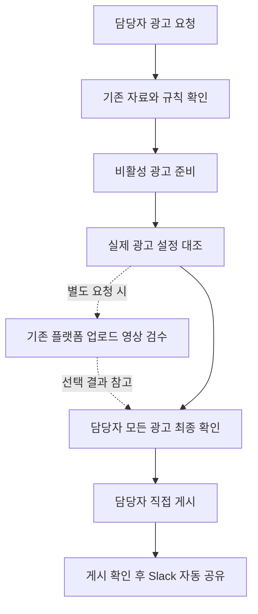
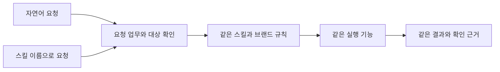
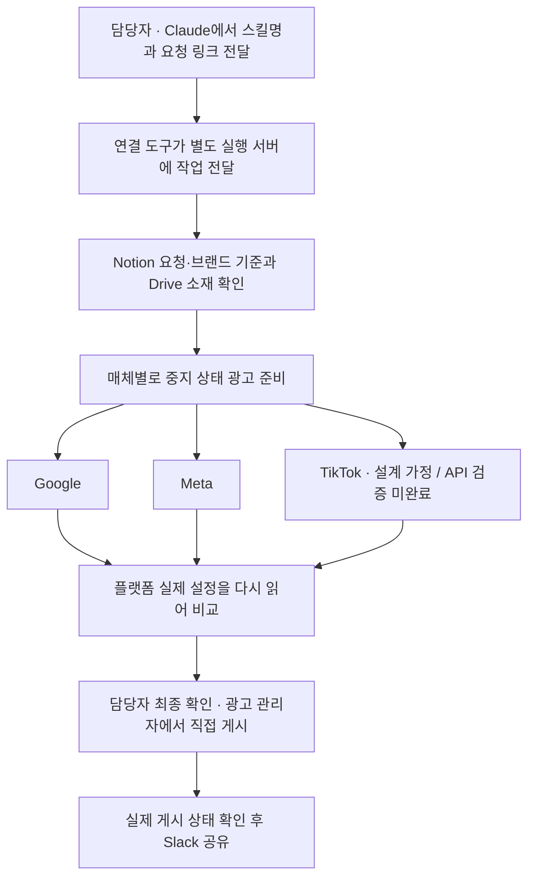
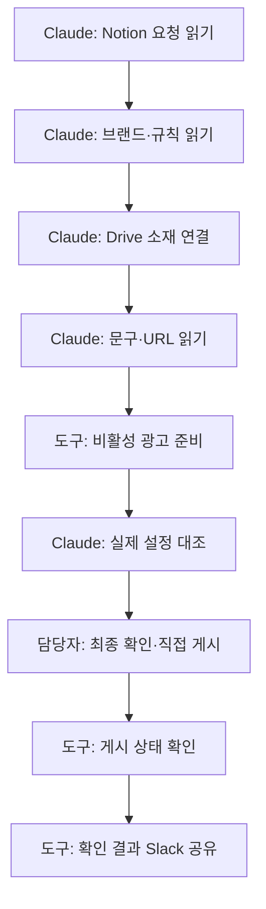

# 위캐리 광고 업무 개선 보고서 v1.23

- 문서 상태: **고객 검토용 · 고객 승인 전**. 사전 리뷰는 동료 의견이며 고객 합의가 아닙니다.
- 구현·실측 상태: **Google·Meta API 비활성 생성·재조회 정상 작동 확인 · TikTok 심사 요건 등의 사유로 확인 중 · 제품 통합·영상 내용검수 미검증**.
- 설문 기준: 제출 순서 R1~R4, 46문항입니다. Q40의 세 순위가 각각 열로 펼쳐져 응답은 48열입니다. v1.7의 2026-10-26 인증 조회 기록 기준 4응답이며 당시 폼은 `Live`였습니다. 분석 대상 수와 기술적 접수 종료는 별개입니다.
- 작성: Codex · 2026-10-28
- 근거: 기존 v1.7에 기록된 설문 4명·46문항, Meta·Google·TikTok 업무 시연 5편, 2026-10-23 Notion·Drive 자료 조사. 이번 개정은 이 근거와 사용자 방향, 2026-10-26 원본 후보 조사·전처리 시험 기록을 반영한 제안입니다.
- 관련 문서: [개발 PRD v1.7](https://kyle92-kr.github.io/wecarry-meeting-docs/prd.html), [리서치 상세 자료](https://kyle92-kr.github.io/wecarry-meeting-docs/research.html), [설문 원문 응답](https://kyle92-kr.github.io/wecarry-meeting-docs/survey.html), [전체 자료·PDF 다운로드](https://kyle92-kr.github.io/wecarry-meeting-docs/). 이전 버전은 자료실의 보존본에서 확인할 수 있습니다.

## 1. Claude가 광고 준비를 맡아 반복 입력과 확인 부담을 줄입니다

<div class="conclusion-callout">

**광고마다 자료를 찾고, 설정을 입력하고, 제대로 반영됐는지 확인하는 일이 반복됩니다. Claude가 자료 확인부터 광고 준비와 설정 대조까지 맡고, 담당자는 판단이 필요한 내용을 확인한 뒤 준비된 광고를 최종 검토하고 직접 게시하는 흐름을 제안합니다.**

</div>

### 업로드 시간뿐 아니라, 같은 내용을 반복 확인하고 작업을 계속 지켜보는 부담을 줄입니다

**담당자가 세팅 과정 내내 붙어 있기보다, 필요한 판단과 마지막 확인에 집중할 수 있게 하는 것이 목표입니다.** 영상 내용 검수는 필요한 경우 별도로 요청하고, 광고에 소재·문구·링크·예산이 맞게 들어갔는지 확인하는 기본 검수는 유지합니다. 담당자가 게시한 광고의 실제 상태가 확인되면 Slack에 자동으로 공유하도록 개발합니다.

| 확인한 부담 | 근거 | 개선 방향 |
|---|---|---|
| 요청·기획·링크·소재를 여러 곳에서 찾음 | Q15~19: 시작 자료 2~3곳, Notion·링크 시트 사용 4/4. 영상 G 00:00–00:25, T1 02:00–02:50 | 기존 자료 링크를 받아 필요한 정보를 연결 |
| 광고별 복제·입력·수정을 반복 | Q9·12: 전체 과정과 물량의 부담. M1 03:15–05:00, M2 00:50–02:45 | 공통값을 재사용하고 광고별 소재·문구·주소의 차이는 유지 |
| 복제 후 값과 자동 옵션을 다시 확인 | Q17: 문구 누락·랜딩 불일치 경험, Q26: 자동 옵션 문제 경험 4/4 | 요청값과 실제 설정을 대조해 차이와 미확인 항목 표시 |
| 완료까지 계속 확인해야 함 | Q14·42: 결과 정보와 최소 개입에 대한 기대 | 진행 상태를 남기고 판단이 필요한 내용만 모아 질문 |

설문은 응답자의 경험과 기대, 시연은 해당 작업에서 관찰한 사실입니다. ‘다른 업무에 집중하기 쉬워질 것’은 기대효과이며 달성 여부는 이후 파일럿으로 확인합니다. 전체 46문항과 응답자별 차이는 부록에 보존했습니다.

## 2. Claude가 광고를 준비하면 담당자가 최종 확인하고 직접 게시합니다

아래는 **개발할 흐름**입니다. 영상 검수를 요청하지 않아도 기본 광고 준비는 진행하며, 영상 검수 미실행은 결과에 그대로 표시합니다.

| 단계 | 맡는 일 |
|---|---|
| 자료 확인 | Claude가 기존 요청·자료를 읽고 브랜드·캠페인별로 나눕니다. 부족하거나 충돌하는 내용만 질문합니다. |
| 광고 준비 | 연결 도구가 게시하지 않은 상태로 광고를 준비합니다. 소재·문구·URL·계정·예산을 광고별로 연결합니다. |
| 기본 설정 대조 | 실제 반영된 설정과 요청을 비교합니다. 명확한 입력 오류는 허용 범위에서 수정·재확인하고, 판단이 필요한 건은 담당자에게 보여줍니다. |
| 최종 확인·게시 | 담당자가 모든 광고의 상태와 근거를 확인한 뒤 광고 관리자에서 직접 게시합니다. |
| 게시 후 공유 | 게시 확인 기능이 실제 결과를 확인한 광고만 지정 Slack 채널로 자동 공유합니다. 심사 중·실제 노출 여부는 구분합니다. |

### Claude가 광고 설정을 대조하고, 담당자가 요청할 때만 영상 내용을 검수합니다



한 브랜드의 단일·복수 캠페인, 여러 브랜드의 묶음 요청을 첫 납품 방향에 포함합니다. 대상 매체는 Meta·Google·TikTok이며, 매체별 계정·광고 유형·처리 규모의 지원은 시험으로 정합니다. 복수 브랜드 요청과 Slack 자동 공유는 사용자 방향이며 설문 전원의 합의로 해석하지 않습니다.

### 새 브랜드가 생기면 기존 자동화에 추가해 사용할 수 있도록 개발합니다.

<div class="onboarding-callout">

지원 범위 안의 신규 브랜드는 위캐리가 개발자의 도움 없이 기존 자동화에 추가할 수 있도록 개발합니다. **아래는 앞으로 만들 등록 절차와 저장 구조이며, 현재 구현되었거나 저장이 완료되었다는 뜻은 아닙니다.**

담당자가 “신규 브랜드 추가해줘”라고 요청하고 기존 Notion·Drive 자료 링크를 전달하면, Claude가 브랜드 설정 초안을 정리하도록 합니다. 담당자가 계정 참조 정보·담당자·공유 채널·적용 규칙을 확인하면, Claude가 합의한 Notion 위치에 저장하고 해당 페이지 링크를 돌려주는 방식입니다. 이어서 접근 권한과 지원 범위를 확인하고 대표 광고를 비활성 상태로 준비·대조해 실제 사용 가능 여부를 확인합니다. 필수 정보가 빠지거나 서로 다르면 저장·사용 전에 담당자에게 확인합니다.

</div>

| 저장할 정보 | 제안하는 저장 위치와 사용 방법 |
|---|---|
| 브랜드·광고 계정 참조 정보·담당자·공유 채널 | 기존 Notion 브랜드 DB를 재사용하고 필요한 속성을 확장합니다. 계정 참조 정보는 계정을 구분할 이름·ID·관리자 링크이며 로그인 비밀정보가 아닙니다. |
| 브랜드별 문구·링크·예산·자동 옵션 규칙 | 브랜드 DB에 연결한 Notion 규칙 페이지에 출처·적용일·확인 상태와 함께 정리합니다. Claude가 광고 준비 때 해당 브랜드 규칙을 읽도록 합니다. |
| 영상·이미지·기획 문서 원본 | 기존 Drive 위치에 유지하고 Notion에는 필요한 원본 링크를 연결합니다. |
| 브랜드 등록·광고 준비·설정 대조의 공통 절차 | 함께 배포할 스킬 패키지에 담습니다. 브랜드별 값은 공통 절차에 복사하지 않고 Notion에서 읽도록 합니다. |
| 비밀번호·인증 토큰 등 접속 비밀정보 | 브랜드 DB·규칙 페이지·스킬 본문에 넣지 않고 별도 인증·비밀정보 저장 방식으로 관리합니다. 구체적인 방식과 권한은 개발 시 정합니다. |

기존 자료에서 알 수 있는 정보를 새 양식에 다시 쓰도록 요구하지 않습니다. 다른 브랜드의 계정·URL·추적 코드·공유 채널이 섞이지 않도록 확인합니다. 새로운 매체·미지원 광고 유형·새 광고 또는 추적 시스템 연결은 2358works가 개발·시험 범위를 검토합니다. 등록 절차의 독립 수행 가능성은 납품 시험으로 확인하며, 등록 자체가 광고 게시를 뜻하지는 않습니다.


<details class="appendix example-accordion" id="example-brand-registration">
<summary>예시 | 신규 브랜드는 어디에 무엇을 등록하나요?</summary>

담당자는 코드를 수정하는 대신 기존 Notion·Drive의 브랜드 자료를 연결합니다. **최초 공통 연동과 등록 기능은 개발팀이 만들고, 위캐리는 검증된 지원 범위 안에서 신규 브랜드를 추가하는 방식입니다.** 아래는 기존 자료 구조에 추가 개발할 설정 영역을 연결하는 제안이며, 현재 등록 기능이 구현됐거나 저장 위치가 확정됐다는 뜻은 아닙니다.

| 출처·등록 위치 | 등록하거나 연결할 내용 | 담당자가 확정할 사항 |
|---|---|---|
| 기존 Notion 브랜드 DB의 새 브랜드 항목 | 브랜드명·담당마케터·부재 시 담당자·진행상태·자사몰·Drive·운영표/회의록 링크 | 브랜드 담당과 자료 위치. 현재 없는 속성은 필요한 범위에서 확장할지 협의 |
| 기존 Notion 제품 DB의 새 제품 항목 | 제품명·브랜드 관계·기획 및 제작자료 연결 | 제품이 어느 브랜드에 속하는지와 사용할 자료 |
| 기존 브랜드 Drive 폴더 | 영상·이미지와 최종본을 찾을 위치, 사용할 파일 링크 | 파일별 용도와 최종 사용본. 원본 이동·복제를 필수로 요구하지 않음 |
| 기존 브랜드별 운영표 | 제품별 랜딩·매체별 계획·일정·운영 기준 | 이번 업무에 유효한 기준. 기존 표를 재사용 |
| 기존 Notion 업로드 요청 | 제품·매체·소재명/유형·수량·파일 링크·담당자·이번 요청 내용 | 이번에 준비할 광고 범위 |
| 브랜드 설정·규칙 연결 페이지 — 추가 개발 | 매체별 계정 참조값·지원 광고 유형·명명/랜딩/추적 규칙·확인자·적용 시점·규칙 버전·Slack 허용 채널 | 해당 브랜드에 적용할 규칙과 공유 채널. 저장할 Notion 위치와 필드는 개발 시 확정 |
| 요청별 확정값 영역 — 추가 개발 | 대상 캠페인·목적·예산/적용 단위·기간·최종 문구·파일별 랜딩/추적·매체별 설정 | 이번 요청에 실제 적용할 값. 저장할 Notion 위치와 필드는 개발 시 확정 |

브랜드별 정보는 **기존 Notion 브랜드 DB와 연결 페이지에 저장하는 안**입니다. 별도의 `brand.md` 파일을 고객이 만들고 함께 관리해야 한다는 뜻은 아닙니다. Claude가 쓰는 공통 업무 절차는 스킬 패키지에 두고, 브랜드별 자료와 규칙은 연결된 Notion·Drive에서 읽도록 합니다.

계정 소유자는 자료와 광고 계정의 실제 연동 권한을 부여합니다. 광고 관리자 주소를 입력하는 것만으로 권한이 생기지는 않습니다. 비밀번호·인증 토큰은 업무 페이지에 적지 않고 별도 비밀정보 저장 방식으로 관리합니다. 미지원 매체·유형이나 새로운 시스템 연결은 개발팀이 검증합니다.

**등록 요청 예시 — 스킬명으로 시작하는 방식을 기본으로 안내합니다**

아래 두 문장은 같은 업무를 요청하는 예시입니다. `brand-register`(브랜드 등록)와 `ad-prepare`(광고 준비)는 설명용 영어 스킬 이름이며, 최종 이름과 호출 방식은 구축 시 정합니다. 스킬 이름 뒤에도 대상과 자료 링크를 함께 전달합니다.

| 요청 방식 | Claude에게 보낼 메시지 예시 |
|---|---|
| 스킬명으로 시작 — 기본 안내 | **brand-register:** 브랜드 A를 추가해줘. 브랜드 페이지 [링크], 제품 [링크], 소재 폴더 [링크], 운영표 [링크]야. 우선 Meta만 사용할 예정이야. 자료를 읽고 빠진 설정을 정리해줘. |
| 자연어로 시작 | 신규 브랜드 A를 등록해줘. 브랜드 페이지 [링크], 제품 [링크], 소재 폴더 [링크], 운영표 [링크]야. 우선 Meta만 사용할 예정이야. 자료를 확인해서 빠진 설정을 정리해줘. |

Claude가 자료를 읽고 누락·충돌을 포함한 초안을 보여주면 담당자가 내용을 확인합니다. 이후 허용된 Notion 필드에 저장하고 다시 읽어 확인한 뒤, 저장된 페이지 링크와 버전을 돌려주도록 개발합니다. 대표 광고를 비활성 상태로 준비하고 설정을 대조한 브랜드부터 사용합니다.

**등록 확인 후 광고 준비 요청 예시**

| 요청 방식 | Claude에게 보낼 메시지 예시 |
|---|---|
| 스킬명으로 시작 — 기본 안내 | **ad-prepare:** 이 [업로드 요청 링크]와 연결된 확정값으로 비활성 광고를 준비해줘. 빠진 값은 모아서 알려주고, 준비 후 실제 설정과 비교해줘. |
| 자연어로 시작 | 이 [업로드 요청 링크]와 연결된 확정값 기준으로 광고를 비활성 상태로 준비해줘. 빠진 값은 모아서 알려주고, 준비 후 실제 설정과 비교해줘. |

브랜드 등록이 광고 게시를 뜻하지는 않습니다. 준비된 광고의 최종 확인과 직접 게시는 담당자가 수행합니다.

</details>

### 광고 API 시험에서 확인한 범위

**Google과 Meta 모두 API를 통한 비활성 광고 준비와 실제 설정 재조회가 정상적으로 작동하는 것을 확인했습니다. Google은 테스트 계정에서 Search·Demand Gen·PMax를, Meta는 신규 일반 광고계정에서 캠페인·광고세트·소재 구성·최종 광고 생성과 URL·UTM 저장까지 확인했습니다. TikTok은 심사 요건 등의 사유로 확인 중입니다.**

| 매체 | 2026-10-28 기준 확인 결과 | 개발 진행 중 최종 검증할 내용 |
|---|---|---|
| Google | Search·Demand Gen·PMax의 비활성 생성·재조회. 설정 비교 20개, 추가 타기팅·일정·상태 비교 14개 통과 | 실제 고객 계정 권한, 운영 환경과 Claude·Notion 통합 |
| Meta | 신규 일반 광고계정에서 캠페인·광고세트·이미지·소재 구성(creative)·최종 광고 생성과 독립 재조회 성공. URL·UTM 저장 확인, 비활성 상태 유지 | 실제 고객 계정 권한, 광고 심사·게재, 운영 환경과 Claude·Notion 통합 |
| TikTok | 심사 요건 등의 사유로 **확인 중** | 실제 API 인증·생성·조회 |

Google은 2026-10-27, Meta는 2026-10-28 독립 API 시험 결과입니다. Meta 광고는 비활성 상태로 생성됐으며 매체 심사는 대기 중입니다. 실제 고객 계정 권한·심사·게재·성과와 전체 연동·복구는 개발 진행하면서 최종 검증할 예정입니다. 담당자가 최종 확인한 뒤 광고 관리자에서 직접 게시하는 흐름을 유지합니다.

## 3. 자동화 업무는 스킬 이름으로 시작하는 방식을 제안합니다

스킬은 ‘광고 준비’처럼 자주 하는 업무의 절차를 묶어 둔 것입니다. **두 방식 모두 같은 실행 기능과 같은 브랜드 규칙을 사용합니다.** 달라지는 것은 요청을 시작하는 방식입니다.

아래는 같은 실무를 두 방식으로 요청한 제안 예시입니다. `ad-prepare`(광고 준비), `video-review`(영상 검수), `result-status`(결과 조회)는 설명용 영어 스킬 이름이며 최종 이름과 호출 표기는 미팅에서 정합니다. 실제 처리 결과나 고객 원문은 아닙니다.

| 같은 업무 | 스킬 이름으로 시작하는 예시 — 기본 안내 | 자연어 요청 예시 |
|---|---|---|
| 광고 준비 | “ad-prepare: 이 요청 링크와 자료로 비활성 광고를 준비하고 실제 설정을 대조해 주세요.” | “이 요청 링크와 자료에 맞춰 광고를 게시하지 않은 상태로 준비하고 실제 설정을 대조해 주세요.” |
| 선택 영상 검수 | “video-review: 기존 플랫폼에 올라간 이 영상들에서 검은 화면과 자막 문제를 확인해 주세요.” | “기존 플랫폼에 올라간 이 영상들에서 검은 화면과 자막 문제를 확인해 주세요. 광고 준비와 별도로 요청합니다.” |
| 결과 조회 | “result-status: 이 작업의 준비·보류·게시 확인·공유 상태와 제가 확인할 내용을 보여 주세요.” | “이 작업의 준비·보류·게시 확인·공유 상태와 제가 확인할 내용을 보여 주세요.” |

### 실행하는 기능은 같습니다. 업무를 요청하는 방식만 정하면 됩니다.



| 방식 | 좋은 점 | 주의할 점 |
|---|---|---|
| 자연어 | 이름을 몰라도 원하는 일을 설명할 수 있고 상황을 덧붙이기 쉬움 | “이것 처리해 줘”처럼 범위가 모호하면 확인 질문이 필요 |
| 스킬 이름 | 반복 업무의 시작점을 짧게 지정하고 팀에서 같은 절차를 찾기 쉬움 | 이름과 기능을 처음에는 알아야 하며, 이름만으로 대상·자료가 정해지지는 않음 |

<div class="conclusion-callout">

**AI가 익숙하지 않은 담당자에게는 업무별 스킬 이름을 보여주고 그 이름으로 시작하는 방식을 권장합니다.** 정해진 절차가 필요한 자료와 확인할 항목을 순서대로 안내하면 요청·확인 누락을 줄이는 데 도움이 될 수 있습니다. 신규 입사자도 같은 절차와 안내를 사용해 일관된 업무 매뉴얼로 활용할 수 있습니다. 이는 설계상 기대효과이며, 누락 감소나 교육 효과를 실측하거나 보장한 결과는 아닙니다.

</div>

자연어 요청도 함께 지원하는 방향입니다. 스킬 이름을 모르거나 상황을 설명하고 싶을 때는 평소 말하듯 요청하면 됩니다. 두 방식의 기능·검사 범위·게시 권한은 같고 요청을 시작하는 방법만 다릅니다. 미팅에서는 스킬 이름으로 시작하도록 안내하는 권장안이 실제 담당자에게 편한지 확인합니다.

처음에는 “지금 할 수 있는 업무를 알려 주세요”, “광고 준비와 영상 검수는 무엇이 다른가요?”, “이 작업에는 어떤 스킬이 필요한가요?”라고 질문해 찾을 수 있도록 합니다. 용어집·업무별 예시·현재 단계 안내를 함께 제공하면 이름을 외우는 부담과 동료에게 반복 질문하는 일을 줄일 수 있습니다. Q20은 현장 설명을 통한 교육 4/4, Q21은 자료 위치 공란 4/4이므로 가이드가 없다고 단정하지 않고 기존 교육에 보탤 방식을 제안합니다.

### Claude는 요청을 받고, 별도 실행 서버가 광고 준비를 이어갑니다

담당자는 Claude에서 `ad-prepare`와 기존 Notion 요청 링크로 시작합니다. Claude가 필요한 내용을 정리하면 별도 실행 서버가 Notion의 확정 문구·링크·예산과 Drive 소재를 읽고 광고를 중지 상태로 준비합니다. 담당자는 전체 결과와 요청에서 달라진 부분을 확인한 뒤 광고 관리자에서 직접 게시합니다.

대화가 끝나도 작업 기록은 서버에 남도록 개발합니다. 일부 광고에서 문제가 생기면 정상 광고는 유지하고 필요한 항목만 확인합니다. 게시 후에는 실제 확인된 상태를 Slack에 공유합니다. 영상 내용 검수는 별도로 요청할 때만 실행합니다.



이 흐름은 개발할 구조입니다. Google·Meta의 개별 API 생성·조회는 확인했으며, 고객 계정 권한과 세 도구의 전체 연동·복구는 개발 진행하면서 최종 검증할 예정입니다.

## 4. Claude가 업무 단계별로 어떤 자료를 읽는지 설명합니다

**Notion과 Drive의 기존 자료를 유지하고, Claude가 작업 단계에 맞는 자료를 읽도록 개발합니다.** 기존 자료의 위치와 일부 연결 관계는 조사했지만, 승인된 소재부터 실제 광고 설정까지 이어지는 연동은 아직 검증하지 않았습니다. 아래 표와 도식은 실제로 동작 중인 시스템 설명이 아닌 개발 제안입니다.

### Notion에서 요청과 규칙을 읽고, Drive 소재로 광고를 준비하는 순서



| 단계 | Claude가 읽을 곳 | 읽은 정보로 수행할 일 |
|---|---|---|
| 1. 요청 확인 | Notion 광고 요청 | 대상 브랜드·매체·캠페인·요청 수량·일정과 자료 링크를 확인합니다. |
| 2. 브랜드 기준 확인 | 기존 Notion 브랜드 DB와 연결된 규칙 페이지 | 계정 참조 정보·담당자·공유 채널과 문구·링크·예산·자동 옵션 규칙을 확인합니다. |
| 3. 소재 연결 | 요청에 연결된 Drive 소재 폴더와 원본 파일 정보 | 광고별로 사용할 소재와 버전을 연결합니다. 이름·수정일만으로 승인본을 고르지 않고 승인 근거를 확인합니다. 이 단계의 소재 연결 확인은 영상 내용 검수와 구분합니다. |
| 4. 문구·주소 연결 | 기획 문서와 링크 시트 | 광고 입력 문구와 실제 사용할 랜딩·추적 URL을 읽어 각 소재에 연결합니다. 스크립트를 광고 문구로, 일반 URL을 발급된 추적 URL로 임의 대체하지 않습니다. |
| 5. 비활성 광고 준비 | 광고 플랫폼의 대상 계정·캠페인·현재 설정 | 연결 도구가 확인된 입력값으로 비활성 광고를 준비합니다. 게시·노출되지 않는 상태를 보장할 수 없으면 자동 준비를 보류합니다. |
| 6. 실제 설정 대조 | 준비된 광고의 실제 설정과 앞 단계의 요청·규칙·소재·문구·URL | 입력 계획과 실제 반영값을 비교하고 일치·불일치·미확인 및 담당자가 판단할 내용을 보여줍니다. |
| 7. 담당자 게시 후 공유 | 담당자가 직접 게시한 광고의 매체 상태와 합의한 Slack 채널 정보 | 게시 결과가 확인된 광고만 Slack에 공유합니다. 게시·심사·실제 노출 상태는 구분합니다. |


Notion에는 요청·브랜드별 규칙·판단 근거·작업 상태를, Drive에는 소재와 문서 원본을 두고, Slack에는 확인된 게시 결과를 공유하는 구조를 제안합니다. **브랜드 등록 정보의 저장 위치와 작업 기록의 자동 작성 범위·권한은 미팅에서 정하며, 정하기 전 기존 작업표·Notion 갱신은 담당자 업무로 유지합니다.** Slack 공유 성공만으로 Notion 기록까지 끝났다고 표시하지 않습니다.

자료가 있더라도 이번 광고에 사용할 수 있는지는 별도 확인합니다. 제작 완료와 사용 승인·게시를 구분하고, 자료 간 충돌은 두 출처와 영향 광고를 모아 질문합니다. 접근 실패는 자료 없음으로 바꾸지 않습니다. 고객 보고서에는 원문 계정·개인정보·민감한 파일 내용 대신 필요한 근거만 요약합니다.

<details class="appendix example-accordion" id="example-ad-preparation">
<summary>예시 | Claude는 어떤 자료를 읽고 광고를 준비하나요?</summary>

담당자가 기존 Notion 업로드 요청 링크를 전달하면, Claude가 연결된 브랜드 정보·운영표·소재 폴더를 읽어 비활성 광고를 준비하도록 개발합니다. 같은 내용을 자동화용 새 양식에 다시 입력할 필요는 없습니다. **아래는 전달받은 실제 자료 조사 내용을 바탕으로 구성한 개발 예정 흐름입니다. 자료의 존재와 일부 연결 관계는 확인했지만, 자동화 구현·실계정 실행 검증이 완료된 것은 아닙니다.** 브랜드명과 내부 주소는 역할명으로 바꿨습니다.

| 출처 위치 | Claude가 참고할 내용 | 담당자가 확정할 사항 |
|---|---|---|
| ① Notion 업로드 요청 | 제품·매체·소재명·수량·파일 경로·담당자와 이번 요청 내용 | 이번에 준비할 광고의 대상과 범위. 본문이 비어 있으면 연결 자료에서 먼저 찾고 부족한 정보만 확인 |
| ② Notion 브랜드 페이지·제품 DB | 담당마케터·제품 관계·Drive·운영표·광고 관리자 링크 | 대상 브랜드와 제품, 사용할 계정이 맞는지 확인 |
| ③ 운영표·회의록 | 해당 작업·매체·일정과 기존 광고를 찾을 단서 | 이번 요청에 적용할 기준. 과거 운영값을 이번 요청의 확정값으로 자동 대체하지 않음 |
| ④ Drive 소재 폴더 | 파일 ID와 A1~A4 같은 파일 번호, 자막·클린 등 버전과 용도 | 사용할 최종 파일과 매체별 버전. 폴더 안의 모든 파일을 자동으로 등록하지 않음 |
| ⑤ 제품별 링크 모음 | 일반 랜딩·비밀 랜딩 후보와 제품별 주소 | 각 광고에 사용할 최종 링크와 추적값. 요청한 세트의 링크가 없다고 단품 링크로 대체하지 않음 |
| ⑥ 요청에 연결할 확정 세팅값 영역 — 추가 개발 | 계정·매체·광고 유형·신규/기존 캠페인·목적·예산과 적용 단위·기간·최종 문구·파일별 랜딩/추적·매체별 필수 설정 | 이번 광고에 실제 적용할 값. 저장 필드와 연결 페이지는 추가 설계·구현할 항목이며, 기존 자료에 모두 갖춰져 있다는 뜻이 아님 |
| ⑦ 광고 매체 계정 | 접근 권한·지원 유형과 준비된 광고의 실제 설정 | Claude가 비활성으로 준비한 결과를 요청값과 비교한 뒤, 담당자가 최종 확인하고 직접 게시 |

**예를 들어 요청 수량이 6개인데 폴더에 영상 8개와 작업용 폴더가 있다면**, Claude가 8개를 모두 등록하는 방식이 아닙니다. 자막·클린 등 버전과 요청의 관계를 먼저 찾고, 어떤 6개를 어느 매체에 사용할지 불명확한 부분만 담당자에게 확인하도록 합니다. 이는 조사에서 확인한 수량 차이를 비식별화한 설명이며, 자동 처리에 성공한 사례는 아닙니다.

Google·Meta·TikTok은 같은 요청·브랜드 자료에서 출발하더라도 계정·광고 유형·캠페인 구조와 적용값을 따로 확인합니다. Meta 요청만으로 다른 매체에 광고를 자동 복제하지 않습니다.

대본은 광고 본문과 다를 수 있고, 목표 ROAS나 과거 지출은 이번 예산·입찰값이 아닙니다. 일반/비밀 링크를 임의로 고르거나 ‘세팅 완료’ 체크만으로 사용 승인·게시까지 확인됐다고 판단하지 않습니다. 불명확한 광고만 보류하고, 필요한 질문을 모아 전달합니다.

</details>

## 5. 검수는 기본 검수와 선택 검수, 두 가지로 나눕니다

| 구분 | 기본 검수: 광고 설정 대조 | 선택 검수: 별도 요청하는 영상 검수 |
|---|---|---|
| 목적 | 요청한 광고가 맞게 준비됐는지 확인 | 선택한 영상의 검은 화면·자막 등 요청한 항목의 의심 구간 확인 |
| 대상 | 실제 광고에 연결된 소재·문구·랜딩·추적 링크·계정·예산·자동 옵션 | 기존 플랫폼에 이미 업로드된 영상 |
| 시점 | 기본 광고 준비에 포함 | 담당자가 검수 대상과 확인할 내용을 지정할 때 |
| 결과 | 요청과 실제값의 일치·불일치·미확인, 사람이 확인할 내용 | 확인한 범위, 의심 구간·시각, 미확인과 사람 판단 항목 |
| 현재 상태 | Google 테스트 계정·Meta 신규 일반 광고계정의 생성·재조회 및 설정 대조 확인. 고객 계정·전체 제품 연동은 개발 중 최종 검증 예정 | 플랫폼별 영상 접근·분석 가능 범위·비용 미검증 |

영상 내용 검수는 영상의 개수·길이·검사 범위에 따라 처리 시간과 AI 사용량이 늘어나 광고 준비와 게시가 늦어질 수 있습니다. 그래서 **검수가 필요한 영상을 골라 검은 화면·자막 등 확인할 항목을 따로 요청하는 방식**을 제안합니다. 검은 화면이나 표현이 의도된 것인지는 담당자가 최종 판단합니다. 소재 연결·문구·랜딩·UTM·계정·예산·자동 옵션의 기본 검수와 모든 광고에 대한 담당자 최종 확인은 항상 유지합니다. 이 운영안은 고객 합의 전 제안이며, 설문 Q36의 응답은 부록에 그대로 보존했습니다.

검수 대상은 기존 플랫폼 업로드 영상이며, Drive 원본을 새로 업로드해야 한다는 절차를 기본으로 추가하지 않습니다. 실제로 읽을 수 있는 영상 버전·음성·자막·길이와 검사 범위는 시험 후 안내합니다. 일부 구간만 확인했다면 전편 검수 완료로 표시하지 않으며, 검은 화면이 의도된 장면인지와 표현의 적합성은 담당자가 판단합니다.

<details class="appendix example-accordion" id="example-review-alert">
<summary>예시 | 검수에서 문제가 발견되면 담당자에게 어떻게 알려주나요?</summary>

Claude가 결과를 보여주는 대화에서 **어떤 광고의 무엇이 문제인지, 요청값과 실제값이 어떻게 다른지, 담당자가 무엇을 결정해야 하는지**를 모아 안내하도록 합니다. 게시 후 Slack 완료 메시지와는 별도입니다. 아래는 개발할 알림 방식의 설명용 예시이며 실제 검사 결과가 아닙니다.

| 발견 상황 | Claude가 안내할 내용 | 담당자가 할 일 |
|---|---|---|
| 기본 검수에서 랜딩 주소 불일치 | 해당 광고, 요청한 주소와 실제 반영된 주소, 사용한 기준 자료, 보류 이유 | 이번 광고에 사용할 주소를 확인. 수정 권한·확정 기준이 있으면 수정 후 다시 대조하고, 판단이 필요하면 답변을 기다림 |
| 별도 요청한 영상 검수에서 검은 구간 발견 | 해당 영상·의심 구간 시각·검사 범위. 의도된 장면인지 오류인지 단정하지 않음 | 연출 의도인지 판단하거나 수정할 소재 전달 |
| 설정을 조회하지 못함 | 확인하지 못한 광고·항목, 접근 또는 조회 문제, 다음 확인 방법 | 필요한 권한이나 자료 보완. 조회 실패를 검수 통과로 표시하지 않음 |

**기본 검수 알림 예시 — 랜딩 주소가 다른 경우**

```text
[광고 준비 · 확인이 필요합니다]
대상: 브랜드 A / Meta / 광고 05
전체 진행: 5개 중 준비됨 4개, 보류 1개

문제: 요청한 랜딩과 실제 반영된 랜딩이 다릅니다.
요청값: 제품 A 세트 전용 랜딩 [확정 링크]
실제값: 제품 A 단품 랜딩 [조회한 링크]
근거: 이번 업로드 요청과 연결된 확정값

담당자 확인: 이번 광고에는 세트 전용 링크를 적용하면 될까요?
광고 05는 비활성 상태로 보류했습니다.
나머지 광고 4개는 준비 결과를 확인할 수 있습니다.
수정한 뒤 실제 반영값을 다시 확인하겠습니다.
영상 내용 검수: 별도 요청하지 않아 미실행
요청 원문 [링크] / 광고 관리자 [링크]
```

**선택 영상 검수 알림 예시 — 담당자가 영상 검수를 따로 요청한 경우**

```text
[영상 검수 · 담당자 판단이 필요합니다]
대상: 브랜드 A / 광고 04에 연결된 영상
요청한 검사: 영상 전 구간의 검은 화면 여부
확인 범위: 00:00~00:30의 화면
의심 구간: 00:28~00:30에 검은 화면이 있습니다.

의도된 마무리 장면인지 오류인지는 판단하지 않았습니다.
담당자 확인: 이 장면을 유지할까요, 수정된 영상으로 바꿀까요?
해당 광고는 담당자 확인 전까지 비활성 상태로 유지합니다.
이번 검사는 자막 내용·음성·표현의 적합성까지 확인한 결과는 아닙니다.
검토할 영상 [링크] / 광고 관리자 [링크]
```

문제가 있는 광고만 보류하고 관계없는 광고는 계속 준비합니다. 같은 소재나 규칙을 사용하는 광고에도 영향이 있으면 함께 표시합니다. 담당자가 답하거나 소재·설정을 바꾸면 영향받는 광고를 다시 확인하고, 최종 확인과 직접 게시를 요청합니다. 실제 알림에는 확인한 값·범위·링크만 넣으며, 아직 조회하지 못한 정보는 ‘미확인’으로 표시합니다.

</details>

## 6. 준비 결과를 확인하고, 게시한 광고를 Slack에 공유합니다

담당자에게는 모든 광고의 상태를 모아 보여주고, 차이·오류·사람 판단 항목을 먼저 표시합니다. 필요한 경우 요청값·실제값·기준 자료·확인 시각을 펼쳐 볼 수 있도록 합니다.

### 상태와 관계없이 확인할 공통 결과

| 결과 항목 | 담당자에게 보여줄 내용 |
|---|---|
| 광고 대상 | 브랜드·매체·계정·캠페인·광고명·연결 소재 |
| 전체 진행 | 전체 광고 수와 진행 중·준비됨·보류 수, 그 밖의 상태와 미확인 수 |
| 입력값 대조 | 광고 문구·랜딩/UTM·예산의 요청값과 실제 반영값, 일치·차이·미확인 |
| AI 판단 | AI가 선택하거나 변경한 값, 변경 전후 값과 이유·기준 자료 |
| 오류와 사람 확인 | 오류·빠진 정보·사람이 판단할 내용과 영향 광고, 다음 조치 |
| 바로 확인할 링크 | 요청 원문과 해당 광고 관리자 링크 |

Q14에서 랜딩/UTM·AI 자동 판단값·오류/확인 사항은 4명 모두, 처리 매체는 3명이 선택했습니다. 위 표는 이 응답을 바탕으로 업무에 필요한 식별·집계·대조·연결 항목을 보탠 **결과 화면 제안**이며, 모든 항목에 전원이 동의했다는 뜻은 아닙니다. 조회할 수 없는 값과 링크는 ‘미확인’ 또는 ‘조회 불가’로 표시하고 이유와 확인 방법을 안내합니다. 실제 광고가 아직 만들어지지 않은 경우, 아직 조회하지 못한 경우, 해당 없는 항목을 구분합니다. AI의 ‘변경 없음’도 확인된 경우에만 표시하며, 미조회 값은 미확인으로 남깁니다.

### 상태에 따라 추가로 확인할 내용

| 상태 | 담당자에게 보여줄 내용 |
|---|---|
| 준비됨 | 비활성 광고와 설정 대조 결과, 최종 확인할 광고 관리자 링크 |
| 보류·확인 필요 | 영향 광고, 빠진 값 또는 충돌한 기준, 필요한 결정 |
| 영상 검수 미실행 | 별도 요청하지 않았음을 표시. 검사 통과로 바꾸지 않음 |
| 게시 확인 | 담당자 게시 후 실제로 확인된 광고와 상태 |
| 공유·기록 | Slack 전송 결과와 Notion 기록 상태를 각각 표시 |

일부 광고가 실패하면 정상 광고는 보존하고 문제 건만 보완합니다. 응답이 끊겨 생성 여부를 모르면 실제 광고부터 확인하며, 바로 다시 만들지 않습니다. 준비 후 소재·문구·링크·규칙이 바뀌면 영향 광고를 다시 대조합니다. 운영 중인 광고를 자동 수정하거나 도구가 자동 게시하지 않습니다.

Slack은 Q38의 기존 매체별 세트명·일예산 양식에 **공통 요약, 변경·문제, 확인 링크**를 보태는 방식으로 제안합니다. Q39에서 R2·R4는 현행 형식이면 충분하다고 했고, R1은 관리자 링크, R3은 재처리·적용값 차이·AI 판단값·확인 시각 등의 정보를 추가로 원했습니다. Q14의 결과 확인 요구도 함께 참고하되, 모든 상세 항목을 Slack에 넣자는 전원 합의로 해석하지 않습니다.

Slack에는 브랜드·매체·캠페인/세트·예산과 적용 단위·요청/게시/미게시 수량·확인 시각을 요약하고, 변경된 값과 이유·재처리·필요한 조치를 덧붙입니다. 광고 관리자와 상세 결과 링크를 함께 제공합니다. 전체 문구·랜딩/UTM·설정 대조 기록은 상세 결과에서 확인합니다. 변경·재처리가 없다는 표시도 확인된 경우에만 사용하며, 조회하지 못한 값은 ‘미확인’으로 남깁니다. 게시 확인분만 완료로 집계하고 미게시 항목은 별도로 안내합니다. Slack 전송 오류가 나면 광고를 다시 게시하지 않고 알림만 복구합니다.

<details class="appendix example-accordion" id="example-slack-results">
<summary>예시 | Slack에는 게시 결과를 어떤 메시지로 공유하나요?</summary>

담당자가 광고 관리자에서 직접 게시하면, 게시 확인 기능으로 실제 상태를 조회한 뒤 기존 브랜드별 Slack 채널과 양식에 맞춰 알리도록 개발합니다. 준비 완료를 게시 완료로 바꾸거나, 게시 확인을 실제 노출 시작으로 표현하지 않습니다.

보고서 v1.7에 정리한 설문 Q38 기반 공유 양식입니다. 아래는 이름과 금액을 표시 칸으로 바꾼 형식이며, 실제 응답 원문이나 이번에 전송한 메시지는 아닙니다.

```text
[신규 소재 세팅]

- 메타
{세트명} 세트 > 일 예산 {금액}

- 구글
{세트명} 세트 > 일 예산 {금액}
```

한 매체만 공유할 때는 설문 예시처럼 아래 형식도 사용합니다.

```text
[메타 신규 소재 세팅]

{세트명} > 일 예산 {금액}
```

**추가 정보까지 반영한 게시 결과 메시지 제안**

위 양식은 기존 공유 형식을 설명하는 참고용입니다. 아래는 그 형식을 유지하면서 설문에서 원한 추가 정보를 보완한 제안입니다. **브랜드·광고명·금액·시각과 처리 내역은 모두 설명용이며 실제 게시 결과나 설문 원문이 아닙니다.** 링크도 표시 칸입니다. 두 매체를 함께 표시한 예시는 같은 가상 브랜드의 작업이며, 서로 다른 고객의 정보를 같은 채널에 공유한다는 뜻이 아닙니다.

**예시 1. 요청한 광고 4개의 게시가 모두 확인된 경우**

매체별 예산의 적용 단위와 광고 수를 함께 보여줍니다. 변경·재처리 없음은 실제 이력을 확인했다는 가정이며, 심사 중인 광고를 실제 노출 중이라고 표시하지 않습니다.

```text
📣 [신규 소재 세팅]
브랜드: 데모 브랜드 A / 제품 A

🔵 메타 | 캠페인: 데모_제품A_메타
세트: 데모_제품A_자막_메타
💰 세트 일 예산 5만원 | 광고 01·02, 2개 게시 확인

🔴 구글 | 캠페인: 데모_제품A_구글
광고 그룹: 데모_제품A_영상
💰 캠페인 일 예산 3만원 | 광고 03·04, 2개 게시 확인

✅ 전체 요청 4개 / 게시 확인 4개 / 미게시 0개
⏳ 매체 심사 중 | 실제 노출 여부: 미확인
🕒 게시 상태 확인: {확인 일시 · KST}

설정 대조: 문구·랜딩/UTM·예산이 확정 요청과 일치
AI 판단: 요청의 파일 번호로 소재를 연결하고 확정 목록과 대조
요청 대비 변경: 없음(변경 이력 확인) | 재처리: 없음(이력 확인)
영상 내용 검수: 별도 요청하지 않아 미실행
담당자 조치: 현재 추가 조치 없음

🔗 광고 관리자: 메타 [링크] / 구글 [링크]
📋 상세 결과: 광고별 문구·랜딩/UTM·설정·판단 근거 [링크]
```

**예시 2. 광고 5개 중 3개만 게시된 경우**

아래 광고 5개는 같은 메타 세트에 속하며, 5만원은 세트 전체의 일예산입니다. 광고 수만큼 예산을 합산하지 않습니다. **광고 04는 담당자가 별도 영상 검수를 요청한 경우**로 가정합니다. 검수를 요청하지 않은 영상에서 문제를 발견했다고 쓰지 않습니다.

```text
📣 [메타 신규 소재 세팅]
브랜드: 데모 브랜드 A / 제품 A
캠페인: 데모_제품A_메타
세트: 데모_제품A_자막_메타
💰 세트 일 예산 5만원(광고별 합산 아님)

전체 요청 5개 / 게시 확인 3개 / 미게시 2개
✅ 게시 확인: 광고 01·02·03 | ⏳ 매체 심사 중
⚠️ 미게시: 광고 04·05 | 실제 노출 여부: 미확인
🕒 게시 상태 확인: {확인 일시 · KST}

설정 대조: 게시된 3개는 확정 요청과 일치
변경·재처리: 광고 02의 이전 랜딩을 담당자가 확정한
세트 전용 랜딩으로 수정하고, 실제 반영값을 1회 다시 대조
AI 판단: 광고 05의 단품 링크는 세트용 요청에 맞지 않아
임의 적용하지 않고 보류

🎬 광고 04: 별도 요청한 영상 검수에서 끝부분 검은 구간 발견
→ 담당자가 의도된 장면인지 확인하거나 수정 영상 전달
🔗 광고 05: 세트 전용 랜딩 URL 확정 필요
→ 담당자가 사용할 링크를 확인한 뒤 설정 재대조
영상 내용 검수: 광고 04만 실행, 나머지는 미실행

🔗 광고 관리자: [링크]
📋 상세 결과: 광고별 문구·랜딩/UTM·변경 전후 값·검수 범위 [링크]
```

정상 결과도 공통 요약과 확인 링크를 유지합니다. 일부만 끝났거나 문제가 있으면 영향 광고와 다음 조치를 더합니다. ‘미확인’을 ‘문제없음’으로 바꾸지 않으며, 영상 검수 결과는 실제 확인한 범위만 표시합니다.

</details>

## 7. 위캐리에서 정해야 할 안건

아래 네 가지는 위캐리에 제안하고 확인받을 내용입니다. 담당자의 직접 게시와 팀장님의 브랜드 관리 역할이 이미 합의됐다는 뜻은 아닙니다.

| 정해야 할 안건 | 미팅에서 확인할 질문 |
|---|---|
| 요청 시작 방식 | 스킬명으로 시작하도록 안내하고 자연어도 함께 지원하는 방식이 괜찮은가요? |
| 영상 검수 | 기본 광고 설정 검수는 유지하고, 영상 내용 검수는 별도 요청할 때 실행해도 괜찮은가요? |
| 광고 확인·게시 | 광고를 세팅한 담당자가 최종 확인하고 직접 게시해도 괜찮은가요? 기존 팀장 승인 절차가 있다면 그대로 적용할까요? |
| 신규 브랜드 추가·관리 | 신규 브랜드 추가와 등록 정보 관리는 팀장님이 맡아도 괜찮은가요? |

개발 후 QC에서 시연할 브랜드와 광고를 요청드릴 예정입니다. 구체적인 준비 사항과 진행 방법은 개발을 진행하면서 다시 안내드리겠습니다.

2358works는 자료 연결과 기술 지원 범위를 확인하고 선택에 필요한 설명을 제공합니다. 고객에게 기술 연동 가능성 판단을 맡기지 않습니다. 사전 리뷰 의견과 고객 합의 기록은 구분합니다.

## 8. 다음 단계는 범위 확정, 개발, 실제 업무 QC, AX 교육입니다

아래는 전체 프로젝트를 6주로 나눈 계획안입니다. 이미 끝난 단계를 표시한 실적표가 아니며, 실제 날짜는 합의한 시작일에 따라 정합니다. 범위·권한·연동 지원 확인 결과에 따라 일정을 함께 조정합니다. 범위·운영 방식 확정은 2주차 말, 주요 기능 중간 시연은 4주차 말의 확인 지점입니다.

```wecarry-gantt
{
  "title": "업무 협의부터 운영 전환까지의 6주 계획",
  "caption": "전체 프로젝트 기준 계획안",
  "rows": [
    {
      "label": "업무 분석·요구사항 협의",
      "startWeek": 1,
      "endWeek": 2
    },
    {
      "label": "범위·운영 방식 확정",
      "startWeek": 2,
      "endWeek": 2,
      "milestone": true
    },
    {
      "label": "기능 개발·연동",
      "startWeek": 3,
      "endWeek": 4
    },
    {
      "label": "주요 기능 중간 시연",
      "startWeek": 4,
      "endWeek": 4,
      "milestone": true
    },
    {
      "label": "실제 업무 QC·오류 보완",
      "startWeek": 5,
      "endWeek": 5
    },
    {
      "label": "AX 교육·최종 확인·운영 전환",
      "startWeek": 6,
      "endWeek": 6
    }
  ]
}
```

업무 분석·요구사항 협의에서 처리할 업무와 운영 방식을 정한 뒤 기능 개발·연동을 진행합니다. 주요 기능 중간 시연에서는 요청부터 준비 결과 확인까지의 흐름을 함께 확인합니다.

개발 후에는 실제 업무의 정상 사례와 누락·충돌·부분 실패 같은 예외 사례로 QC를 진행합니다. 확인된 오류를 보완하고 다시 확인하며, 시험 전에는 실제 광고 게시·공유의 허용 범위를 별도로 정합니다.

AX 교육에서는 스킬로 업무 요청하기, 결과와 미확인 항목 확인하기, 신규 브랜드 등록하기, 문제 발생 시 조치·지원 요청하기를 직접 연습합니다. 최종 확인과 인수 조건이 충족되면 운영으로 전환합니다. 이 일정은 구현·QC·교육 완료를 의미하지 않습니다.

효과는 반복 확인·중간 개입·입력 오류·재처리·체감 부담이 줄었는지로 확인합니다. 처음 쓰는 담당자가 용어를 질문하고 적절한 업무를 찾아 요청할 수 있는지도 살펴봅니다. Q42의 개인 희망인 ‘시간 절반’을 공동 목표나 달성값으로 쓰지 않습니다.

<a id="faq"></a>

## 9. 자주 묻는 질문

1. **스킬 이름을 외워야 하나요?** 외우지 않아도 됩니다. 구축 후에는 Claude에게 언제든 “사용할 수 있는 스킬을 알려줘”, “이 스킬은 어떻게 써?”라고 물어볼 수 있도록 합니다. 이름 목록과 사용 예시를 보고 시작하거나 평소 말하듯 요청하면 됩니다.
2. **영상 검수는 매번 해야 하나요?** 필요할 때 따로 요청하면 됩니다. 요청하지 않은 영상은 “내용을 확인하지 않음”으로 표시합니다. 그래도 광고에 맞는 소재·문구·링크·예산이 들어갔는지는 확인하고, 담당자가 모든 광고를 살펴본 뒤 게시합니다.
3. **누가 마지막으로 확인하나요?** 현재 광고를 세팅하는 담당자가 모든 광고를 최종 확인하고 광고 관리자에서 직접 게시하는 방식을 권장합니다. 향후에는 최종 확인 후 Claude에게 게시를 요청하는 방식도 검토할 수 있지만, **이번 개발 범위에는 포함하지 않는 향후 선택지**입니다. 지금 제안하는 흐름에서는 Claude가 광고를 게시하거나 자동으로 켜지 않습니다.
4. **영상이 많으면 비용이 많이 드나요?** 개수뿐 아니라 길이·검사 범위·접근 방식에 따라 달라질 수 있습니다. 실행 전 범위와 예상 비용을 안내하는 방식을 제안합니다. 원본 후보 20개 중 영상 1개를 읽고 분석용 이미지를 뽑는 전처리만 성공했으며, Claude 내용 시험과 비용 확인, 5·20개 시험은 아직 하지 않았습니다.
5. **자료가 빠졌거나 서로 다르면요?** Claude가 기존 자료에서 먼저 찾아보고, 그래도 알 수 없거나 자료마다 내용이 다르면 담당자에게 묻도록 합니다. 꼭 필요한 정보가 빠진 광고는 기다리고, 필요한 정보가 모두 있는 다른 광고는 계속 준비합니다.
6. **브랜드 규칙이 바뀌면요?** 어떤 브랜드에 언제부터 적용할 규칙인지 확인하고, 아직 게시하지 않은 광고 중 해당하는 광고를 다시 확인하도록 합니다. 이미 운영 중인 광고를 자동으로 바꾸지는 않습니다.
7. **게시 전에 팀장 승인이 필요한가요?** 담당자가 직접 게시하는 원칙은 유지합니다. 담당자 판단으로 게시하는지, 팀장 승인 후 담당자가 게시하는지는 기존 위캐리 절차를 확인해 정합니다. 승인 표현만으로 Claude가 광고를 켜지는 않습니다.
8. **일부만 실패하면 처음부터 다시 하나요?** 잘 준비된 광고는 그대로 두고 문제가 생긴 광고만 다시 확인합니다. 광고가 만들어졌는지 알 수 없을 때는 광고 관리자에서 먼저 찾아본 뒤 필요한 작업만 다시 합니다.
9. **Notion과 Slack은 각각 무엇에 쓰나요?** Notion은 자료·판단·진행 기록, Slack은 확인된 게시 결과 공유에 씁니다. 기록 자동화 범위는 별도 결정합니다.
10. **모든 광고와 영상을 지원하나요?** Google의 Search·Demand Gen·PMax와 Meta의 시험 광고는 API 생성·설정 재조회가 정상적으로 작동했습니다. TikTok은 심사 요건 등의 사유로 확인 중입니다. 실제 사용할 고객 계정·광고 유형·영상 지원 범위는 개발 진행하면서 최종 확인합니다.

## 업무 용어를 쉽게 설명합니다

| 용어 | 쉬운 설명 |
|---|---|
| Claude | 담당자가 업무를 요청하고 결과를 확인하는 대화 창구 |
| 스킬 | 광고 준비·선택 영상 검수·결과 조회 등 업무 절차를 묶은 안내 |
| 규칙 | 브랜드별 계정·문구·링크·옵션에 적용할 기준과 출처 |
| 연결 도구 | 허용된 자료나 광고 시스템을 읽고 필요한 작업을 실행하는 기능 |
| 비활성 광고 | 담당자가 게시하기 전 광고가 나가지 않게 준비한 상태 |
| 설정 대조 | 요청한 값과 실제 광고에 들어간 값을 비교하는 일 |
| UTM | 어떤 광고에서 방문했는지 구분하도록 링크에 붙이는 정보 |
| 게시 확인 | 담당자가 게시한 결과를 매체에서 확인한 상태. 실제 노출과는 구분 |

## 부록 | AI 리서치 요약 — 광고·마케팅 활용 현황과 업무 개선 사례

AI 활용은 콘텐츠 제작에서 자료 수집·캠페인 준비·설정 검수·결과 보고로 확대되고 있습니다. WFA의 2026년 주요 광고주 조사에서 생성형·에이전트 AI 사용은 **96%**, 워크플로 자동화·자율 에이전트 활용은 <strong>46%</strong>로 나타났습니다. [출처](https://wfanet.org/knowledge/item/2026/09/30/96-of-major-brands-now-use-ai-in-marketing-wfa-research-finds)

| 대표 사례 | 발표된 업무 개선 결과 |
|---|---|
| HBO Max × Phiture — 캠페인 설정 검수 | 검수 부담 약 50% 감소, 월 약 45시간 절감. [출처](https://phiture.com/success-stories/phiture-hbomax-brazeai-case-study-2026/) |
| Layer × Supermetrics — 마케팅 보고서 작성 | 작성 시간 10시간 → 20분. [출처](https://supermetrics.com/case-studies/layer) |
| Advolve — 여러 매체의 광고 운영·최적화 | 운영 작업시간 90% 감소, 고객 ROAS 15% 증가를 발표. [출처](https://claude.com/customers/advolve) |

**위캐리가 국내 경쟁사 대비 빠르게 AI 광고 운영을 도입해 활용할 경우, 반복 업무 부담을 줄이고 더 많은 광고 업무를 안정적으로 처리하는 데 도움이 될 것으로 기대됩니다.** 담당자는 광고 기획·성과 분석·개선 판단에 더 집중하고, 팀 공통 절차를 통해 신규 담당자의 업무 적응과 운영 품질의 일관성을 높일 수 있을 것으로 기대됩니다.

**[상세 자료 보기 →](https://kyle92-kr.github.io/wecarry-meeting-docs/research.html)** · [Markdown 원문 읽기](https://kyle92-kr.github.io/wecarry-meeting-docs/research.md)

상세 자료에서 전체 조사·사례·출처를 확인하고 Markdown 원본을 내려받을 수 있습니다.

## 부록 | 설문 결과와 응답 자료 확인하기

[설문 원문 확인하기](https://kyle92-kr.github.io/wecarry-meeting-docs/survey.html) · [원문 응답 PDF](https://kyle92-kr.github.io/wecarry-meeting-docs/pdf/survey-original.pdf). 로그인 없이 열람할 수 있는 2026-10-28 기준 4건의 응답 사본입니다.

<span id="부록-a-응답자별-차이" tabindex="-1"></span>

#### 응답자별 주요 차이

응답자 4명의 업무량, 주요 부담과 개선 요구를 요약했습니다.

| 구분 | R1 · 저빈도 | R2 · 고빈도 | R3 · 고빈도 | R4 · 고빈도 | 해석 |
|---|---|---|---|---|---|
| 업무량·한 요청 소재 `Q4~5` | 하루 1건 미만·2~5개 | 하루 4~10건·2~5개 | 하루 4~10건·6~10개 | 하루 4~10건·2~5개 | 단건과 여러 소재 묶음 모두 시험 필요 |
| 요청→공유 `Q6`, 직접 작업 `Q7` | 31~60분·15분 미만 | 경우마다 차이 큼·모름 | 15~30분·15분 미만 | 15~30분·15분 미만 | 자기보고 범위와 모름을 평균으로 만들 수 없음 |
| 추가 시간 `Q8`, 전체 수정 `Q25` | 15분 미만·모름 | 15~30분·10% 미만 | 경우마다 차이 큼·10% 미만 | 15분 미만·10~30% | 대기·수정이 섞인 문항이라 독립 비용 분해 필요 |
| 가장 큰 부담 `Q9·12` | 자동 옵션 확인·업로드 실패 재처리; 자동 옵션 처리 1순위 | `기타`: 특정 한 단계보다 세팅을 위한 **전체 과정과 많은 건수**가 부담; 단일 기능 자동화만으로는 부족 | 자동 옵션 확인·매체별 반복 입력·문구 작성; 여러 매체 동시 업로드 선택 | UTM·링크, 업로드 실패 재처리, 매체별 반복 입력; 여러 매체 동시 업로드 선택 | R2의 자유 서술은 업로드 한 단계 중심 가설의 반례 |
| 개선 순위 `Q40` | 자동 옵션 오류→실제 적용 결과 확인→문구 | 여러 매체 업로드→문구→URL·UTM | 여러 매체 업로드→문구→요청 정보 찾기 | 여러 매체 업로드→오류 원인 분석→URL·UTM | 고빈도 R2~R4의 1순위는 같지만 R4의 2순위는 오류 원인 분석 |
| 영상 재작업 `Q32`, 검수 시간 `Q31` | 5~10%; **소재 세트당 약 4분** | 5% 미만; **영상 1개당 1분 이내** | 거의 없음; **영상 1개당 약 1~2분** | 5% 미만; **영상 1개당 약 1~2분** | 시간 단위가 달라 평균 불가, 재작업률은 경험 범위 |
| 완료 정보 `Q39` | 광고관리자 연결 정보 추가 | 현행 짧은 형식이면 충분 | 재처리·적용값 차이·판단값·처리 시간 등 상세 희망 | 현재 형식이면 충분; Q44 Slack 공유는 수동 가능 | 공유 메시지와 담당자 상세 기록의 수준을 분리할 여지 |
| 채택 조건 `Q42` | 세팅을 거의 신경 쓰지 않는 수준을 희망 | 필수 매체·광고명·예산 입력 후 나머지 자동 세팅 희망 | 작업시간 절반·필수 오류 없음·간단 요청으로 기존 담당자 수준을 희망 | 세팅은 개입 없이 자동 처리하되 더블체크는 사람이 수행 희망 | R3의 ‘절반’은 **개인 희망**이며 합의한 KPI 목표가 아님 |

<details class="appendix survey-questions" id="survey-all-questions">
<summary>전체 46문항 보기</summary>

<span id="부록-b-46문항-대조-기록" tabindex="-1"></span>

#### 전체 46문항 대조 기록

표의 빈값은 응답 없음, `기타`는 제공 선택지 외에 응답자가 직접 쓴 서술이다. 여러 개를 고르는 문항은 핵심 차이와 공통점을 압축했다. 원문 식별정보와 완료 메시지 예시는 요약했다. `R1/R2/R3/R4`는 위 표와 같은 사람이다. 2026-10-26 조회한 4응답을 대조했으며, 응답 빈도는 실제 오류 발생률이 아니다.

| 문항 | 조회 기준 4건의 응답과 차이 | 영상 연결·판단 경계 |
|---|---|---|
| Q1 신원 | 4건 입력됨; 비식별 | 영상 인물과의 동일성 미확인 |
| Q2 역할 | 4명 모두 기획·세팅·분석 선택. R1~R3은 소재·기록·브랜드 운영도, R1은 계정·권한도 선택 | 화면 조작자 외 승인자 미확인 |
| Q3 담당 범위 | 담당 고객·제품·매체 범위가 다름; 식별정보 생략 | 시연 3매체가 전체 업무를 대표한다고 단정 불가 |
| Q4 빈도 | R1 하루 1건 미만, R2~R4 하루 4~10건 | G·M·T는 각각 한 시연 묶음, 평상시 빈도 근거 아님 |
| Q5 소재 수 | R1·R2·R4 2~5개, R3 6~10개 | G 00:25–02:20 4개, M1/M2 각 버전 4개씩, T1 03:15 5개 |
| Q6 전체 시간 | R1 31~60분, R2 경우마다 차이 큼, R3·R4 15~30분 | 영상 길이와 비교해 우열·평균 계산 불가 |
| Q7 직접 시간 | R1·R3·R4 15분 미만, R2 모름 | 대기·재작업 분해된 관찰 없음 |
| Q8 추가 시간 | R1·R4 15분 미만, R2 15~30분, R3 경우마다 차이 큼 | 녹화 공백 때문에 추가 시간 미계측 |
| Q9 소요 단계 | R1 자동 옵션·업로드 실패; R2 `기타`: 전체 과정과 물량; R3 자동 옵션·매체별 입력·문구; R4 UTM·링크·업로드 실패·매체별 입력 | M2 03:00–03:10 옵션 재조정, G 06:00–10:40 문구·반복 연결 |
| Q10 AI 요청 예시 | R1 고객별 구조·소재 적합 문구; R2 자막/클린을 다른 세트로; R3 기존 캠페인 참고·최근 설정 차이 재확인·선행 업로드; R4 브랜드·Meta 전환·Drive 소재 링크·예산을 제시 | M2 00:50–02:45 버전별 세트, G 00:25–02:20 선행 업로드 |
| Q11 사람 판단·한계 | R1 자동 추천 해제·타겟 세그먼트·소재 맞춤 문구, R2 모름, R3 원인 불명 오류·UI 변경, R4 소재 이상·계정/소재 더블체크·예산 정확성 | T1 약 03:00 카탈로그 선택, M2 03:00–03:10 옵션 조정. 타기팅의 사람 판단·자동 변환 범위는 협의 필요 |
| Q12 가장 도움 될 한 업무 | R1 자동 옵션, R2 `기타`: 한두 단계 자동화로 부족, R3·R4 여러 매체 동시 업로드 | 단일 버튼보다 전체 연결 흐름 후보; 선호를 구현 승인으로 해석하지 않음 |
| Q13 모호한 요청 | R1·R3 상황에 따라 다름, R2 필요한 정보를 먼저 질문, R4 가능한 부분부터 처리하고 부족 항목 표시 | 필수값·안전값의 임의 추정 금지 원칙을 협의해야 함 |
| Q14 결과 확인 정보 | 랜딩/UTM·자동 판단값·오류/확인 사항 4/4, 처리 매체 3/4(R1~R3). R4는 주요 설정·요약·상태·계정/캠페인/세트도 선택 | G 12:20–13:03, M2 03:15–04:40, T2 약 04:05의 공유·기록과 연결 |
| Q15 자료 수 | R1·R3 3곳, R2·R4 2곳 | G 00:00–00:25 요청·기획·파일, T1 02:00–02:50 링크·작업표 |
| Q16 시작 자료 | Notion·UTM/링크 시트 4/4, Drive 소재 폴더 3/4(R1~R3), Slack 요청 R1·R4 | G 00:00–00:25, M1 00:50–01:35, T1 02:00–02:50. 실제 파일 저장 방식은 별도 확인 |
| Q17 중복 확인·입력 | R1 복제 문구 2개 중 1개 누락·Meta 두 랜딩 위치 불일치·기본 옵션; R2 랜딩·예산·크리에이티브; R3 UTM; R4 소재명·랜딩·UTM·예산 | M1 03:15–05:00, M2 00:50–03:10 복제·수정; 실제 링크 불일치를 영상에서 전수 확인한 것은 아님 |
| Q18 설정 참고 자료 | R1 `기타`: 고객의 성과·매출·캠페인 수 등 상황, R2 과거 광고, R3 기획·링크 시트·요청자·경험·과거 광고, R4 최근 7일 기존 캠페인 효율 | T1 약 01:30 기존 타 매체 광고 참고, G 05:00–05:55 기획표 |
| Q19 출처 충돌 | R1·R2 상황에 따라 다름, R3 리더·동료 확인, R4 최근 7일 기존 캠페인 효율 | 출처 우선순위는 합의 전 미확정 |
| Q20 교육 | 업무 중 옆에서 직접 설명 4/4; R2~R4는 선임 교육 세션도 선택 | 신규 담당자 독립 수행 여부 시험 필요 |
| Q21 자료 위치 | **4명 모두 공란.** 게시 질문은 존재 | 가이드가 없다는 결론 금지; 위치·접근 방식 확인 필요 |
| Q22 가이드만으로 어려운 일 | R1·R2 없음, R3 어려우면 동료·팀장 문의, R4 효율 불안정 시 신규 캠페인/기존 캠페인의 신규 세트 선택을 팀장에게 문의 | Q20의 현장 교육과 모순으로 단정하지 않음 |
| Q23 새 고객 준비 | R1 계정·UTM 규칙, R2 고객 요청 시 UTM/아니면 일반 랜딩, R3 계정·랜딩·이름/UTM 규칙, R4 계정 생성·UTM 생성 규칙 | G 03:20–04:20, T1 02:00–02:50 링크 준비; 모든 고객 UTM 의무 아님 |
| Q24 규칙 변경 공유 | R1 별도 공유 없음, R2·R4 Slack 공지, R3 Slack·구두·정해진 방식 없음 | 규칙 버전과 효력 시점 미확인 |
| Q25 수정·재처리 비율 | R1 모름, R2·R3 10% 미만, **R4 10~30%** | 자기보고 범위; 로그 기반 오류율 아님 |
| Q26 잦은 문제 | 자동 옵션 문제 4/4. R1 계정·소재·링크, R2 이름·예산, R3·R4 의도하지 않은 지면·프로모션, R4 일부 매체 업로드 실패·담당자 계정별 화면 차이도 선택 | T1 약 03:00, M2 03:00–03:10 옵션 화면은 보이나 실제 오류 발생 증명 아님 |
| Q27 발견 시점 | R1 관리자 재확인, R2 `기타`: 세팅 후 1시간 이내 확인·수정, R3 입력 중, R4 업로드 직후 | G 11:05–12:15, T2 03:15–03:45 사후 재확인; 전 건 관행으로 확대 불가 |
| Q28 우선 방지 | 소재 연결 4/4, 계정/고객·예산 3/4(R1~R3). R4는 일부 매체 실패·중복도 선택; 링크 R1·R2, 영상 품질 R1, 자동 옵션·중복 R3, 선행 영상 공개 설정 R2 | 오류 **선택 빈도**와 실제 발생률은 다름 |
| Q29 테스트 확인 | 광고 객체 생성 3/4(R1~R3). R4는 예산/타겟·자동 옵션·요청 소재 선택; R2·R3은 링크/UTM·예산 등, R3은 영상·자동 옵션도 선택 | 관리자 실제값 재조회 필요; 기술 접근은 미검증 |
| Q30 영상 검수 시점 | R1·R4 원본 수령, R2 원본 수령·게시 후, R3 소재 선택·업로드 직전 | G 11:05–12:15 일부 재확인, M2 00:30–00:45 일부 재생 |
| Q31 영상 검수 담당·시간 | R1 담당자 전편 재생·세트당 약 4분; R2 제작자 업로드 후 담당자 재생·영상당 1분 이내; R3 제작자 1차 후 담당자 전편 재생·영상당 1~2분; R4 담당자 업로드 전 전편 재생·영상당 1~2분 | R2 제작자의 선행 검수 여부는 미확인. 단위·순서가 다르며 영상 표본에서 전체 영상 검수 완료는 확인 불가 |
| Q32 영상 수정·재업로드 | R1 5~10%, R2·R4 5% 미만, R3 거의 없음 | 정상/오류 파일과 기간·분모가 없어 실제 비율 미확정 |
| Q33 경험한 영상 문제 | 끝 검은/빈 화면·자막 문제 3/4(R1~R3). R4는 **경험한 문제 없음**; 시작 부분 R1·R2, 오탈자 R1, 다른 파일 R2, 음성 불일치 R3 등 | G 약 12:00 로딩 화면을 원본 불량 사례로 사용 금지 |
| Q34 현재 검수 기준 | 전편 직접 재생 4/4. R2 자막 위치·오탈자, R3 승인 원본 비교도 선택 | 자동 검사가 대체할 인간 판단 범위는 미정 |
| Q35 오류 처리 희망 | R1·R3 담당자 확인 전 ON 차단, R2·R3 타임코드, R3 장면 제공, **R4 경고 후 담당자가 진행 여부 선택** | 차단의 조건·예외 승인자 협의 필요 |
| Q36 자동 검사 방식 | **업로드 시작 시 자동 검사 4/4** | 원본 검사와 매체 변환 후 확인을 분리해야 함 |
| Q37 현재 완료 공유 | R1 `기타`: 매체/캠페인/일예산, R2 고객·캠페인/세트/광고명·예산/타겟, R3 ON 여부도 선택, R4 전체 완료 여부 | G 12:20–13:03, M2 03:15–04:40, T2 약 04:05 완료 메시지 |
| Q38 완료 메시지 예시 | R1·R3 다매체 목록, R2 단일 매체, R4 기존 캠페인 내 세팅과 일예산 예시. 식별정보·금액 생략; 설문에 제공한 형식이며 실제 전송 로그는 미확인 | 영상에서도 세 매체의 Slack 공유가 보임; 공유=실제 노출 확인 아님 |
| Q39 추가 완료 정보 | R1 관리자 링크, R2·R4 현행 형식 충분, R3 재처리·관리자 링크·적용값 차이·판단값·시각 등 | 짧은 공유와 내부 상세 결과의 분리 제안 |
| Q40 개선 1~3순위 | R1 자동 옵션→실제 결과→문구; R2 업로드→문구→링크; R3 업로드→문구→요청 정보; R4 업로드→오류 원인 분석→URL/UTM | 순위 열 3개를 한 문항으로 합쳐 해석 |
| Q41 기대 효과 | 광고 1건당 시간 단축 3/4(R1~R3); R1 다른 업무 집중, R2 여러 매체 처리, R3 반복 입력/클릭, R4 반복 입력/클릭·여러 매체 처리 | 기대치이며 달성값 아님 |
| Q42 사용 기준 | R1 세팅에 신경 쓰지 않는 수준, R2 필수 정보만 제공, R3 시간 절반·필수 오류 없음·간단 요청, R4 세팅은 개입 없이 자동 처리하되 **더블체크는 사람** | R3 개인 희망을 공식 목표로 채택 금지 |
| Q43 허용 불가 오류 | R1 고객·페이지·과대 예산·랜딩, R2 다른 소재·소재/랜딩 불일치·예산 불일치, R3 예산 조정·ON/OFF 결정, R4 잘못된 예산·같은 소재 중복 세팅 | 예방·차단 항목과 권한 경계를 분리 |
| Q44 수동 유지 | R1·R2 없음, R3 예산 조정, **R4 Slack 공유는 수동 가능** | 승인 예산값 **입력**과 예산 **변경**은 다른 행위 |
| Q45 공유 가능 자료 | R1 요청·기획·소재·링크·과거 광고·완료 예시, R2 과거 광고·기획·소재, R3 완료 예시·링크, R4 과거 광고·Slack 요청·기획 | 자료 제공 의향이며 접근 권한 확보가 아님 |
| Q46 추가 의견 | 4명 모두 추가 의견 없음 | 이 문항에 추가 의견이 없다는 뜻이며 설문 밖 요구의 부재를 뜻하지 않음 |

</details>

## 부록 | 매체별 시연과 관찰 경계

| 매체·시연 | 관찰된 경로 | 공통 흐름과 다른 확인점 |
|---|---|---|
| Google `G` | 00:25–02:20 영상 4개를 YouTube에 먼저 업로드해 식별자를 확보 → 03:20–04:20 상품 랜딩·추적 링크 준비 → 06:00–10:40 문구·영상·광고 4개 연결 → 약 10:50 자동 소재 최적화 표시 → 약 11:00 운영중 표시 → 12:20–13:03 기록·공유 | 선행 업로드 결과와 광고 객체 연결을 따로 확인. 운영중 표시만으로 실제 노출·과금 판정 불가. 공유 자료의 원래 매체 표기와 실행 매체가 달랐지만 오류로 단정 불가 |
| Meta `M1/M2` | M1 00:00–00:45 새 캠페인·첫 세트 구성 → 00:50–01:00 광고별 추적 코드 8개 준비 → 03:15–05:00 첫 광고 복제·개별 수정 → M2 00:50–02:45 자막/클린의 다른 세트로 복제·예산·영상·링크 조정 → 03:00–03:10 광고 8개 자동 최적화 조정 → 03:15–04:40 상태·공유·표 기록 | **2세트×4광고**의 소재 버전·추적 코드 연결. 게시 처리 뒤 비활성·처리 중 상태가 섞임. Q17의 두 랜딩 입력 위치 불일치는 응답 사례이며 영상 전수 대조 결과가 아님 |
| TikTok `T1/T2` | T1 00:15–01:20 그룹·전환·예산·일정 설정 → 약 01:30 다른 매체 광고 참고 → 02:00–02:50 랜딩·추적 링크 준비 → 약 03:00 자동 선택 카탈로그 자산 제외 확인 → 03:15 영상 5개 업로드 → T2 00:00–02:10 광고별 복제·영상 연결 → 약 04:05 검토 중 목록과 ON 토글·완료 공유 | 참고 매체와 실행 매체를 구분. 카탈로그·CTA·예산 자동 변경 옵션의 허용 정책 확인 필요. `검토 중+ON`을 안전한 비활성 초안으로 간주할 수 없음 |

세 매체에서 **요청 확인→자료/규칙 재구성→광고별 연결→복제·옵션 검수→결과 공유**라는 공통 구조가 보인다. 다른 광고 유형·고객 사례도 비슷할 가능성은 있지만, 본 관찰 범위 밖이므로 **모든 광고가 동일하다**고 주장하지 않는다. 특히 검색 광고, 이미지 소재, 리타겟팅, 신규 계정은 이 영상 5편으로 대표성을 확인하지 않았다.


## 부록 | 동영상 AI 검수 테스트 결과

**현재 결과는 영상 1개의 전처리 시험입니다. Claude의 영상 내용 검수 결과나 성능 측정값은 아직 없습니다.**

2026-10-26 조사에서 **Drive 원본 시험 후보 20개를 확보했고, 그중 길이 38.74초인 영상 1개의 로컬 전처리에 성공했습니다.** 전 구간 영상·음성 디코딩과 표본 이미지 40장 추출을 포함한 성공 전처리 시간은 11.146초입니다. 다운로드·첫 실행 실패·조사·대기 시간은 제외한 값으로, 전체 작업시간이나 일반적인 처리 속도가 아닙니다.

**Claude 앱과 CLI의 내용 시험은 각각 0회이며, 토큰은 미측정이고 5·20개 묶음 시험은 미실시입니다.** 전처리는 영상을 읽고 분석에 사용할 이미지를 준비한 단계입니다. 자막·음성·검은 화면의 의미를 판단하거나 영상 품질을 통과시킨 결과가 아닙니다. 비용·검수 정확도·누락률과 플랫폼에서 변환된 영상의 확인 가능 범위도 미검증입니다.

운영 시 별도로 요청할 영상 검수의 대상은 기존 플랫폼 업로드 영상입니다. 이번 Drive 원본 예비시험이 플랫폼 영상 접근·검수 성공을 증명하지는 않습니다. 허용된 Claude 실행 경로와 사용량 확인 방법을 확보해 소규모 내용 시험부터 진행하고, 결과를 검토한 뒤 확대 여부를 정합니다. 실측 완료와 고객 승인은 별도로 확인합니다.

영상 시험의 확인 범위는 이 부록에 정리했습니다. 개발 요구사항과 인수 기준은 [개발 PRD](https://kyle92-kr.github.io/wecarry-meeting-docs/prd.html#prd-9)에서 확인할 수 있습니다.


## 개정 이력

- 2026-10-28 · Codex · v1.23: 별도 실행 서버의 업무 흐름, PRD v1.7 동기화, 설문 원문 공개 사본·자료실 및 4종 PDF 연결. v1.22 보존.

- 2026-10-28 · Codex · v1.23: 설문 부록 A·B를 통합. 원문 링크 → 응답자별 요약 → 접힌 전체 46문항 순서로 구성. 설문 내용 보존, 내부 검색·기존 링크·인쇄 동작 보완. 부록 제목을 내용 중심으로 통일. v1.21 보존.

- 2026-10-28 · Codex · v1.21: Google·Meta API 생성·재조회 정상 작동 결과를 본문·표·FAQ에 반영. Meta 신규 일반 계정의 최종 광고 및 URL·UTM 저장 확인 반영. TikTok 문구 수정. AI 리서치를 부록 첫 아코디언으로 이동·요약하고 상세 자료 링크 제공. v1.20 보존.

- 2026-10-28 · Codex · v1.20: AI 활용 현황·업무 개선 사례와 도입 기대효과를 부록 E 아코디언으로 추가. 상세 리서치 HTML·Markdown 열람 및 원본 다운로드 제공. v1.19 보존. 이번 개정은 리서치 별첨 추가이며 API·runtime 후속 개정은 별도 진행.

- 2026-10-27 · Codex · v1.19: 사용자 Page 권한 조회 성공과 sandbox creative 실패를 구분. 원인 미확인 유지. v1.18 보존.

- 2026-10-27 · Codex · v1.18: Meta 앱 공개 완료와 현재 Page 접근권한 오류를 구분. v1.17 보존.

- 2026-10-27 · Codex · v1.17: 독립 Google·Meta API 시험 결과와 Meta 앱 개발 모드 제한을 요약. TikTok 확인 중, 영상·운영 계정·전체 제품 통합 미검증 구분. PRD v1.4 상세 구조로 연결. v1.16 보존.

- 2026-10-27 · Codex · v1.16: 1절 중복 설명 두 문단 삭제, 단계별 설명 표를 플로우차트 앞으로 이동, 신규 브랜드 강조 박스를 두 문단으로 제한. 표·후속 안내는 일반 본문으로 분리. PRD v1.3과 기존 버전 보존.

- 2026-10-27 · Codex · v1.15: 1절에 반복 확인·진행 관찰 부담과 개선 목적을 통합하고 개발 PRD v1.3으로 연결. 기존 설문·영상 근거와 부록 보존. 고객 승인·구현·실측 상태 변경 없음.

- 2026-10-27 · Codex · v1.14: Slack 예시에 공통 요약·변경/문제·관리자/상세 결과 링크 추가. 위캐리 논의 안건을 네 개로 통합하고 QC 준비는 추후 안내로 변경. 이전 문서·PRD 보존, 실제 게시·메시지 전송 없음.

- 2026-10-27 · Codex · v1.13: 영상 시험 내용을 부록 D로 이동, 위캐리 결정 안건과 역할 하위 항목 정리, FAQ를 간트차트 뒤로 이동하고 본문 번호 재정렬. 스킬명 예시를 영어로 통일. 시험 사실과 이전 문서·PRD 보존.

- 2026-10-27 · Codex · v1.12: 등록·광고 준비 예시를 스킬명 우선/자연어 두 방식으로 정리. 검수 문제 알림과 v1.7의 Slack 공유 양식을 기본 접힘 예시로 추가. 영상 문제는 별도 검수 요청 상황으로 명시. v1.11·PRD v1.2 보존, 실제 검사·게시·Slack 전송 없음.

- 2026-10-27 · Codex · v1.11: 사용자 전달 조사 내용을 바탕으로 자료 조회·신규 브랜드 등록 예시 아코디언 2개 추가. 실제 브랜드·내부 URL은 비식별화하고 기존 자료와 추가 개발 영역을 구분. v1.10·PRD v1.2 보존, 새로운 실계정 검증 없음.

- 2026-10-26 · Codex · v1.10: 기본·선택 검수의 목적과 선택 이유, 공통 결과 항목과 설문 근거, 현재 직접 게시와 향후 선택지의 경계, 기존 담당 기준 역할 및 6주 계획을 반영했습니다. PRD v1.2·대응표 v0.3과 연결하고 v1.9 및 부록 A–C를 그대로 보존했습니다. 새 영상 시험은 수행하지 않았습니다.

- 2026-10-26 · Codex · v1.9: 본문 제목을 담당 주체와 행동이 드러나도록 고치고, 신규 브랜드의 Notion 저장 구조·등록 대화 예시, AI 초보자를 위한 스킬 이름 시작 권장안, 단계별 자료 읽기와 실제 설정 대조 흐름을 구체화했습니다. 고객 본문의 내부 조사 수치를 제외하고 영상 원본 후보 확보·전처리 성공·Claude 내용 시험 미실시를 구분했습니다. v1.8 원본과 부록 A–C는 그대로 보존했습니다.
- 2026-10-26 · Codex · v1.8: 영상 검수를 별도 요청으로 분리하고, 기본 설정 대조·담당자 최종 확인과 직접 게시·게시 확인 후 Slack 자동 공유를 유지했습니다. 같은 업무의 자연어/스킬 이름 요청 비교, 구성 도식 3개, 용어집과 FAQ 10개를 추가했습니다. 고객 승인 전과 입력 영상 접근 미확보에 따른 실측 미실시를 분리하고 기존 설문·시연 부록을 보존했습니다.
- 이전 개정 이력과 당시 제안은 v1.7 및 이전 보존본에서 확인할 수 있습니다.
